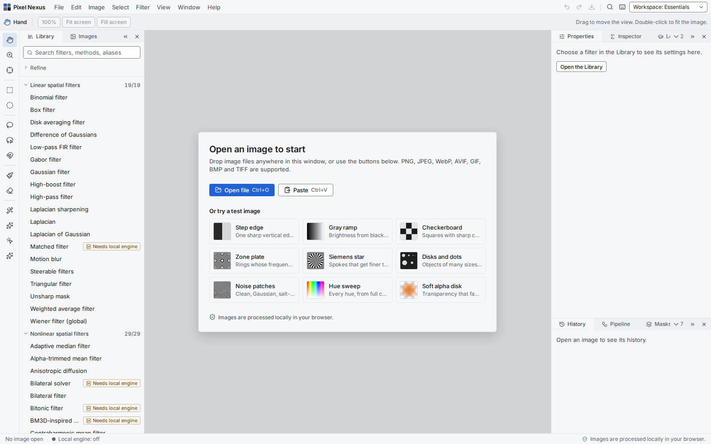
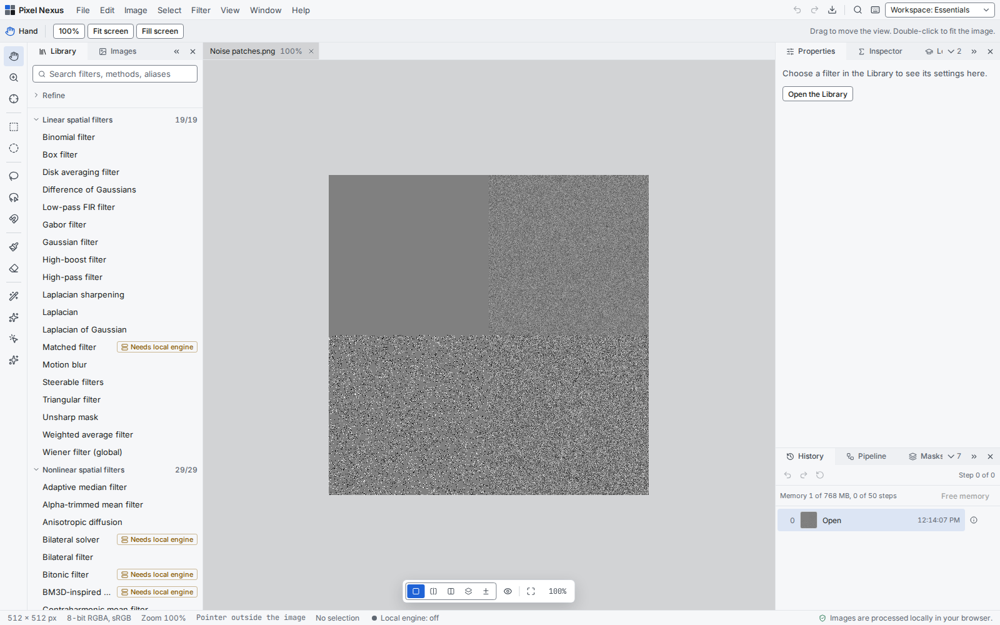
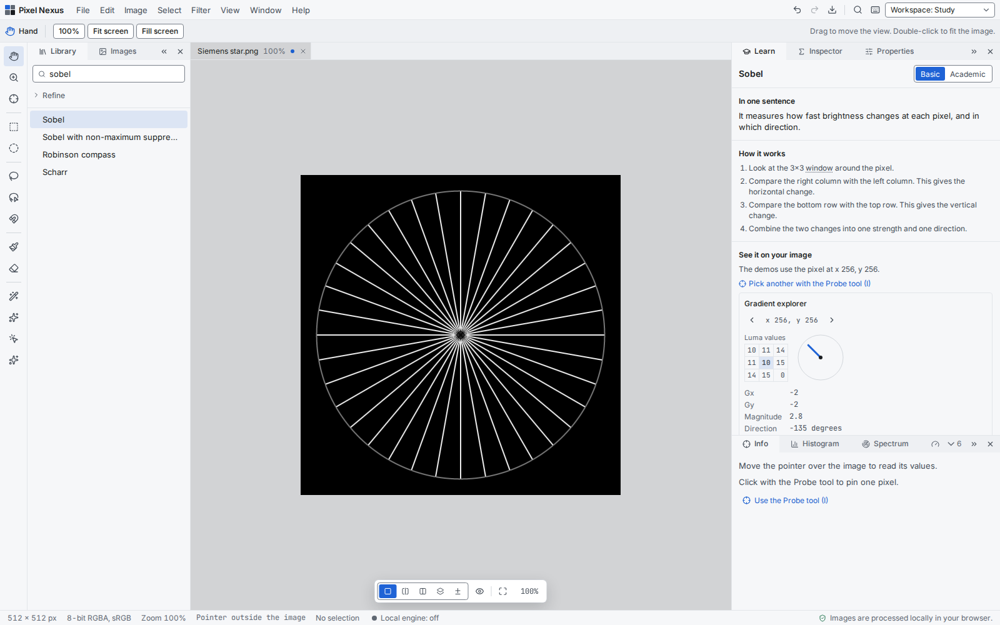
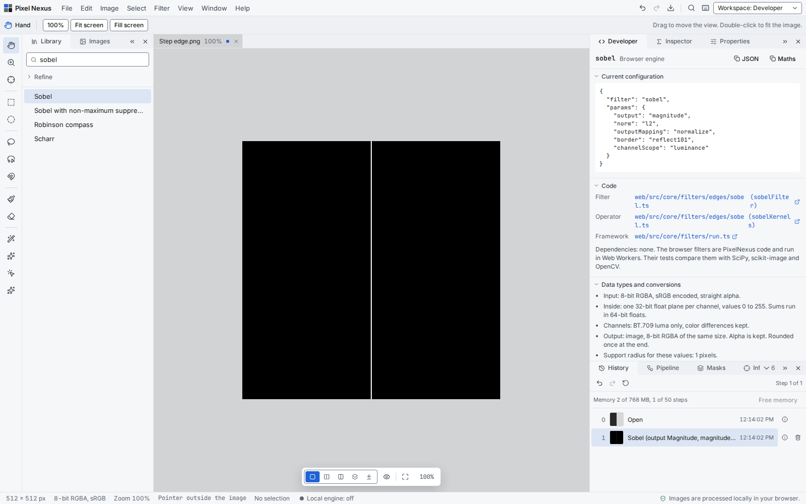
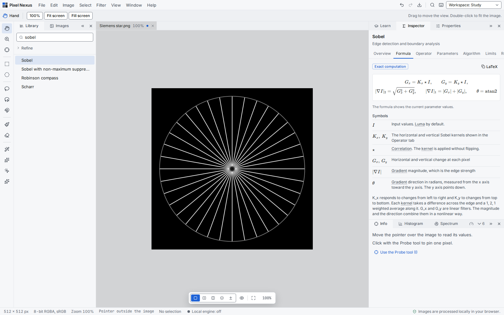
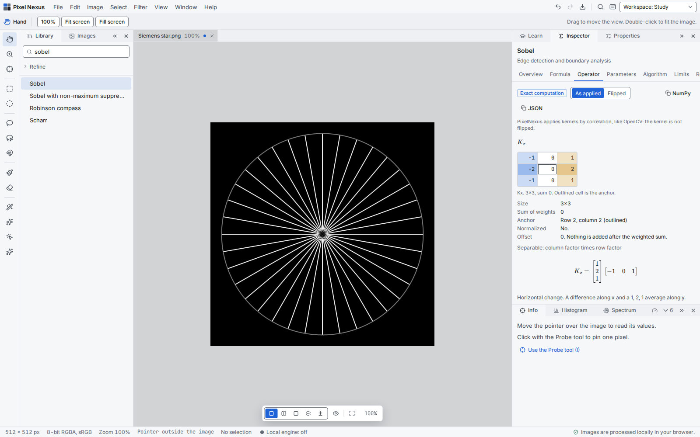
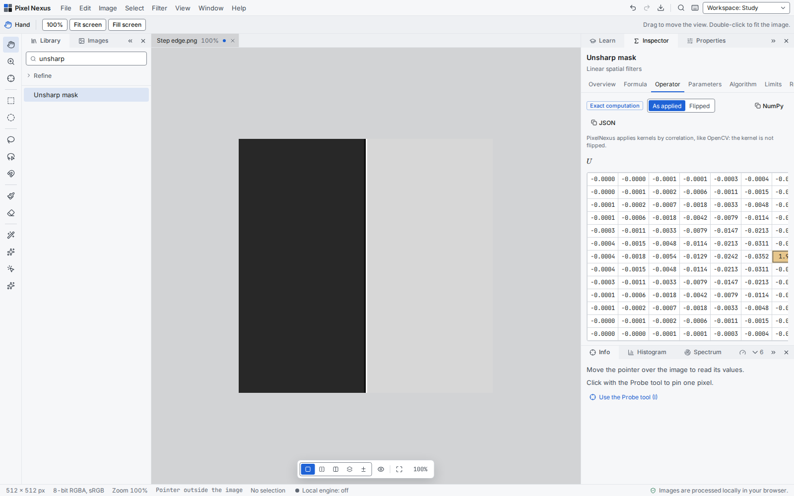

# PixelNexus: an image processing studio that shows its math

*Apply a filter, then see the formula, the kernel and the numbers behind the result.*

Almost every image you see today has passed through a few filters first. Your phone sharpens a photo and removes noise before you even look at it. A robot finds the edges of a box before it picks it up. A scanner in a hospital cleans up an X-ray before a doctor reads it. Behind each of these steps is a small piece of mathematics. Often it is a few lines of code and a small grid of numbers.

Most photo editors hide that mathematics, and for good reason. You move a slider and the picture changes. That is all you need when you want a nicer photo. It is not enough when you want to understand what happened. A student wants to know why a Sobel filter finds edges. An engineer needs to reproduce the same result in Python, value for value. Both have to dig through textbooks, library docs and old forum posts to get there.

PixelNexus is my attempt to close that gap. It is a free image processing studio that runs in your web browser. It has close to 300 filters, from classic blurs to neural networks, and selection tools in the style of Photoshop. Every filter also shows its formula, its kernel, its steps and its limits. The numbers you see are the numbers the code uses.

In this post I explain why I built it, how it works, and how you can use it to study or to work. Then I walk through two examples, edge detection and sharpening, with numbers taken from the studio itself.



## Why I built it

I am a student in the AI field. Image processing kept coming back in my courses: in computer vision, in robotics, in deep learning. A convolutional network starts with the same idea as a blur filter. A robot camera needs the same edge detector as a textbook exercise. So I needed to understand these filters well, not only call them.

That turned out to be harder than I expected. The theory was in one place and the practice was in another. A textbook gave me the formula for a Gaussian blur. OpenCV ran it in one line. A tutorial showed a nice before and after picture. But no single place let me apply the filter to my own image, see the kernel it used, change one setting and watch both the numbers and the picture change. I moved between PDFs, notebooks and a photo editor. Even then I was not always sure that the formula in the book matched what the library did.

I wanted all of it under one umbrella. That wish became PixelNexus. I built it first for myself, and then for anyone who learns or works with images and wants to see inside a filter.

So PixelNexus has three goals:

- Teach image processing with live examples that show the real computation.
- Give developers the exact kernel, parameters and data types of each run.
- Work as a normal photo editor for everyday tasks.

## How it works

You open the studio in your browser, drop in an image and pick a filter. Under the surface, three parts make this work.

**Two engines.** Each filter runs in exactly one of them.

- **The browser engine.** 207 filters are written in TypeScript and run in Web Workers. They need no install and no server.
- **The local engine.** 89 advanced filters need Python libraries such as SciPy, scikit-image or OpenCV. A small Python server runs them on your own computer. The studio finds it and shows "Local engine: on".

Neural network models are always optional. They run through ONNX Runtime, and you download each model only when you want it.

**One catalog.** A set of YAML files, one per filter, drives everything. Each file holds the filter's name, parameters, formula, explanations, references and the tests that check it. The studio, the Python engine, the documentation and the test tools all read the same files. So a formula cannot say one thing in the docs and another in the code.

**Tests against known libraries.** The tests compare the studio's output with SciPy, NumPy, scikit-image and OpenCV on fixed test images. About 3,800 web tests and over 900 Python tests run on every change that goes into the main branch.

Your images never leave your computer. The filters run in the browser or on your own local engine, and the studio also works offline after the first visit.

## Three ways to use the studio

The workspace box at the top right switches the layout. Three layouts matter most. Each one puts different panels first, for a different kind of work.

### Essentials, for editing

The Library on the left lists every filter by family. Properties on the right holds the settings. History and Undo work as in any editor. You can apply a filter to the whole image or only to a selection.



### Study, for learning

The Study workspace gives most of the room to two panels: **Learn** and **Inspector**.

The **Learn** panel explains the selected filter in plain words. It has two levels. **Basic** has no formulas. **Academic** adds the formula with your current values. Under the explanation it runs small demos on one pixel of your image. You choose that pixel with the Probe tool.

For Sobel, the demo is a gradient explorer. It shows the 3x3 window of brightness values around the pixel, the horizontal change Gx, the vertical change Gy, the edge strength and its direction as an arrow. Move the probe across an edge and watch the arrow turn.



### Developer, for engineers

The Developer workspace adds the **Developer** panel. It shows:

- The current configuration as JSON, ready to copy.
- Links to the filter code and to the function that builds its kernel.
- The data types inside the filter: 8-bit input, 32-bit float planes, the channel used and the border mode.
- The timing of the last run and the memory a full run needs.
- A numeric example with real pixel values from your image.
- The test files that check the filter.

With the JSON and the kernel, you can reproduce a result in a few lines of Python.



## The Inspector panel

The Inspector is the heart of PixelNexus. It shows the mathematics of the selected filter in seven tabs:

- **Overview.** The purpose, a small before and after example, and facts such as linearity, border handling and the engine.
- **Formula.** The formula with your current values, a table of symbols and a plain explanation.
- **Operator.** The kernel, window or curve that the filter uses.
- **Parameters.** Each setting with its meaning, effect, default and range.
- **Algorithm.** The steps of the computation.
- **Limits.** Time and memory cost, known artifacts, strengths and use cases.
- **References.** The papers, books and library docs the filter follows.

Textbooks often mix exact formulas with simplified pictures, and readers cannot tell which is which. So every formula in PixelNexus carries one of four labels:

- **Exact computation.** The studio computes it value for value.
- **Mathematical definition.** The textbook form, which the code computes in a discrete way.
- **Approximation.** The code approximates it, for example with a truncated kernel.
- **Simplified explanation.** A picture that helps understanding, but not what the code computes.

The Inspector also follows your settings. Change the sigma of a Gaussian filter in Properties, and the kernel in the Operator tab changes with it. A test checks that the kernel the Inspector shows is the kernel that runs. Copy buttons give you the formula as LaTeX and each kernel as a NumPy array.



## Example 1: edge detection with Sobel

Edges are places where brightness changes fast. They outline objects, so many vision tasks start by finding them. The Sobel filter measures that change at each pixel.

1. Open the **Step edge** test image from the start screen. It is dark on the left and bright on the right.
2. Type "sobel" in the Library and click **Sobel**.
3. Click **Apply**. A single bright line appears where the two halves meet. Everything else turns black, because flat areas have no change.

Now open the Inspector and choose the **Operator** tab. It shows the horizontal kernel Kx:

```text
-1  0  1
-2  0  2
-1  0  1
```

The kernel subtracts the left column from the right column. The middle row counts twice, which smooths the result along the edge. The weights sum to 0, so a flat area gives 0.



The documentation works through one window with numbers from the filter code. Take a window on a vertical edge, with value 20 on the left and 200 on the right:

```text
20  20  200
20  20  200
20  20  200
```

- Gx = (200 - 20) x (1 + 2 + 1) = 720.
- Gy = 0, because the top and bottom rows are equal.
- The magnitude is 720, and the direction is 0 degrees, pointing from dark to bright.

The studio then maps the magnitudes to the 0 to 255 range for display. The Learn panel's gradient explorer shows the same steps at any pixel you pick.

**What you learn:** an edge detector is a weighted difference. The kernel weights decide which direction it sees. Next, try **Canny**. It thins these thick responses to one-pixel lines and links them.

## Example 2: sharpening with Unsharp mask

Unsharp mask is the classic way to sharpen a photo. The name comes from the darkroom, where a blurred copy of a negative was used to boost detail. It has three steps:

1. Blur a copy of the image with a Gaussian.
2. Subtract the blur from the image. What is left is the fine detail.
3. Add the detail back, multiplied by the amount.

The documentation shows it on one row of a soft edge, with sigma 1 and amount 1. The values come from the filter code:

```text
Position   2    3    4    5    6
Input     40   70  150  200  215
Result    26   52  160  215  223
```

The dark side dips below its old value, and the bright side rises above it. These overshoots make the edge look sharper. Too much amount turns them into visible halos. The Limits tab warns about that.

With threshold 0, Unsharp mask is linear, so the Inspector can show it as one kernel. The center weight is large and positive, and the ring around it is negative.



**What you learn:** sharpening does not add new detail. It makes the existing differences larger, and halos are the price when you push it too far.

## The filter library

The catalog holds 297 filters in 14 families, plus 20 selection tools. Here are five from each family, with the size of the family.

- **Linear spatial filters (19):** Box, Gaussian, Laplacian of Gaussian, Unsharp mask, Gabor.
- **Nonlinear spatial filters (29):** Median, Bilateral, Anisotropic diffusion, Kuwahara, Non-local means.
- **Adaptive and statistical filters (22):** Lee, Frost, Kuan, Kalman, 2D LMS adaptive filter.
- **Morphological filters (26):** Erosion, Dilation, Opening, Closing, Top-hat.
- **Frequency-domain filters (23):** Ideal low-pass, Gaussian low-pass, Butterworth high-pass, Homomorphic, Notch reject.
- **Wavelet and multiscale filters (10):** Gaussian pyramid, Laplacian pyramid, Scale-space, Wavelet thresholding, Multiresolution diffusion.
- **Edge detection and boundary analysis (19):** Sobel, Prewitt, Scharr, Canny, Marr-Hildreth.
- **Texture, corners, blobs and features (28):** Harris, Shi-Tomasi, FAST, Gabor filter bank, Laws' texture energy.
- **Enhancement, illumination and color (32):** CLAHE, Contrast stretching, Gamma correction, White balance, Multi-scale retinex.
- **Restoration and reconstruction (22):** Wiener deconvolution, Richardson-Lucy, Inverse filtering, Tikhonov, Landweber.
- **Segmentation and regions (25):** Otsu, Sauvola, Region growing, K-means color, Watershed.
- **Deep learning and learned processing (10):** DnCNN, FFDNet, SwinIR, Restormer, Real-ESRGAN.
- **Artistic and geometric effects (21):** Oil painting, Pencil sketch, Cartoon, Halftone, Fisheye.
- **Utilities (11):** Add Gaussian noise, Quality metrics, Resize, Crop, Rotate and flip.

The selection tools include the marquee, lasso, magnetic lasso, Magic Wand, Quick Selection and an optional AI click select.

## Other features

- **Selections.** Apply any filter inside a selection. The studio blends the result at the edge without seams.
- **Test images.** Nine images made for learning: a step edge, a zone plate, a Siemens star, noise patches and more.
- **Compare.** Hold the backslash key to see the original, or use split and side-by-side views.
- **Compare grid.** Run one filter at several values side by side.
- **Metrics.** PSNR, SSIM, MSE and MAE against the original.
- **Histogram and Spectrum.** See how the values and the Fourier spectrum change.
- **Pipelines.** Save a chain of filters and run it again on other images.
- **Projects.** Save your images, history and selections in one file.
- **Offline use.** Install the studio as an app from the browser menu.

## Who it is for

Image processing sits under many fields of computer science and engineering. PixelNexus helps anyone who needs to understand a filter, not only run it.

**Students** in computer science, AI, data science and electrical engineering:

- You see the formula and the result side by side, on your own image.
- Each step is visible. The Learn demos show the window, the weights and the sum for one pixel.
- The labels tell you when a formula is exact and when it is a simplified picture.
- Study paths lead from basic filters to harder ones, for example Box, then Gaussian, Median and Bilateral.

**Teachers** can show a filter live in class. The test images make each effect clear, and the Compare grid shows one setting at several values side by side. Students can open the same studio at home, with nothing to install.

**Software developers:**

- The JSON and the NumPy kernel let you reproduce a result in Python.
- The Developer panel lists data types, rounding and border modes. These details often explain why two libraries give different results.
- The tests compare the filters with SciPy, scikit-image and OpenCV, so you can use the studio as a reference.

**Computer vision and robotics engineers** add filters to pipelines that run on cameras, drones and robots. Before a filter goes into such a pipeline, you need to know how it behaves. Does the edge detector keep thin lines? How does a median filter treat the salt-and-pepper noise of a cheap sensor? What happens near the border of the frame? The studio answers these questions in a few clicks. The Limits tab lists the cost and the artifacts of each filter, and the Metrics panel measures the result. You can choose your settings here, then write the code.

**Researchers and imaging specialists** often work with images that are not photos. PixelNexus includes filters made for them:

- Lee, Frost and SRAD reduce speckle in radar and ultrasound images.
- Richardson-Lucy deblurs astronomy and fluorescence microscopy images, where the noise follows the Poisson law.
- Frangi vesselness finds blood vessels in retinal photos, and also cracks and fibers.

Each of these filters lists the original paper in its References tab.

## Built together with a coding agent

I did not write PixelNexus alone. The whole project is a collaboration between me and an AI coding agent, Claude Code by Anthropic. The first commit was on 11 October 2026. Version 1.0, with the studio, the engine, the tests and the documentation, followed about a week later.

We split the work in a clear way. I decided what to build, set the rules and checked the results. The agent wrote most of the code, the tests and the documentation, and explained its choices as it went. Nearly every commit in the repository names the agent as a co-author.

The rules mattered more than I expected. A few of them shaped the whole project:

- Never invent a kernel, a formula, a citation or a benchmark number. Take them from the code, a paper or a library.
- Never mark a filter as tested until its tests have run and passed.
- Keep every filter in one catalog, so the studio, the engine and the docs cannot disagree.
- Write the docs in short, plain sentences.

With these rules, the agent worked fast without making things up. I learned a lot from the work too. Reading its code and its explanations taught me as much image processing as building the filters did.

## Try it yourself

The fastest way to see the idea is a five-minute session:

1. Open the studio and choose **Workspace: Study**.
2. Open the **Noise patches** test image.
3. Apply a **Box filter**, then undo it and apply a **Median filter**.
4. Look at the salt-and-pepper patch. The box filter smears the dots, and the median filter removes them. The Learn panel explains why.


## Sources

The filters follow published sources. Each filter's References tab lists its own. The two examples above use these:

- Sobel, I. and Feldman, G. A 3x3 isotropic gradient operator for image processing. Talk at the Stanford Artificial Intelligence Project, 1968.
- Gonzalez, R. C. and Woods, R. E. Digital Image Processing, 4th edition. Pearson, 2018. Chapters 3 and 10.
- OpenCV documentation, image filtering, Sobel: https://docs.opencv.org/4.x/d4/d86/group__imgproc__filter.html
- scikit-image documentation, `skimage.filters.unsharp_mask`: https://scikit-image.org/docs/stable/api/skimage.filters.html#skimage.filters.unsharp_mask

## Explore the code, and tell me what you think

The studio shows the math, but the code tells the full story. I invite you to read it. A good place to start is one small filter, such as the box filter. Follow it from its catalog entry to its TypeScript code, its tests and its documentation page. Then pick a filter you know well and check whether PixelNexus does it the way you would.

PixelNexus keeps growing. New filters come as I study them, and each one arrives with its formula, its tests and its page in the documentation.

I would be glad to hear your honest opinion, including criticism. Tell me where a formula looks wrong, where an explanation confuses you, which filter is missing, or how the code could be cleaner. Constructive criticism is the fastest way for this project, and for me, to improve. You can open an issue on GitHub or leave a comment under this post.

## Explore further

- The code on GitHub: https://github.com/mKamiAsim/pixelnexus
- Documentation: https://mkamiasim.github.io/pixelnexus/
- The studio online: https://mkamiasim.github.io/pixelnexus/studio/
- The studio guide, with study paths: https://mkamiasim.github.io/pixelnexus/user-guide/studio/

The documentation has one page for every filter, with its formula, a worked example with real numbers, its cost, its limits and the tests that check it.

Thank you for reading.
