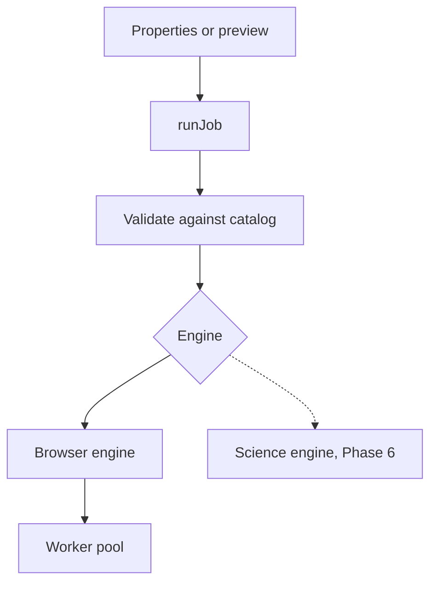

# Execution model

This page explains where filters run, how a job is split into parts, and how previews and Apply share the work. It covers the engine client, the worker pool, the preview scheduler and the history.

## Engine client

Every part of the studio runs filters through one function, `runJob` in `web/src/engine-client/index.ts`.

1. `runJob` finds the catalog entry. It refuses planned and unsupported filters with a message.
2. It validates the parameters against the catalog, the same way the Properties panel does. Missing values get their default. Numbers are clamped to their range and snapped to their step, whole-number and odd-only rules. Unknown keys are dropped. So the engine always gets values that obey the catalog.
3. It sends the job to the engine of the entry. Both engines have the same interface: run with a cancel signal and a progress callback, and get back the pixels, warnings and timing.

Until Phase 6, the science engine answers that it runs on your computer and arrives later.

## Worker pool

The browser engine runs filters in Web Workers, so the page stays responsive. The code is in `web/src/core/workers/pool.ts` and `web/src/engine-client/browser.ts`.

- **Pool size.** One worker less than the number of processor cores, at most 8 and at least 1. Workers start when the first job needs them.
- **Strips.** A job is split into horizontal strips. The engine aims for about 65,536 pixels per strip, so messages cost less than the work. A strip is at least 4 halos and 8 rows high. There are at most 4 strips per worker.
- **Halos.** Each strip is padded with its halo before it goes to a worker. See [Processing pipeline](processing-pipeline.md).
- **Lazy tiles.** A strip's padded input is built only when a worker is free. So only a few padded strips exist at a time.
- **Transfer.** Pixel buffers move to the worker and back without a copy.
- **Order.** Results are put back in strip order, whatever order they finish in.

### Cancel

Cancelling a job drops its waiting strips. A worker that is still busy with the job is stopped and replaced by a new one. A long strip cannot block the next job.

### Memory guard

Before a job starts, the engine estimates the memory it needs: the result, plus a padded strip and about twelve float planes for each busy worker. The budget is a quarter of the device memory, at most 2 GB. When the browser does not report the device memory, the engine assumes 4 GB. A job above the budget stops with a message that names both numbers.

## Preview

The preview shows the filter result on the canvas before you apply it. The scheduler is in `web/src/app/preview.ts`. It follows the policy in the project plan.

| Image and zoom | What the preview computes | Exact |
|---|---|---|
| Up to 4 million pixels | The whole image at full resolution | Yes |
| Larger, zoom 50% or more | The visible part plus a 64 pixel margin, at full resolution | Yes |
| Larger, zoom below 50% | A smaller copy, at most 2048 pixels on the longest side | No |

On the smaller copy, parameters measured in pixels shrink by the same factor, so the result looks the same. Sizes that must be odd stay odd. The studio then shows an "Approximate preview" note with the size. With the `normalize` mapping on part of a large image, the stretch uses the range of the visible part only, and the note says so.

- **When it runs.** After you change the filter, a value, the image or the view, the scheduler waits 120 ms for more changes. Then it starts one job.
- **Cancel.** A new request cancels the job that is still running.
- **Cache.** Each image keeps its last 8 previews, keyed by filter, values, region and scale. Going back to earlier values shows the stored result at once.
- **Display.** The renderer draws the preview over the current image in the previewed region. The original is still there for the compare modes.

The preview is off during Apply. After Apply it turns off, because a preview of the new image would show the filter twice.

## Apply

Apply always runs on the whole image at full resolution.

1. The Properties panel shows a progress bar and a **Cancel** button. The status bar shows the progress too.
2. The job runs through `runJob` with the same values as the preview.
3. If you changed the image while the job ran, nothing is applied and a message explains why.
4. The compositor puts the result into the image. A new history step records the filter id and its parameters.
5. A message gives the time the job took.

## History

Each document keeps a list of steps in `web/src/state/documents.ts`. Step 0 is the original, and it is always kept.

- **Undo and redo** move through the steps. A new edit after an undo drops the steps after it.
- **Jump.** Click a step in the History panel to go back or forward to it.
- **Revert** goes back to the original, as a new step, so you can undo it.
- **Limits.** A document keeps at most 50 steps after the original, and at most 768 MB of pixels across its steps. The oldest steps go first. The History panel says how many were dropped.
- **Export names.** The export dialog suggests a file name with the last filter and its main values, for example `photo_gaussian_sigma-2.5`.

## Timing

Each run records the total time, the compute time inside the workers, the number of strips and the number of workers. The Developer panel shows these numbers for the last preview and the last Apply. They describe one run on one machine. They are not a benchmark.
