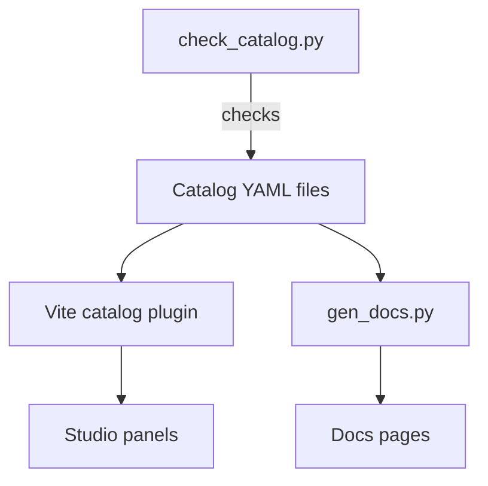

# Filter catalog and registry

This page explains where a filter is described and where its code is found. The **catalog** describes every filter for people and for the studio. The **registry** links a catalog id to the code that runs it.

## One source of truth

Every filter has one YAML file in `catalog/filters/<family>/<id>.yaml`. The studio, the docs and the tests all read these files. No other place lists filters, parameters, formulas or kernels.

| File or folder | Holds |
|---|---|
| `catalog/filters/` | One file per filter, in the folder of its family. |
| `catalog/families.yaml` | The filter families, such as linear or edges, with their names and order. |
| `catalog/common-params.yaml` | Parameters that many filters share, such as the border mode and the output mapping. |
| `catalog/glossary.yaml` | Terms that the studio underlines and explains in a tooltip. |
| `catalog/schema/catalog.schema.json` | The JSON Schema that every file must match. |

A catalog entry holds the facts that do not depend on code:

- The id, name, aliases, family, tier, engine, status and phase.
- The parameters, with type, default, range, unit and rules such as "odd only".
- The formula in LaTeX, a plain explanation and a meaning for every symbol.
- The kind of operator representation, and the function in the code that builds it.
- The algorithm steps, complexity, limitations, artifacts and references.
- The Learn panel lesson and the demos it uses.
- Paths to the code, the tests and the docs page.

## From YAML to the studio

- **Vite catalog plugin.** At build time it reads the YAML files and offers them to the studio as one module, `virtual:pixelnexus-catalog`. `web/src/catalog/index.ts` gives typed access to it.
- **Generated types.** TypeScript types for the catalog come from the JSON Schema, so a wrong field fails the type check.
- **check_catalog.py.** It checks the schema, unique ids, parameter ranges, formula placeholders and that implemented entries point to real code, tests and docs.
- **gen_docs.py.** It writes the parameter tables, status and source paths of each filter into `docs/_generated/`. The filter pages include these parts.

## The registry

The catalog says which engine runs a filter. Each filter has exactly one engine.

- **Browser engine.** The code is in `web/src/core/filters/`. `registry.ts` lists every browser filter by its catalog id.
- **Science engine.** The Python engine in `engine/`. It runs on your computer and the studio connects to it from Phase 6.

`tools/check_catalog.py` fails when a catalog entry has the browser engine and an implemented status but `registry.ts` does not list it. So the catalog and the code cannot drift apart.

A browser filter in code is small. It states its kind and supplies one function. The framework does the shared work: borders, channels, alpha and the mapping to 8 bits. See [Processing pipeline](processing-pipeline.md).

| Kind | What the filter supplies | Examples |
|---|---|---|
| `smooth` | A function on one float plane. Results keep their meaning and are clipped. | Box, Gaussian, median |
| `derived` | A function on one float plane. Results are a new signed quantity. | Sobel, Laplacian |
| `point` | A function of one value. It runs through a 256-entry table. | Gamma |
| `pixel` | A function of the three color values of one pixel. | Grayscale |
| `noise` | Adds noise that depends on the position and the seed only. | Gaussian noise |

## Status

A filter can run only when its status says it is implemented. The catalog holds only filters that run, or that run after you add a model or a package. The statuses `planned` and `unsupported` remain in the schema for future entries. The seven statuses and their labels are the same in the catalog, the studio and the docs:

| Status key | Shown as |
|---|---|
| `implemented-tested` | Implemented and tested |
| `implemented-untested` | Implemented, testing incomplete |
| `partial` | Partially implemented |
| `optional-dependency` | Available through an optional dependency |
| `optional-model` | Available through an optional pretrained model |
| `planned` | Planned but not implemented |
| `unsupported` | Unsupported or deprecated |

A filter gets `implemented-tested` only after its tests have run and passed.

## Add a filter

1. Write or complete the catalog entry.
2. Write the filter in `web/src/core/filters/<family>/` and add it to `registry.ts`.
3. Write unit tests and add reference values to the fixtures from SciPy or OpenCV.
4. Write the docs page with the template in the project plan.
5. Run `uv run python tools/check_catalog.py`, the tests and the docs generators.
6. Set the status to `implemented-tested` when all of them pass.
