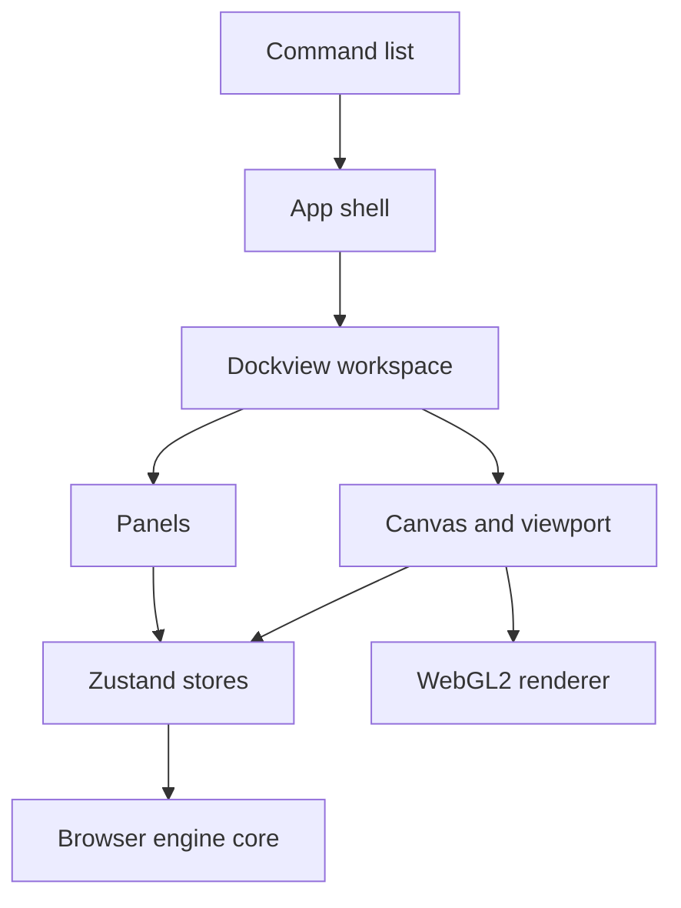

# Frontend architecture

This page explains how the studio is put together. It covers the parts of the screen, where their code lives and how they share state. It also follows an image from a file to the screen and back out.

The studio is a React app written in TypeScript. It runs in any modern browser, on GitHub Pages and later inside the phone app. All image work happens on your device.

## Layers

- **Command list.** Every action in the studio is a command with an id, a label, a menu, an optional shortcut and a function that runs it.
- **App shell.** The menu bar, the options bar, the tool strip, the status bar, dialogs and messages.
- **Dockview workspace.** The docking area. The canvas sits in the middle and panels dock around it.
- **Panels.** Images, Navigator, Info and Histogram in Phase 2. Library, Properties, Inspector, Learn and others follow in later phases.
- **Stores.** Small Zustand stores hold the open documents and the interface state.
- **Browser engine core.** Pure TypeScript in `web/src/core`. It decodes, encodes, measures and, from Phase 3, filters images. It never imports React.
- **WebGL2 renderer.** Draws the image, the checkerboard, the pixel grid and the compare modes. See [Preview and rendering](preview-and-rendering.md).

## Where the code lives

| Folder | Contents |
|---|---|
| `web/src/app/` | Shell, command list, menus, dialogs, keyboard handling, layout presets, import and export. |
| `web/src/panels/` | One component per dockable panel, plus the canvas panel. |
| `web/src/canvas/` | Viewport maths, the WebGL2 renderer, the viewport component and the rulers. |
| `web/src/state/` | Zustand stores. |
| `web/src/components/ui/` | Buttons, fields, menus and other controls of the design system. |
| `web/src/core/` | The browser engine. Pure TypeScript with no React. A lint rule enforces this. |
| `web/src/styles/` | Design tokens, themes and the dockview theme. |

## One command list

`web/src/app/commands.ts` lists every command. Four parts of the studio read this one list:

1. The menu bar builds its menus and submenus from it.
2. The keyboard handler matches key presses against the shortcuts in it.
3. The command palette (Ctrl+K, or Cmd+K on a Mac) searches it.
4. The shortcut sheet (Help > Keyboard shortcuts) prints it.

So a menu, a shortcut and the palette can never disagree. Each command can say when it is enabled and whether it shows a check mark. Commands that arrive in a later phase say so. For example, Select > Deselect is listed with Ctrl+D and is disabled until Phase 4.

A unit test checks that every command id is unique, that no two commands share a shortcut, and that the shortcuts from the requirements exist.

## State

| Store | File | Holds |
|---|---|---|
| Documents | `state/documents.ts` | Open images. Each has the original pixels, the current pixels, a view, a short undo stack and its file facts. |
| Interface | `state/ui.ts` | Active tool, compare mode, hover and probe pixel, theme, open dialog and running tasks. |
| Messages | `state/notifications.ts` | Toasts and the last message for screen readers. |
| Settings | `state/settings.ts` | Image limits and rulers. Saved in this browser. |

The original pixels of a document never change. Edits replace the current pixels and push the previous version onto the undo stack. Phase 2 keeps up to 20 whole images. Phase 3 replaces this with the full history.

The browser remembers a few conveniences in `localStorage`: the theme, the panel layout, the workspace preset, collapsed panel sides and the settings above. The studio works the same when storage is blocked. It then forgets them when the page closes.

## Workspace and panels

The workspace uses [dockview](https://dockview.dev/), an MIT-licensed docking library. The canvas panel has no tab strip and accepts no other panels, so it always keeps the center. Panels can be moved by their tabs, stacked as tabs, floated, closed and reopened from the Window menu.

- **Presets.** Essentials, Study and Compact build a layout in one step. They live in `app/layout.ts`.
- **Saved layout.** Every layout change is saved. The next visit restores it. A layout that cannot be restored is replaced by the last preset.
- **Icon rails.** The double arrow on a panel group collapses that whole side of the workspace to a narrow strip of icons, as in Photoshop. The other side keeps its width, so the canvas gains the space. The code is in `app/rails.ts`.

## From file to screen

1. A file arrives from the file picker, a drop on the window or a paste.
2. `app/importer.ts` sends the bytes to the decode worker with the current limits.
3. The worker checks the format and the limits, then decodes. See [Image data model](image-data-model.md).
4. The documents store opens a new document. A message says what happened, including any warnings.
5. The viewport fits the image and the renderer uploads it to the graphics card.

A file that is not an image, is damaged, or breaks a limit gets an error message with the reason. Other files in the same drop still open.

## From screen to file

The export dialog (File > Export, Ctrl+S) writes the current image. The encoders are in `web/src/core/image/encode.ts`.

| Format | Encoder | Exact |
|---|---|---|
| PNG | Our own encoder in `core/image/png.ts` | Yes. Every value, including semi-transparent colors. |
| TIFF | utif2, uncompressed RGBA | Yes. |
| JPEG | The browser, with a quality setting | No. Lossy. Transparent areas become white. |
| WebP | The browser, with a quality setting | No. Lossy. Keeps transparency. |

A browser test decodes each exported PNG and TIFF file again and checks that every byte matches the original. No encoder writes EXIF, GPS, camera or color profile data. Resizing on export uses the browser's high-quality resampling. Resampling filters with documented maths arrive in Phase 5f.

## Accessibility

- Every control has a name for screen readers. Icon buttons show their name as a tooltip.
- Two live regions read messages aloud. Errors use the assertive region, so they are read at once. Other messages wait for a pause.
- Keyboard focus is always visible. Menus, dialogs and the palette work with the keyboard alone.
- The page has landmarks: a header with the menu, a main area and a status bar.
- When your system asks for reduced motion, animations stop.
- The end-to-end tests run axe on the empty studio, an open image, the export dialog, the command palette and two themes. They fail on any serious or critical issue.

## Tests

| Kind | Where | Examples |
|---|---|---|
| Unit | Next to the code, `*.test.ts` | Command list, palette search, viewport maths, histogram statistics, settings. |
| Browser | Next to the code, `*.browser.test.ts(x)` | Decoding, encoding round trips, the WebGL2 renderer, the shell in a real Chromium. |
| End to end | `web/tests/e2e/` | Open three images, zoom, pan, compare and export in every format. Open and pan a 6000x6000 image. Accessibility checks. |

See [Running tests](../getting-started/running-tests.md) for the commands.
