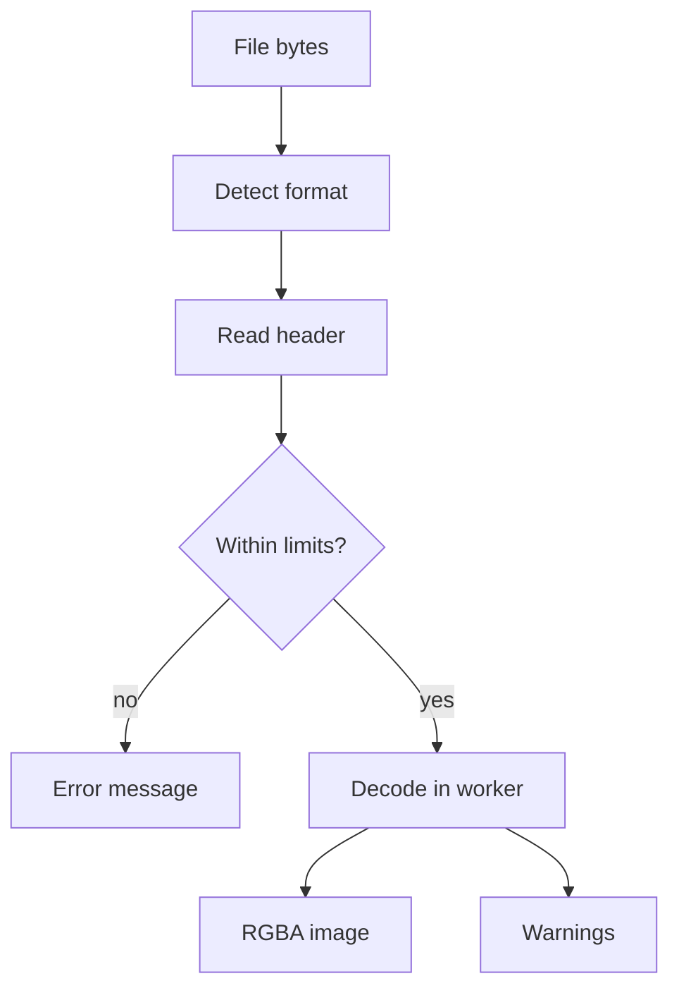

# Image data model

This page explains how PixelNexus stores an image in memory and how a file becomes that image.

## The working image

Every open image is an `RgbaImage`, defined in `web/src/core/image/types.ts`.

| Property | Meaning |
|---|---|
| `width`, `height` | Size in pixels. |
| `data` | A `Uint8ClampedArray` with 4 bytes per pixel: red, green, blue, alpha. |

The layout follows four rules:

- Pixels are stored row by row, starting at the top left. There is no padding between rows.
- Values run from 0 to 255 and are sRGB encoded.
- Alpha is straight. Color values are not multiplied by alpha.
- The shape matches the browser's `ImageData`, so the two can be swapped without copying.

The byte offset of channel \(c\) of pixel \((x, y)\) is

\[
o = 4\,(y\,W + x) + c
\]

where \(W\) is the image width, \(x\) grows to the right, \(y\) grows downward, and \(c\) is 0 for red, 1 for green, 2 for blue and 3 for alpha.

The image keeps 8 bits per channel to save memory. A 6000x6000 image takes 144 MB in this form. Filters work in 32-bit floating point inside, and round to 8 bits only at the end. This choice is decision D7 in the project plan.

## From file to image

1. **Detect the format.** The first bytes of the file decide the format. The file name and the MIME type are not trusted.
2. **Read the header.** A small parser reads the size and other facts without decoding any pixels.
3. **Check the limits.** A file that is too large is rejected here, before the browser spends memory on it.
4. **Decode.** A Web Worker decodes the first frame, so the interface never freezes.
5. **Report.** The studio shows warnings about anything that changed during decoding.

The format code is in `web/src/core/image/format.ts`, the limits in `web/src/core/image/limits.ts`, and the decoder in `web/src/core/image/decode.ts`. The worker is `web/src/core/workers/decode.worker.ts`.

## Supported formats

| Format | Decoded by | Notes |
|---|---|---|
| PNG | Browser | 16-bit files are reduced to 8 bits. Animated PNG opens the first frame. |
| JPEG | Browser | EXIF orientation is applied. CMYK files are converted to RGB. |
| WebP | Browser | Lossy, lossless and animated. Animated files open the first frame. |
| AVIF | Browser | Needs a browser with AVIF support. |
| GIF | Browser | Opens the first frame. |
| BMP | Browser | Tested with 8-bit palette and 24-bit files. |
| TIFF | utif2 library | Browsers cannot decode TIFF, so the utif2 library does it. Opens the first page. |

## Header facts

The header parser returns these fields. Fields the file does not state are left out.

| Field | Meaning |
|---|---|
| `format` | The detected format. |
| `width`, `height` | Stored size, before any EXIF rotation. |
| `bitDepth` | Bits per channel in the file. |
| `channels` | Channels in the file, such as 1 for gray, 3 for RGB, 4 for RGBA or CMYK. |
| `colorModel` | `gray`, `rgb`, `palette`, `cmyk` or `ycbcr`. |
| `hasAlpha` | The file has transparency. |
| `hasColorProfile` | The file carries an embedded ICC color profile. |
| `frames` | Frames in an animation, or pages in a TIFF file. |
| `orientation` | EXIF orientation from 1 to 8. |

## Limits

| Limit | Default | Why |
|---|---|---|
| File size | 30 MB | Keeps uploads and memory use predictable. |
| Pixels | 50 million | A small compressed file can hold a huge image. This stops such files before decoding. |
| Longest side | 16,384 pixels | Many graphics cards cannot hold a larger texture. |

These defaults are for desktop browsers. The phone app gets lower limits in Phase 11.

## Warnings

A warning does not stop the import. It tells you what changed.

| Code | When it appears |
|---|---|
| `bit-depth` | The file has more than 8 bits per channel. The finest tonal steps are lost. |
| `color-profile` | The file has an embedded profile. Its colors are converted to sRGB. |
| `frames` | The file has several frames or pages. Only the first one opens. |
| `cmyk` | The file uses CMYK. It is converted to RGB, and some colors may shift. |
| `orientation` | The file asks to be rotated or flipped. TIFF orientation is not applied yet. |

## Exact pixel values

A 2D canvas stores colors multiplied by alpha. Reading pixels back divides them again, and the rounding changes the colors of semi-transparent pixels. For example, red 35 at alpha 35 is stored as round(35 x 35 / 255) = 5. Dividing again gives round(5 x 255 / 35) = 36.

PixelNexus avoids this. The decoder uploads the image to a WebGL2 texture with premultiplication turned off, then reads the texture back. The values match the file exactly. A browser without WebGL2 in workers uses the 2D canvas instead. The decode result records which path was used, so a test or the Developer panel can tell.

## Tests

| Test file | What it checks |
|---|---|
| `web/src/core/image/format.test.ts` | The header of every sample file, against facts written by the generator. Each file is also cut short at several points, and the parser must fail with a clear error, never a crash. |
| `web/src/core/image/decode.browser.test.ts` | Real decoding in Chromium, through the worker. Checks the size after rotation and one pixel value. |
| `web/src/core/image/synthetic.test.ts` | The built-in test images and the histogram. |

The sample files are written by `tools/make_fixtures.py` with Pillow. Each one is 37x23 pixels, an odd and non-square size, so swapped width and height show up at once.

Pixel tolerances in the decode test:

- Lossless formats must match exactly.
- JPEG, lossy WebP and AVIF may differ by up to 8 levels, because different decoders round differently.
- CMYK JPEG is checked for size only, because decoders handle CMYK conventions differently.

## Known limitations

- Images with more than 8 bits per channel are reduced to 8 bits.
- TIFF orientation tags are not applied.
- utif2 covers common TIFF variants. Rare compression schemes may fail with a clear error.
- Color profile conversion depends on the browser.
