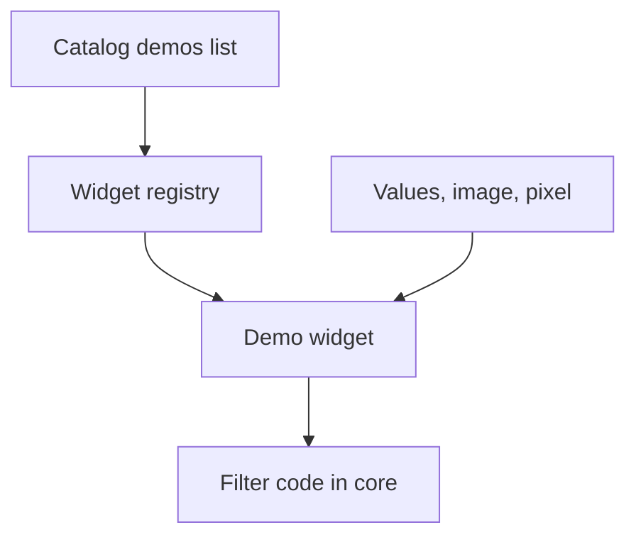

# Learn panel architecture

This page explains how the Learn panel is built: where its text comes from, how demos are chosen and how a demo runs the real filter code. For how to use the panel, see [The Learn panel](../user-guide/learn-panel.md).

## Text comes from the catalog

Each catalog entry has a `learn` block. The panel shows it and adds nothing of its own about the filter.

| Field | Shown as |
|---|---|
| `oneSentence` | In one sentence |
| `howItWorks` | How it works, as numbered steps |
| `academic` | The extra paragraph at the Academic level |
| `paramNotes` | What the parameters do, one note per parameter key |
| `tryThis` | Try this |
| `pitfalls` | Common mistakes |
| `demos` | The demo ids for See it on your image |

The Academic level also shows the catalog formula, filled with the current values by the same code as the Inspector. Glossary terms in all these texts get a tooltip from `catalog/glossary.yaml`.

## Demos

- **Registry.** `web/src/learn/registry.ts` maps each demo id to a widget. Demo ids that have no widget yet are listed with the phase that brings them. The panel shows that phase instead of the demo.
- **Widgets.** `web/src/learn/widgets.tsx` holds the five Phase 3 widgets: Neighborhood stepper, Impulse response, Rank stepper, Gradient explorer and Line profile.
- **Inputs.** Every widget gets the filter id, the validated values, the active image and the chosen pixel. It can move the pixel, which updates the probe pixel in the interface store.

## Same code, same numbers

A demo never has its own copy of a formula. It calls the code in `web/src/core`:

- The Neighborhood stepper reads the kernel from the filter's `representation` function and the window with the filter's border rule. It then runs the real filter on that window and shows its output next to the hand sum.
- The Impulse response runs the real filter on a small black image with one white pixel.
- The Rank stepper reads the window with the filter's border rule and sorts it, as the median filter does. It shows at most a 7x7 window.
- The Gradient explorer runs the Sobel code for the horizontal and the vertical change. Its direction map uses a copy of the image about 160 pixels on the longest side.
- The Line profile runs the real filter on up to 97 pixels along the line. The framework adds the halo, so the values match a whole-image run.

Helpers in `web/src/learn/common.ts` read pixels exactly as the filters do: luma for the brightness scope, otherwise the red channel, and the same border modes.

The demos work on a small part of the image, so they stay fast on large images.

## Tests

- Unit tests check the glossary matching, and that each demo id in the catalog has a widget or a planned phase.
- An end-to-end test opens an image, selects the median filter and checks the Rank stepper: nine sorted values for a 3x3 window, and a step to the next pixel.
