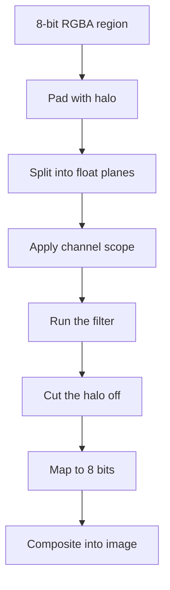

# Processing pipeline

This page follows one filter run in the browser engine, from 8-bit pixels to 8-bit pixels. Every browser filter goes through the same steps. The code is in `web/src/core/filters/run.ts`.

## The steps

1. **Pad with a halo.** A neighborhood filter reads pixels around each output pixel. The **support radius** is how far it reads. The framework adds a border of that width around the region, filled by the border mode.
2. **Split into float planes.** Each channel becomes a plane of 32-bit floats from 0 to 255. Filters compute in floats and round only once, at the end.
3. **Apply the channel scope.** The scope decides which values the filter sees. See below.
4. **Run the filter.** The filter's own function runs on the planes.
5. **Cut the halo off.** Only the region itself stays.
6. **Map to 8 bits.** Results that keep their meaning, such as a blur, are clipped to 0 to 255. Signed results, such as a gradient, use the output mapping.
7. **Composite.** The compositor puts the result into the image, through the selection mask when there is one.

## Border modes

Pixels outside the image do not exist, so the border mode decides what a filter reads there. The results match the OpenCV and SciPy modes listed on the page [Boundary conditions](../mathematics/boundary-conditions.md).

| Mode | Outside pixels repeat | Example for a row a b c d |
|---|---|---|
| `reflect101` | A mirror that does not repeat the edge pixel | c b a b c d c b |
| `reflect` | A mirror that repeats the edge pixel | b a a b c d d c |
| `replicate` | The edge pixel | a a a b c d d d |
| `constant` | A fixed value, 0 | 0 0 a b c d 0 0 |
| `wrap` | The other side of the image | c d a b c d a b |

Because the halo holds exactly the pixels that a whole-image run would read, a tile of the image gives the same pixels as a run on the whole image. The worker pool depends on this. A browser test proves that tiled and whole runs match byte for byte.

## Channel scopes

| Scope | What the filter sees |
|---|---|
| RGB | Red, green and blue, each on its own. |
| Each channel separately | The same as RGB. The name stresses that channels do not mix. |
| Brightness only | The Y' channel of BT.709 Y'CbCr. The color channels stay as they were. |
| Color only | The Cb and Cr channels. Brightness stays as it was. |

A signed result, such as a gradient, has no color. With the brightness scope, its single plane is copied to all three channels. A signed filter cannot use the color-only scope, and the framework refuses it.

## Alpha

PixelNexus decides once per image whether alpha matters. If any pixel is not fully opaque, smoothing filters weight colors by alpha:

\[
I_{\text{out}} = \frac{F(\alpha \cdot I)}{F(\alpha)}
\]

where

- \(I\) is one color plane and \(\alpha\) is the alpha plane, scaled to 0 to 1.
- \(F\) is the filter, for example a Gaussian blur.
- \(I_{\text{out}}\) is the output color plane.

This is an exact computation. A transparent pixel then adds no color to its neighbors, so no dark fringe appears around shapes. Where \(F(\alpha)\) is 0, the color stays as it was. For an opaque image the formula gives the same result as \(F(I)\). The decision is made once for the whole image, so every tile treats alpha the same way.

## Linear light

The stored values are sRGB encoded. Light adds up in linear values, not in encoded ones. Smoothing filters offer **Linear light**: the framework decodes each RGB channel to linear values, runs the filter and encodes the result again. Bright details then spread more like a real optical blur. Linear light works with the RGB scopes only. With the brightness or color scopes, the studio says it was not used.

## Output mapping

Signed results need a rule to become 8-bit values.

| Mapping | Rule |
|---|---|
| `abs` | The absolute value, then clip. |
| `offset` | Add 128, then clip, so zero shows as mid gray. |
| `normalize` | Stretch the lowest value to 0 and the highest to 255. |
| `clip` | Clip to 0 to 255. |

The `normalize` mapping needs the range of the whole result. The worker pool then runs two passes: the first collects the range of each tile, and the second maps every tile with the joined range. So tiles agree with each other.

## Rounding

Each value is rounded once, to the nearest whole number, when it is mapped to 8 bits. Values between steps stay as floats. NaN becomes 0. See [Numerical precision](../mathematics/numerical-precision.md).

## Compositing

`web/src/core/composite/compose.ts` blends the filtered region into the image. Without a selection, the result replaces the region. With a mask \(M\) from 0 to 1, the blend is

\[
O = M \cdot F + (1 - M) \cdot I
\]

where \(O\) is the output, \(F\) the filtered value and \(I\) the input value. This is an exact computation. Where \(M = 0\), the compositor copies the input bytes, so those pixels stay bit-identical. The maths is on [Masks and alpha blending](../mathematics/masks-and-alpha-blending.md).

## Selections and region processing

When the image has a selection, the Properties panel has an "Apply to" choice: the selection, everything outside it, or the whole image. Outside uses the inverted mask \(255 - m\). `web/src/core/composite/scope.ts` turns the choice into a mask and a region:

1. Without a mask, the region is the whole image.
2. With a mask, the region is the bounding box of the pixels where \(m > 0\). The framework fills the halo around the box with the real neighboring pixels, as for any tile. So the box gives the same pixels as a whole-image run.
3. A global filter processes the whole image, because its result at one pixel depends on all pixels. Today that is any filter with the `normalize` output mapping.
4. When the mask touches no pixel, nothing runs, and the studio says why.

The compositor then blends the region result into the image through the mask. A unit test runs every browser filter this way, inside and outside a soft mask. It checks that pixels with \(M = 0\) keep their bytes, and that pixels with \(M = 1\) match a whole-image run. An end-to-end test exports the image before and after a filter and compares every pixel outside the selection.

The live preview is computed without the mask. The renderer blends it through the mask on the GPU, with the same formula. So drawing or changing a selection does not compute the preview again, and the preview cache does not need the mask.
