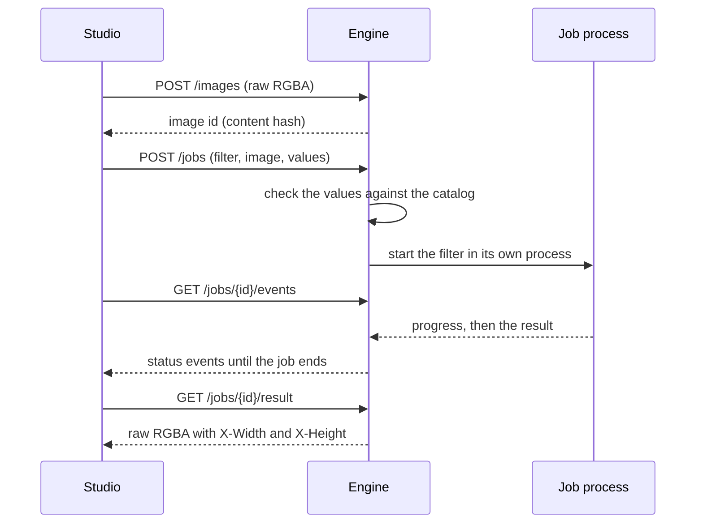

# Science engine

The science engine runs the filters that need Python libraries such as PyWavelets, SciPy, scikit-image and OpenCV. It is a small web server on your computer. The studio finds it at `http://127.0.0.1:8765` and sends it the image and the settings. The studio works without it. Filters that need it then show "Needs local engine" and cannot be applied.

Start it from the repository folder:

```bash
uv run pixelnexus-engine
```

The settings are on the [configuration page](../getting-started/configuration.md#science-engine-settings).

## How a job runs



- **Images.** The studio uploads each image once, as raw RGBA bytes with its width and height. The engine names it by the SHA-256 hash of its size and pixels, so the same image always gets the same id. Images stay in memory until the cache limit is reached. Then the one used least recently is dropped. A job on a dropped image gets a "Upload it again" answer, and the studio uploads it again.
- **Values.** The engine checks every value against the catalog entry of the filter, with the same rules as the studio. Numbers must be in their range, options must be in their list, and unknown keys are refused. Missing values get their catalog default. A wrong value gets an answer with status 422 and a sentence that names the parameter.
- **Processes.** Each job runs in a new process. So a long job never blocks the server, and Cancel really stops the work: the engine ends the process. At most `PIXELNEXUS_MAX_WORKERS` jobs run at the same time. The others wait in a queue.
- **Progress.** The studio follows a job through server-sent events. Each event holds the state (queued, running, done, failed or cancelled) and the progress from 0 to 1.
- **Results.** An image comes back as raw RGBA bytes, with its size in the `X-Width` and `X-Height` headers. Tables come back as JSON.
- **Selections as inputs.** Some filters read the selection, such as inpainting, which fills it. Their catalog entries set `needsSelection`. The studio uploads the selection as a gray image of the same size, and the job names it in its `mask` field. The engine refuses such a job without a mask, a mask of another size, and a mask for a filter that does not read one. By default the selection is also the area that changes. Some entries only read it. They set `selectionRole: template`, such as the matched filter, or `selectionRole: markers`, such as the marker-controlled watershed. Such a filter runs on the whole image, and its result covers the whole image.
- **Feature tables.** Feature detectors, such as the blob detectors, return a table as JSON instead of an image. It has columns with a key, a label and a unit, rows of numbers, and a summary such as "10 blobs". Rows with the keys x and y are points on the pixel grid, with an optional radius and angle. The studio keeps the table with the image it was found on, lists it in the Features panel and draws it on the canvas. Their catalog entries have the output `features`.
- **Label maps.** Segmentation filters, such as SLIC superpixels, return regions as JSON of kind `labels`. It holds the width, the height, and the label of every pixel from 1, or 0 for none. The labels are base64 of little-endian unsigned integers of 8, 16 or 32 bits, the smallest that fits. It also holds a feature table with one row per region: its label, area, centroid and mean brightness. The studio draws the regions over the image in their label colors, lists the table in the Features panel, and turns one region or all of them into the selection. Their catalog entries have the output `labels`. Their other outputs, such as boundaries or mean colors, are ordinary images.
- **Results of another size.** Some filters change the size, such as super-resolution, which enlarges the image. Their catalog entries set `changesSize` and have a `scale` parameter. The studio checks the new size against its image limits first, runs the filter on the whole image, and replaces the image with the result. The selection is scaled with it.

## Routes

All routes start with `/api/v1`. The engine also serves an interactive description of them at `/api/v1/docs`.

| Route | Purpose |
|---|---|
| `GET /info` | Version, Python and package versions, devices and limits. Never file paths. |
| `GET /filters` | The catalog entries for this engine, and whether this engine can run each one. |
| `GET /filters/{id}` | One of them. |
| `POST /filters/{id}/representation` | The operator for the Inspector, for the values in the body. |
| `POST /images?width=&height=` | Upload raw RGBA bytes. Answers with the image id. |
| `GET /images/{id}/metadata` | The size of an uploaded image. |
| `POST /jobs` | Start a filter on an uploaded image, with a mask for filters that read the selection. |
| `GET /jobs/{id}` | The status of a job. |
| `GET /jobs/{id}/events` | The status as server-sent events, until the job ends. |
| `GET /jobs/{id}/result` | The result of a finished job. |
| `DELETE /jobs/{id}` | Cancel a job. |

## In the studio

- The status bar shows "Local engine: on" or "off". The studio checks at start, when its window gets the focus again, and when you click the light.
- Science filters carry an "Engine" badge in the Library, or "Needs local engine" while the engine is off.
- Science filters have no live preview, since each run starts a process. Click Apply to see the result, and Undo to go back.
- The Inspector asks the engine for the operator each time the settings change, because the engine code builds it.
- The Noise lab in the Learn panel repairs its patch in the engine for science filters.

## Adding a science filter

Every science filter follows the same steps. Wavelet thresholding was the first.

1. Write the filter in a module in `engine/src/pixelnexus_engine/filters/`, and import the module in `filters/__init__.py`.
2. Register it with `@register("<catalog id>", representation=...)`, and `mask=True` if it reads the selection. That filter finds the selection in `params["mask"]`, from 0 to 255. The filter gets the RGBA image, the checked values and a progress function. `filter_by_scope` in `planes.py` applies the channel scope with the same rules as the browser filters. It also keeps alpha, and rounds and clips the result to 8 bits.
3. Fill in the catalog entry with `engine: science` and `preview: on-demand`. The catalog check makes sure the module registers the id and is imported.
4. Write tests in `engine/tests/` against an independent reference, such as scikit-image or a brute-force search, and run one job through the API.
5. Add the figures and the worked example to `tools/engine_docs.py`. It runs the engine code on the studio's test images, copied to Python in `tools/synthetic.py`. A studio test checks that the copies give the same pixels. Then draw the figures with `tools/figures/make_figures.py`.

## Optional packages

Some catalog entries with the tier "optional" need packages that the engine does not always install. They are listed in the `optional` extra of `engine/pyproject.toml`. The repository installs them with `uv sync`. Without them, the engine still runs, and those filters show as not available.

| Package | Version | Used by | Notes |
|---|---|---|---|
| pyrtools | 1.0.11 | Steerable pyramid filters | MIT license. Works with NumPy 2. |
| dtcwt | not used | Dual-tree complex wavelet filtering | Version 0.14.0 requires NumPy below 2, so the filter stays planned. |
