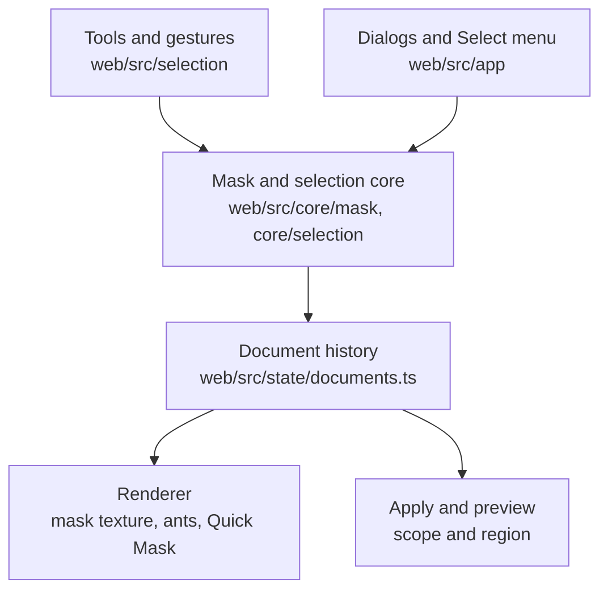

# Selection and masking

This page shows how selections are stored, drawn, made and used by filters. The user guide is [Selections](../selection/index.md).

## The mask

A selection is a `Mask`: width, height and one `Uint8Array` byte per pixel, from 0 to 255 (decision D8). The type and the basic operations are in `web/src/core/mask/mask.ts`: combine, invert, bounds, statistics, masks from alpha or luminance, crop, resize and compare. Like all of `web/src/core`, this code is plain TypeScript without React, so the unit tests run it directly.

## Where the selection lives

Each history step of a document holds its selection, next to its image (`HistoryStep.selection` in `web/src/state/documents.ts`). So undo and redo cover selections, and a filter step keeps the selection it ran with. An edit that keeps the image size keeps the selection. An edit that changes the size drops it. Saved masks (`ImageDocument.masks`) stay with the document until it closes.

Some selection state is not part of the history. It lives in `web/src/state/selection.ts`:

- the combine mode of the options bar and the tool settings,
- the mask view,
- the selection that Deselect removed, for Reselect,
- the last refine amounts.

## Making selections

- **Gestures** (`web/src/selection/gestures.ts`) turn pointer events in image coordinates into outlines, draft masks and finished selections. Each tool is one gesture. They have no React and no DOM, so the tests drive them with plain points.
- **Shapes** (`core/mask/raster.ts`): rectangles, ellipses and polygons with exact or 4-row anti-aliasing, and brush strokes.
- **By color** (`core/selection/wand.ts`, `range.ts`): Magic Wand, Color Range, brightness and hue.
- **Refine** (`core/mask/refine.ts`): grow, shrink, border, smooth and feather. Grow, shrink and border use the exact distance transform in `core/mask/distance.ts`.
- **Edges** (`core/selection/livewire.ts`, `snap.ts`): the magnetic lasso and Snap to edges.
- **Superpixels and subject** (`core/selection/slic.ts`, `quick.ts`, `saliency.ts`, `subject.ts`): Quick Selection, Subject and Background.

The viewport (`web/src/canvas/ImageViewport.tsx`) owns the running gesture. A gesture belongs to one tool, document and history step. When any of them changes, the old gesture is dropped.

## Workers

Two jobs are too slow for the main thread on large images, so they run in Web Workers:

| Worker | Job | Size limit |
|---|---|---|
| `core/workers/superpixel.worker.ts` | SLIC superpixels and their facts for Quick Selection | a copy of at most 2 megapixels |
| `core/workers/subject.worker.ts` | Subject and Background | a copy of at most 512 px on the longer side |

The superpixels are made once per image and kept in a cache keyed by the image (`web/src/selection/superpixelCache.ts`). Choosing Quick Selection starts the work.

## Drawing

The renderer keeps the shown mask as a one-channel texture. The shader draws it in one of three ways: marching ants on the last pixel inside the edge, a red Quick Mask tint, or the mask in gray. While you paint with a brush, only the changed rectangle is uploaded again. The ants move every 120 ms, unless the system asks for less motion.

## Filters through the mask

The Properties panel has **Apply to**: selection, outside or whole image. `core/composite/scope.ts` turns that into a mask and a region. Only the bounding box of the mask is processed, unless the filter is global. The compositor then blends through the mask. The live preview is computed without the mask, and the renderer blends it on the GPU with the same formula. See [Processing pipeline](processing-pipeline.md#selections-and-region-processing).

## Tests

- Unit tests for every tool on synthetic images: `web/src/core/mask/mask.test.ts`, `web/src/core/selection/*.test.ts` and `web/src/selection/gestures.test.ts`.
- A test that every browser filter keeps the bytes of pixels with \(M = 0\), inside and outside a soft mask, and matches a whole-image run where \(M = 1\): `web/src/core/composite/compose.test.ts`.
- A renderer test for the masked preview: `web/src/canvas/renderer.browser.test.ts`.
- End-to-end tests in `web/tests/e2e/selection.spec.ts`:
    - select then filter, comparing every exported pixel outside the selection,
    - coordinates at seven zoom levels,
    - the Select menu, the dialogs and the Masks panel,
    - Quick Selection, Snap to edges and Subject,
    - an accessibility check of the dialogs.
