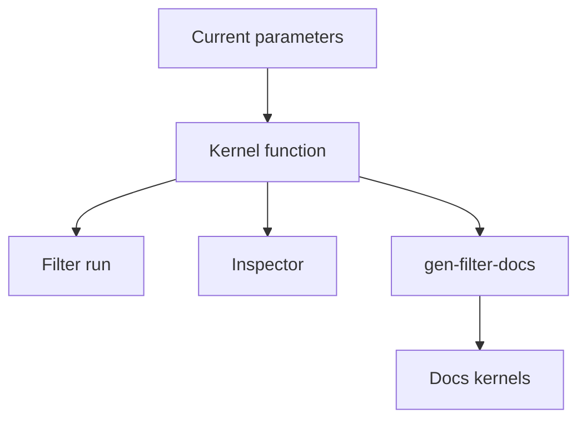

# Kernel generation

This page explains where the operators in the Inspector come from. The short answer: from the same function that the filter runs. Nothing is typed by hand.

## One function for the filter and the Inspector

Every browser filter has a `representation` function. It takes the current parameters and returns the operator. The filter itself calls the same kernel function when it runs. For example, `gaussianKernel1d` in `web/src/core/filters/linear/gaussian.ts` builds the Gaussian weights for the blur and for the Inspector.

The catalog names this function in `representationSource`. The Operator tab links to it on GitHub, so you can read the code that made the numbers.

The docs use the same path. `pnpm --filter @pixelnexus/web gen:filter-docs` loads the filter code and writes each kernel as a LaTeX matrix into `docs/_generated/kernels/`. A CI step fails if these files are out of date.

## Kinds of operators

| Kind | Shown as | Filters |
|---|---|---|
| Kernels | One or more weight matrices | Box, Gaussian, motion blur, Laplacian, Sobel, unsharp mask |
| Rank | The window, sorted, with the chosen position | Median |
| Curve | The output value for each input value from 0 to 255 | Gamma |
| Weights | The weight of each channel, and whether it acts on encoded or linear values | Grayscale |
| Generator | A description of the random process | Gaussian noise, salt-and-pepper noise |

## What a kernel shows

- **Size.** Rows by columns. Kernels larger than 15x15 show their center 15x15 part, and the panel says so.
- **Anchor.** The cell that sits on the pixel being computed. It has an outline.
- **Divisor.** Fixed integer kernels show whole numbers and a divisor. Each shown number is divided by the divisor to give the weight.
- **Sum.** The sum of all weights. A blur sums to 1, so it keeps the mean brightness. An edge filter sums to 0, so a flat area gives 0.
- **Normalized.** Whether the weights add up to 1.
- **Separable.** When the kernel is a column times a row, the panel shows the two factors. A separable filter runs as two 1D passes, which is faster.

## Correlation and convolution

PixelNexus applies kernels by correlation, like OpenCV. The kernel is laid on the image as it is, without a flip:

\[
I_{\text{out}}(x, y) = \sum_{j} \sum_{i} K(i, j) \, I(x + i, y + j)
\]

where

- \(I\) is the input channel and \(I_{\text{out}}\) the output channel.
- \(K(i, j)\) is the kernel weight at offset \(i\) to the right and \(j\) down from the anchor.
- \((x, y)\) is the pixel being computed.

This is an exact computation. A convolution formula flips the kernel in both directions first. For symmetric kernels, such as the Gaussian, both give the same result. For others, such as Sobel, the sign or the direction changes. The **Kernel order** switch on the Operator tab shows the kernel **As applied** or **Flipped**. The page [Convolution and correlation](../mathematics/convolution-and-correlation.md) explains the difference in detail.
