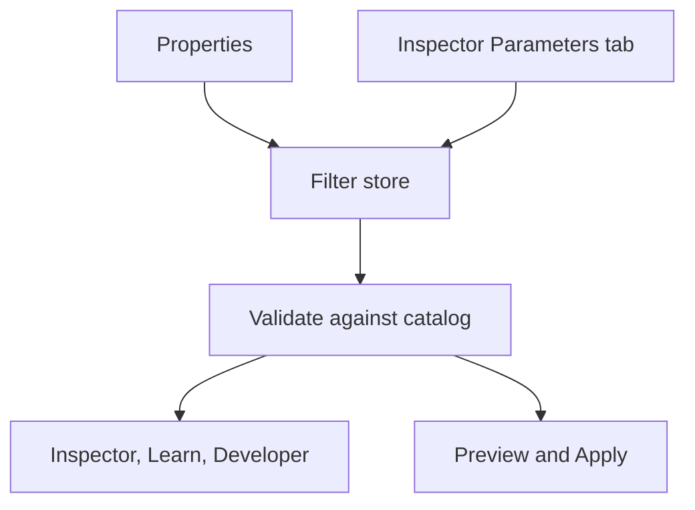

# Parameter synchronization

This page explains how the Properties, Inspector, Learn and Developer panels show the same values, and how the preview and Apply use them.

## One store for filter values

The filter store in `web/src/state/filters.ts` holds the selected filter and the values you set for each filter. Every panel reads from it. A change in one panel shows in the others at once.

- You can change values in the Properties panel or in the Parameters tab of the Inspector. Both write to the store.
- Each filter keeps its own values. When you go back to a filter, your last values are still there.
- **Reset** in the Properties panel returns a filter to its defaults.

## Validation

The store holds what you set. Before any panel uses the values, `validateParams` in `web/src/catalog/params.ts` checks them against the catalog entry:

- A missing value gets its default.
- A number is clamped to its range and snapped to its step.
- Whole-number parameters get whole numbers. Odd-only parameters get odd numbers.
- Unknown keys are dropped.

The engine client calls the same function before every run. So the formula, the kernel, the preview and the result always use the same values.

## What updates when a value changes

| Part | What it does |
|---|---|
| Inspector | Fills the formula with the new values and rebuilds the operator from the filter code. The live example runs again. |
| Learn panel | Runs its demos again with the new values. |
| Developer panel | Shows the new parameters JSON and the new numeric example. |
| Preview | Waits 120 ms for more changes, then computes the new preview. See [Execution model](../architecture/execution-model.md). |
| Export name | After Apply, the suggested file name includes the filter and its main values. |

## Presets

A preset saves the current values of one filter under a name. Presets and favorites are saved in this browser. Load a preset from the Properties panel. **Copy JSON** copies the filter id and the values, so you can share them or keep them with your notes.
