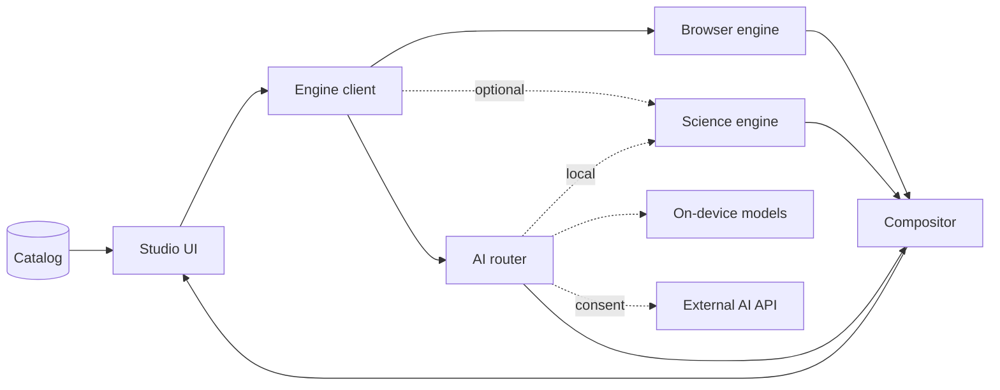

# PixelNexus build plan

Version 2. Created 2026-10-11. Approved 2026-10-11, with the mobile and AI provider addition (D20 to D24).

This is the master plan. It is written so that any later session can pick up the work without the original chat. Read it together with:

- [CATALOG.md](CATALOG.md): the full filter scope. Every entry has a tier, an engine and a phase.
- [WRITING_STYLE.md](WRITING_STYLE.md): rules for all docs and all text inside the app.

The source requirements are in `prompts/`. Where they disagree, the decisions in section 2 win.

## Current status

| Item | Value |
|---|---|
| Current phase | Phase 6: science engine and advanced filters |
| Next action | Phase 6f part 1: edge-preserving denoising (nlm, tv-denoise, domain-transform, rolling-guidance, susan-smoothing, bitonic). The engine Docker image is rebuilt and checked once Phase 6 is complete. |
| Last updated | 2026-10-16 |

## Handoff

Read this first on any machine. It is updated with every commit.

| Item | Value |
|---|---|
| Branch to continue | `Development` (the only working branch from 2026-10-12) |
| Last finished step | Phase 6e done: Select > Object and the Click Select tool, after the graph-cut, random-walker and grabcut filters. |
| In progress | Phase 6: science engine and advanced filters |
| Next steps | Phase 6f part 1: edge-preserving denoising (nlm, tv-denoise, domain-transform, rolling-guidance, susan-smoothing, bitonic). The engine Docker image is rebuilt and checked once Phase 6 is complete. |
| Open questions | None at the moment. Decided: structured-edge downloads its model only on a click, on the user's machine, outside git, since its license is non-commercial (2026-10-16); checkpoint 3 approved on 2026-10-16 with larger panel text; the engine Docker image is rebuilt once Phase 6 is complete (2026-10-16); on 2026-10-15 you said to continue into the next phases without waiting for approval. |
| Machine notes | Run `pnpm install`, `uv sync` and the Playwright Chromium install after pulling. Behind a TLS-inspecting proxy, set `UV_SYSTEM_CERTS=1`. Inside the Claude desktop app on Windows, also set `UV_PYTHON_INSTALL_DIR` to a folder outside `AppData` (the app's sandbox hides `AppData` writes from uv). The E2E tests use `127.0.0.1` and at most 4 local workers, because parallel browser loads from `localhost` stalled on the office PC (probably the Norton network filter). On the home PC on 2026-10-15, a few unrelated tests also failed at random under 4 workers (`page.goto` aborted); `npx playwright test --workers=2` in `web` passed all 36. The E2E smoke test fails with a CORS error while your own engine runs on port 8765; the other tests pass. |

## 1. How to continue in a new session

1. Run `git fetch`, check out the branch in the Handoff block, and pull. Then read `CLAUDE.md`, this section and the progress log at the end of this file.
2. Find the first unchecked task in the current phase.
3. Build it. Meet the definition of done in section 8.
4. Tick the task. Add one line to the progress log. Update "Current status".
5. Start a new phase only when the exit criteria of the current phase pass.

## 2. Decisions

D1 to D4 were agreed with you on 2026-10-11. D5 onward are my technical choices. Any change needs a note in the progress log.

| ID | Topic | Decision | Reason |
|---|---|---|---|
| D1 | Product name | PixelNexus | Matches the repository and README. |
| D2 | Architecture | Hybrid and browser-first. Two engines. Each filter has exactly one engine. | Core work runs offline and on a static host. Advanced methods use proven Python libraries. |
| D3 | AI scope | AI selection, AI restoration and AI super-resolution. Always optional. Runs through the providers in D21. | Your choice. |
| D4 | Hosting | GitHub Pages. Docs at the site root. Studio at `/studio/`. | Your choice. |
| D5 | Single source of truth | A language-neutral catalog in `catalog/` (YAML checked by JSON Schema). The studio, the Python engine, the docs generator and the validators all read it. | Names, parameters, formulas and statuses live in one place. TypeScript, Python and docs cannot drift apart. |
| D6 | Catalog scope | Union of both requirement catalogs. One algorithm with two names becomes one entry with aliases. | No duplicate code or docs. |
| D7 | Working image | RGBA, 8 bits per channel, sRGB. Each filter computes in Float32 inside. Signed results use an explicit output mapping. | A 6000x6000 image fits in memory. Behavior is predictable. |
| D8 | Masks | Uint8 values 0 to 255. Scaled to the range 0 to 1 only when blending. | Matches requirements 2. Compact. |
| D9 | Blending | One compositor in the browser blends every result, whichever engine made it. | One formula and one test suite. |
| D10 | Region processing | Engines process the mask bounding box plus a halo equal to the filter's support radius. Global filters process the full image. | No seams at the selection edge. No wasted work. |
| D11 | Canvas | Custom WebGL2 viewport. The mask is a texture. Marching ants are drawn by a shader. A 2D canvas layer draws handles. | Works with pixel masks and very large images. Scene-graph libraries suit vector shapes, not masks. |
| D12 | Panels | dockview (MIT). Docking, tabs, floating panels and saved layouts, like Photoshop. | Mature, no dependencies, React support. |
| D13 | Frontend stack | React 19, TypeScript strict, Vite, Tailwind CSS v4, Radix UI primitives, Zustand, KaTeX, lucide icons, self-hosted fonts, pnpm. | Requirements 2 stack at current versions. |
| D14 | Python stack | Python 3.12 managed by uv. FastAPI, NumPy 2, SciPy, scikit-image, opencv-contrib-python-headless, PyWavelets, Pillow. ONNX Runtime for AI. | Widest wheel support. No PyTorch needed at runtime. |
| D15 | Docs | MkDocs 1.6 and Material for MkDocs 9.7, pinned. MathJax, Mermaid, and pymdownx snippets for generated tables. Figures are generated from the real code. | Required by the docs prompt. See risk R4. |
| D16 | Text style | WRITING_STYLE.md applies to docs and to all text in the app. `tools/lint_prose.py` enforces it. | Your requirement. |
| D17 | Licenses | The default install uses permissive licenses only (MIT, BSD, Apache 2.0). Anything else is optional and clearly labeled. Project license is MIT unless you choose another. | The project stays easy to share and teach with. |
| D18 | Git | All work goes on the `Development` branch with clear commit messages, pushed often. No branch per phase. You merge `Development` into `main`. Deploys still need your approval. | Your instruction on 2026-10-12. Two PCs stay in step. |
| D19 | Versions | Phase 1 picks the latest stable version of each dependency that is at least two weeks old. Versions are recorded in the docs dependency page. | Current and stable. |
| D20 | Mobile app | Later, the same web build ships as a phone app with Capacitor. Android first, iOS later (Phase 11). The browser engine runs on the phone. Science engine filters on a phone need a PixelNexus engine you run elsewhere. Otherwise they show as unavailable with the reason. | Agreed with you. Capacitor bundles the web app offline and gives native file, camera, share and secure storage. |
| D21 | AI providers | AI tools run through one of three provider kinds: models in the local engine (desktop), small on-device models (ONNX Runtime Web, in the browser or phone app), or an external AI API that you configure (base URL, API key, model and other settings). | Agreed with you. Phones never depend on large downloads. |
| D22 | No forced downloads | No model is ever downloaded without your action. The app may suggest small models and shows their size and license first. | Agreed with you. |
| D23 | Consent | Every use of an external AI API asks for permission first, every time. Local engine models and on-device models never ask. Any other request that sends an image off the device (for example to a remote PixelNexus engine) asks once per session for that host. | Agreed with you for AI. The remote engine rule is my default. You can change it. |
| D24 | Secrets | API keys stay in OS secure storage in the phone app. In a desktop browser they are kept for the session only, unless you choose "remember on this device". Keys are never logged, never put in URLs, never exported in projects or pipelines, and only sent to the configured base URL. | Keeps keys safe and visible to you. |
| D25 | Default theme | Light is the default theme. Your choice is remembered per browser. | Agreed with you on 2026-10-12. |
| D26 | Themes | Five themes: Light, Dim, Dark, Midnight and High contrast, all with the blue accent. The canvas stays neutral gray in every theme. `web/tests/unit/theme-contrast.test.ts` checks every theme, so a new theme costs one token block. | You asked for more themes if they cost little. The test keeps that true. |

## 3. Architecture

### 3.1 Big picture



Dashed lines are optional parts. The catalog also feeds the science engine and the docs site.

- **Studio UI**: React app with dockable panels. The same build runs in a desktop browser, on GitHub Pages and inside the phone app.
- **Engine client**: one interface for running, previewing and cancelling jobs on either engine.
- **Browser engine**: pure TypeScript in Web Workers. Runs offline, on GitHub Pages and on phones.
- **Science engine**: a Python package served by FastAPI. Usually on `127.0.0.1`. Optional.
- **AI router**: sends each AI task to the provider you chose and asks for consent when the rules in section 3.11 require it.
- **On-device models**: small ONNX models run by ONNX Runtime Web in the browser or phone app. Optional.
- **External AI API**: a service you configure with your own base URL and key. Optional.
- **Compositor**: blends each result with the original through the mask.
- **Catalog**: YAML files that define every filter, tool, glossary term, model and provider type.

### 3.2 Engine assignment rule

A filter runs in the **browser engine** when all of these are true:

- The algorithm is local or FFT based, and it is short to implement correctly.
- It is fast enough on a 6000x6000 image in workers, or on a preview crop.
- A reference library exists to create test fixtures for it.

Otherwise it runs in the **science engine**. That covers iterative optimization, large transforms, library-grade algorithms, feature descriptors and model inference.

The science engine may call library functions inside its own algorithms, for example SciPy's Gaussian inside a scikit-image routine. That is not duplication. Each catalog entry still has one authoritative implementation.

### 3.3 Repository layout

```text
pixelnexus/
  web/                     Studio (pnpm, Vite)
    src/app/               Shell, providers, menus, workspaces
    src/panels/            One folder per dockable panel
    src/canvas/            WebGL2 viewport, overlays, compare modes
    src/selection/         Selection tool UI and gestures
    src/learn/             Learn panel demo widgets
    src/state/             Zustand stores
    src/engine-client/     One API for both engines
    src/core/              Browser engine. Pure TypeScript. Never imports React.
      image/ math/ mask/ selection/ filters/<family>/ workers/
    tests/                 Unit, component and E2E tests
  engine/                  Science engine (uv)
    src/pixelnexus_engine/
      core/                Image I/O, dtypes, masks, registry binding
      filters/<family>/    Algorithms
      models/              AI model registry and runners
      api/                 FastAPI app, routes, jobs
    tests/
  catalog/                 Single source of truth
    schema/                JSON Schemas
    filters/<family>/<id>.yaml
    tools/<id>.yaml        Selection tools
    families.yaml
    glossary.yaml
    models.yaml
  docs/                    MkDocs pages
  tools/                   Validators, prose lint, generators, fixtures, figures
  planning/                This plan, the catalog plan, the style guide
  docker/                  Dockerfiles
  .github/workflows/       CI and Pages
  mkdocs.yml
  compose.yaml
  CLAUDE.md
```

### 3.4 Catalog entry

One YAML file per entry. Example (shortened):

```yaml
id: gaussian
name: Gaussian filter
aliases: [Gaussian blur, Separable Gaussian, Per-channel Gaussian]
family: linear
tags: [smoothing, denoise]
status: implemented-tested      # one of the seven statuses in section 7.4
engine: browser                 # browser | science | model
classification: {linearity: linear, domain: spatial, operation: convolution}
output: image                   # image | mask | labels | features | spectrum | table
representation: dynamic-kernel  # one of the ten types in section 3.5
representation_label: exact     # exact | definition | approximation | simplified
support_radius: "ceil(truncate * sigma)"
params:
  - {key: sigma, label: Sigma, type: number, min: 0.1, max: 50, step: 0.1, default: 1.0, unit: px,
     description: Standard deviation of the Gaussian., effect: Larger values blur more.}
  - {key: truncate, label: Truncate, type: number, min: 1, max: 6, step: 0.5, default: 3.0,
     description: Kernel radius in units of sigma.}
  - {key: border, type: select, default: reflect101, ref: common.border}
formula: |
  G(x,y) = \frac{1}{2\pi\sigma^2} e^{-\frac{x^2+y^2}{2\sigma^2}}, \quad \sigma = {{sigma}}
symbols:
  - {symbol: '\sigma', meaning: Standard deviation in pixels}
steps: [Build the 1D kernel and normalize it, Filter rows, Filter columns]
complexity: {time: 'O(N k)', memory: 'O(N)', notes: Separable passes}
limitations: [Blurs edges as much as noise]
references: [{kind: book, text: 'Gonzalez and Woods, Digital Image Processing, 4th ed., 2018'}]
implementation: {path: web/src/core/filters/linear/gaussian.ts, symbol: gaussianFilter}
tests: [web/src/core/filters/linear/gaussian.test.ts]
learn:
  one_sentence: Each pixel becomes a weighted average of its neighbors. Close neighbors count more.
  demos: [neighborhood-stepper, impulse-response, line-profile]
```

Rules:

- Formulas may contain `{{param}}` placeholders. The Inspector fills them with current values.
- Formulas use the LaTeX subset that both KaTeX and MathJax support. A CI test compiles every formula with KaTeX.
- The validator checks that `implementation.path` and `tests` exist and that the id is registered in the declared engine.
- TypeScript types are generated from the JSON Schema. Python uses Pydantic models built from the same schema.

### 3.5 Operator representations

The Inspector has one widget per representation type. Every algorithm uses the type that fits it. No algorithm is forced into a kernel. The last three types were added in Phase 3, because point operations, color conversions and noise generators fit none of the first ten.

| Type | Shown as | Examples |
|---|---|---|
| fixed-kernel | Numeric grid, divisor, offset, sum | Sobel, Laplacian, emboss |
| dynamic-kernel | Grid regenerated from parameters | Gaussian, motion blur, Gabor |
| structuring-element | Footprint grid, origin, connectivity | Erosion, top-hat |
| rank | Window, sorted values, chosen rank | Median, alpha-trimmed mean |
| frequency-response | H(u,v) image and radial profile | Butterworth, notch |
| transform | Decomposition diagram, filter taps, subbands | Wavelets, Radon |
| iterative | Objective, update rule, stopping rule, convergence plot | Richardson-Lucy, TV |
| estimator | Estimator equation, assumptions, local statistics | Lee, adaptive Wiener |
| algorithm | Stage list with intermediate images | Canny, watershed, SIFT |
| neural | Model card, pipeline diagram, tensor shapes | DnCNN, SAM |
| point-transfer | Transfer curve from 0 to 255, with the input and output value | Gamma, levels, thresholds |
| color-transform | Channel weights or conversion matrix, and the color space | Grayscale, color space conversions |
| random-process | Distribution, parameters and the seed rule | Noise generators |

### 3.6 Execution flow

1. You change a parameter.
2. The studio validates it against the schema.
3. The Inspector recomputes the representation. It calls the same generator that the engine uses.
4. The engine client sends a job to the filter's engine with the image version, parameters and region.
5. The engine returns F(I) for the region. The result can be an image, mask, label map, feature list or spectrum.
6. The compositor blends: I_out = M · F(I) + (1 − M) · I. Pixels where M = 0 stay bit-identical.
7. The preview updates. Apply writes a history entry.

### 3.7 Preview policy

- At 50% zoom or more, the preview covers the visible region at full resolution.
- Below 50%, the preview uses a smaller proxy image. It shows an "Approximate preview" badge. Parameters in pixel units are scaled, and the badge says so.
- Science engine filters preview on request, with a Preview button.
- Apply always runs at full resolution.
- With a selection, the preview is computed without the mask and blended through it on the GPU. Changing the selection does not compute the preview again.

### 3.8 Science engine API

All routes are under `/api/v1`. Images travel as binary, never as JSON arrays.

| Route | Purpose |
|---|---|
| `GET /info` | Version, dependency versions, device, limits |
| `GET /filters`, `GET /filters/{id}` | Catalog entries with availability on this machine |
| `POST /filters/{id}/representation` | Kernel, coefficients or response for given parameters |
| `POST /images` | Upload once. Returns a content hash used as the image id |
| `GET /images/{id}/metadata` | Metadata |
| `POST /jobs` | Run a filter. Returns a job id |
| `GET /jobs/{id}` and `GET /jobs/{id}/events` | Status and live progress (SSE) |
| `GET /jobs/{id}/result` | Binary result, or JSON for features and tables |
| `DELETE /jobs/{id}` | Cancel |
| `POST /selection/auto` | Subject, object and click selection |
| `GET /models`, `POST /models/{id}/download`, `DELETE /models/{id}` | Model registry and downloads |

Pipelines live in the studio. The engine runs single steps. Export is done in the browser.

### 3.9 Image and color conventions

- Values are sRGB encoded by default. Filters where it matters (blur, bokeh, resize) offer a "Linear light" option.
- Grayscale uses luma Y' = 0.2126 R' + 0.7152 G' + 0.0722 B' on encoded values. A luminance option works on linear values. The docs explain the difference.
- Alpha is kept. Neighborhood filters use premultiplied alpha to avoid dark fringes.
- Default border mode is reflect-101 (OpenCV default, SciPy `mirror`). Replicate, reflect, constant and wrap are also available.
- Kernels are applied by correlation, as OpenCV does. The Inspector can show the flipped kernel for true convolution.
- 16-bit and float sources are converted to 8-bit with a visible warning.
- Engines replace NaN and infinite values before output and report how many they replaced.

### 3.10 Performance targets

- A 6000x6000 image opens without a crash. Zoom and pan stay smooth.
- Local filters aim for about 100 ms preview on the visible region. Real numbers are measured later. The docs quote only measured numbers.
- A worker pool processes tiles with halos. Channels are processed one at a time when memory is tight.
- A memory budget limits caches. History snapshots are compressed in IndexedDB.
- Phones get lower default limits for pixels, workers and history. They are set in Phase 11 after measuring.

### 3.11 AI providers and consent

Every AI task (subject select, click select, object select, denoise, JPEG cleanup, super-resolution) goes through the AI router. The router picks the provider you set for that task.

| Provider kind | Where it runs | Consent prompt | Available on |
|---|---|---|---|
| Engine model | Local science engine on this computer | Never | Desktop |
| On-device model | ONNX Runtime Web in the browser or phone app | Never | Desktop, Pages, phone |
| Remote PixelNexus engine | A PixelNexus engine on another machine that you run | Once per session per host | All |
| External AI API | A service you configure: base URL, API key, model name, extra headers | Every time | All |

**Consent dialog.** Before each external request, a dialog shows:

- The provider name and host.
- What will be sent: image size, whether it is the full image or a crop, the mask, and any prompt points.
- What comes back: a mask or an image.
- A note that the provider's own privacy terms apply.
- Two buttons: **Send once** and **Cancel**.

There is no "always allow" for external AI. This follows your rule.

**Less data out.** When a task allows it, the router sends only the selection's bounding box plus a margin, and offers to downscale first.

**Transparency.** A status bar icon shows while an external request runs. A session log lists every external request with time, host, task and data size. The log stays on the device.

**Adapters.** Each provider kind has an adapter with one contract: task, input image, optional mask and prompts, output mask or image.

- PixelNexus engine adapter: speaks our own API. Used for local and remote engines.
- Generic HTTP adapter: you map the request and response fields in settings. Works with your own endpoints.
- Presets for one or two hosted inference services, chosen in Phase 7 after checking their current APIs.

**Rules.**

- External hosts must use HTTPS. Plain HTTP is allowed only for private network addresses, with a warning.
- If a provider fails, the app says so and offers the classical tool. It never switches provider silently.
- Results from external or learned models carry the label "AI result. Detail may not exist in the original scene."

## 4. User interface

### 4.1 Desktop layout

```text
+--------------------------------------------------------------------------------+
| Menu: File  Edit  Image  Select  Filter  View  Window  Help | Workspace | Engine|
+--------------------------------------------------------------------------------+
| Options bar: settings of the active tool                                       |
+----+--------------+----------------------------------+--------------------------+
| T  | Library      | Document tabs                    | Properties | Inspector   |
| o  | Images       | +------------------------------+ | Learn      | Developer   |
| o  | Masks        | |                              | |                          |
| l  |              | |           Canvas             | +--------------------------+
| s  |              | |                              | | History | Pipeline       |
|    |              | +------------------------------+ | Info | Histogram | Nav   |
+----+--------------+----------------------------------+--------------------------+
| Status: size | zoom | x,y and RGB | selection | engine | job progress            |
+--------------------------------------------------------------------------------+
```

Every panel can be docked, tabbed, floated, collapsed to an icon rail or closed, as in Photoshop. The Window menu opens closed panels. The canvas always keeps the most space.

### 4.2 Panels

| Panel | Purpose | Phase |
|---|---|---|
| Tools | Tool strip with grouped tools and flyouts | 2 |
| Options bar | Settings of the active tool | 2 |
| Canvas | Document tabs, viewport, overlays, compare modes | 2 |
| Images | Open documents with thumbnails and metadata | 2 |
| Info | Pixel probe: RGB, HSV, Lab and a 5x5 value window | 2 |
| Histogram | Live RGB and luma histogram | 2 |
| Navigator | Mini map of the image | 2 |
| Library | Search, facets, favorites, status badges | 3 |
| Properties | Parameters, scope, preview, apply, presets | 3 |
| Inspector | Mathematics, kernel or operator, complexity, limits | 3 |
| Learn | Plain explanation and live demos on your image | 3 |
| Developer | Schema, JSON, source path, tests, timing | 3 |
| History | Steps with thumbnails, jump, delete | 3 and 8 |
| Masks | Named masks, save, load, preview | 4 |
| Spectrum | FFT magnitude, filter response, notch placement | 5e |
| Metrics | PSNR, SSIM, MSE, MAE | 5b and 8 |
| Pipeline | Chain, reorder, enable, disable | 8 |
| Compare grid | Several filters or values side by side | 8 |

### 4.3 Workspaces

Workspace presets switch the panel layout in one click:

- **Essentials**: Library, Properties, History. For everyday editing.
- **Study**: Learn and Inspector large, Info and Histogram open. For teaching and learning.
- **Selection**: Masks, Info and tool options up front.
- **Developer**: Developer, Inspector and Metrics.
- **Compact**: for small screens.

Your own layout is saved and restored.

### 4.4 Visual design

- Light theme by default (D25). Dim, Dark, Midnight and High contrast are also available (D26).
- One accent color. No gradients and no decorative cards.
- Inter for the interface. JetBrains Mono with tabular numbers for values. Both self-hosted.
- Compact density: 28 px controls on a 4 px spacing grid.
- Scrubby sliders: drag a label to change a value, or type an exact value.
- Every technical term has a tooltip from the shared glossary.
- Clear empty, loading, error and success states.
- Phase 2 starts with a style tile for your review.

### 4.5 The Learn panel

The Learn panel explains what a filter or tool does, in plain words, on your own image. The Inspector is the technical reference. The Learn panel is the teacher.

It has two levels:

- **Basic**: for everyday users. Short words, no formulas.
- **Academic**: for students. Adds the key equation, links to the Inspector and the docs.

Each entry has the same sections:

1. **In one sentence.**
2. **How it works**: three to six short steps with a small diagram.
3. **See it on your image**: a live demo at the probe point. Click with the Probe tool to move it.
4. **What the parameters do**: one line and one mini visual per parameter.
5. **Try this**: small guided experiments.
6. **Common mistakes.**
7. **Where to go next**: related filters and the docs page.

Demo widgets are reusable. They call the real engine code, so they always match the result.

| Widget | Shows | Used by |
|---|---|---|
| Neighborhood stepper | Pixel window, kernel, products, sum, result. Steps across a row. | All kernel filters |
| Impulse response | How one bright pixel spreads. This is the kernel as a picture. | Blurs, sharpening, PSFs |
| Rank stepper | Window values, sorted list, chosen value | Median, min, max, rank filters |
| Gradient explorer | Gx, Gy, magnitude, direction arrow, direction color wheel | Sobel, Prewitt, Scharr, Canny |
| Line profile | Brightness along a line, before and after | Blur spread, halos, ringing |
| Frequency explorer | Spectrum, H(u,v), product, inverse, radial plot | Frequency filters |
| Point-op curve | Transfer curve and histograms before and after | Gamma, equalization, CLAHE |
| Morphology stepper | Structuring element over a binary patch, fit and hit | Morphology |
| Stage viewer | Intermediate images of multi-stage methods | Canny, unsharp mask, Harris, watershed |
| Weight viewer | Weight map at the probe pixel | Bilateral, guided, non-local means |
| Iteration viewer | Result per iteration and a convergence plot | Richardson-Lucy, TV, diffusion |
| Noise lab | Add a known noise or blur, then measure the repair | Denoising and deblurring |

Three examples you asked about:

- **Gradient (Sobel)**. One sentence: "It measures how fast brightness changes, and in which direction." The Gradient explorer shows the 3x3 window under the probe. It shows the Gx and Gy products and sums, an arrow for the direction, and the magnitude. A color wheel then maps direction across the whole image.
- **Motion blur**. The Impulse response demo turns one bright dot into a streak of length L at angle θ. The kernel view shows the line of weights. The Line profile shows an edge spreading along the motion direction only.
- **Median**. The Rank stepper lists the window values and sorts them. The middle value is picked. A salt pixel (255) moves to the end of the sorted list and is never picked. A side panel shows the mean of the same window, pulled up by that one outlier.

Selection tools get Learn entries too. For example, a flood-fill animation for Magic Wand.

### 4.6 The Inspector panel

The Inspector shows all 19 fields from requirements 1 section 5.1 in tabs: Overview, Formula, Operator, Parameters, Algorithm, Complexity and limits, References.

- Formulas render with KaTeX and update when parameters change.
- Every symbol is defined in a table.
- Kernels show as a numeric grid with a heat tint, sum, divisor, offset, anchor and normalization.
- A toggle switches between correlation and convolution order.
- Each representation carries a label: exact computation, mathematical definition, approximation or simplified explanation.
- Copy buttons give LaTeX, JSON and NumPy.

### 4.7 Additional features I propose

| Feature | Why it helps | Phase |
|---|---|---|
| Learn panel with live demos | Your request. Teaches each method on your own image. | 3 to 7 |
| Pixel probe and Info panel | Exact values under the cursor and in a 5x5 window | 2 |
| Line profile tool | Plot brightness along a line before and after a filter | 3 |
| Live histogram | See contrast and equalization changes as they happen | 2 |
| Noise lab | Add Gaussian, salt-and-pepper, speckle, Poisson or periodic noise, or a known blur. Then test a repair against the clean image. | 3 and 5b |
| Quality metrics | PSNR, SSIM, MSE and MAE against the clean image | 5b and 8 |
| Synthetic test images | Step edge, zone plate, Siemens star and more. Built in, with no license issues. | 2 |
| Spectrum panel | Live FFT magnitude. Click to place notches. | 5e |
| Compare grid and parameter sweep | For example sigma 1 to 5 side by side | 8 |
| Command palette | Find any filter or action by typing | 2 |
| Workspace presets | One click to a Study, Selection or Developer layout | 2 |
| Glossary tooltips | Plain definitions, shared with the docs glossary | 3 |
| Project files | Save images, masks, history and pipeline together | 8 |
| Pipeline as JSON | Reproduce a result exactly | 8 |

### 4.8 Small screens and the phone app

- Side panels become drawers. Lower panels become a bottom sheet with tabs.
- The tool strip becomes horizontal.
- Upload, select, filter, undo and export stay available.
- Controls are touch sized. Gestures: pinch to zoom, two fingers to pan.
- The design is touch-ready from Phase 2, so the phone app in Phase 11 needs layout polish, not a redesign.

### 4.9 Accessibility

- Full keyboard use, including shortcuts to move between panels.
- ARIA labels on all controls and visible focus rings.
- WCAG 2.2 AA contrast in all themes.
- A live region announces filter results, progress, errors and exports.
- `prefers-reduced-motion` turns animations off.
- Selection state is shown with marching ants, a pattern and status text. Never with color alone.

## 5. Phases

Every phase writes the docs for what it builds. Docs never wait until the end.

### Phase 0: Plan review

- [x] Read all three requirement documents.
- [x] Inspect the repository and the machine.
- [x] Resolve the four conflicting decisions with you.
- [x] Save the plan, the catalog plan and the style guide.
- [x] Your approval (2026-10-11), with the mobile and AI provider addition.

### Phase 1: Foundation and tooling

Goal: an empty but working monorepo with quality gates from day one.

- [x] Root files: short README, LICENSE (MIT, after your OK), `.editorconfig`, `.gitignore`, `.env.example`, `CLAUDE.md`.
- [x] `web/`: Vite, React 19, TypeScript strict, Tailwind v4, ESLint flat config with import rules (`src/core` never imports React), Prettier, Vitest, React Testing Library, Playwright. pnpm through corepack. Scripts: `dev`, `build`, `preview`, `test`, `test:coverage`, `lint`, `format`, `typecheck`, `e2e`.
- [x] `engine/`: uv project on Python 3.12. FastAPI with `/api/v1/info`. ruff, mypy, pytest.
- [x] `catalog/`: JSON Schemas for filters, tools, families, glossary, models and AI provider types. Validator `tools/check_catalog.py`. TypeScript types generated from the schema. Three full sample entries to prove the chain.
- [x] Import every row of CATALOG.md as a catalog stub (id, name, aliases, family, tier, engine, phase, status, reason). Full fields are required only once an entry is implemented. The Library can then show the whole catalog with honest statuses from Phase 3.
- [x] The web build uses relative asset paths, so the same build works at `/`, at `/studio/` and inside a native WebView.
- [x] `tools/lint_prose.py`: checks from WRITING_STYLE.md.
- [x] `tools/make_fixtures.py`: writes the shared synthetic images now. Reference outputs per filter start in Phase 3.
- [x] MkDocs skeleton: `mkdocs.yml`, Material theme in PixelNexus colors, MathJax, Mermaid, snippets, admonitions, tabs. `mkdocs build --strict` is clean.
- [x] GitHub Actions: `ci.yml` for web, engine, catalog, prose and docs. `pages.yml` builds docs and studio. Deploy stays manual until you enable Pages.
- [x] `compose.yaml` and Dockerfiles for the engine and a static web server. The GPU profile moves to Phase 7c, where GPU models arrive.

Docs: installation, development environment, configuration, running tests.

Exit: every command passes locally. The catalog validator passes on the samples. **Met on 2026-10-11.**

Also added: `tools/gen_docs.py` (generated docs tables), `.claude/launch.json` (studio, docs and engine preview servers).

### Phase 2: Studio shell, canvas and image I/O

Goal: a real editor that opens, navigates, compares and exports images. No filters yet.

- [x] Style tile in dark and light: palette, type scale, controls, panel chrome, and a phone layout sketch. **Checkpoint: your review.** Approved 2026-10-12: blue accent and density kept, light made the default, two themes added. The layout review moves to the Phase 3 checkpoint.
- [x] Design tokens as CSS variables and a Tailwind theme. Dark, light and high contrast. In `web/src/styles/tokens.css`. Contrast checked: text 4.5:1 or more, control borders 3:1 or more.
- [x] App shell: menu bar, options bar, tool strip, status bar, dockview workspace, Window menu, workspace presets (Essentials, Study, Compact), saved layouts, icon-rail collapse per side (`app/rails.ts`). Every action is a command in `app/commands.ts`.
- [x] Command palette (Ctrl or Cmd + K). Search in `app/palette.ts`, tested.
- [x] Import by file picker, drag and drop, and paste. PNG, JPEG, WebP, AVIF, BMP, GIF (first frame) and TIFF (utif2, MIT). Decoding runs in a worker with exact WebGL2 readback, tested in Chromium for all 20 sample files.
- [x] Validation: 30 MB default size limit, configurable limits (Edit > Preferences), magic-byte check, clear errors for corrupt or oversized files. EXIF orientation applied. Privacy notice in the empty state, the drop overlay and the status bar.
- [x] Metadata: name, format, file size, dimensions, channels, bit depth from headers, alpha, color profile name, read path. Warnings when decoding changes bit depth or drops a profile. Shown in the Images panel.
- [x] Several documents: tabs plus the Images panel.
- [x] WebGL2 viewport: zoom by wheel, keys and menu. Pan by space-drag, middle mouse and trackpad. Fit, fill, 100%, nearest-neighbor above 100%, pixel grid at 800% and more, checkerboard for transparency, optional rulers, Navigator panel.
- [x] Compare modes: split with a draggable divider, side by side with synced view, opacity overlay, hold to see original (the `\` key or the eye button), difference.
- [x] Probe tool, Info panel (RGBA, hex, luma, HSV, Lab, 5x5 window) and Histogram panel (RGB, luma, channels, log scale, statistics).
- [x] Export: PNG (exact), JPEG and WebP with quality, TIFF, resize, filename pattern `name_filter-param.ext`, metadata stripped (stated in the dialog). PNG and TIFF round trips are bit-exact in a browser test.
- [x] Built-in synthetic images, generated in code (`core/image/synthetic.ts`). The menu to open them comes with the shell.
- [x] Shortcuts from requirements 2 and a shortcut sheet (Help > Keyboard shortcuts, Ctrl or Cmd + /). Ctrl+D is listed and arrives with selections in Phase 4.
- [x] Screen-reader announcer (`app/Notices.tsx`, polite and assertive live regions, edits and undo announced), focus rings, reduced motion. axe finds no serious or critical issue in 6 states.

Docs: frontend architecture, image data model, preview and rendering, user guide for the workspace and panels. Written, plus export and keyboard shortcut pages. A unit test keeps the shortcut page equal to the command list.

Exit: E2E test opens three images, zooms, pans, compares and exports in each format. A 6000x6000 image opens and pans smoothly on this machine. No console errors. axe reports no serious issues. **Met on 2026-10-12.** `web/tests/e2e/studio.spec.ts` covers the flow and axe. On the office PC (RTX 3060 Laptop GPU) a 6000x6000 PNG opens in about 1.1 s and pans at a median of 16.7 ms per frame (`pnpm --filter @pixelnexus/web bench:viewport`). Numbers are in `docs/architecture/preview-and-rendering.md`.

### Phase 3: Filter framework, Inspector, Learn and the first filters

Goal: prove the full path from catalog to pixels to maths to docs with a small set.

- [x] Engine client: run, cancel, progress, timing. Same interface for both engines (`web/src/engine-client/`). The science engine answers that it arrives in Phase 6. Parameters are validated against the catalog before every run. Preview scheduling sits on top of it in the studio.
- [x] Browser worker pool: strips with halos, transferable buffers, cancellation that replaces busy workers, memory guard (`core/workers/pool.ts`, `engine-client/browser.ts`). A browser test proves tiled runs are byte-identical to whole-image runs.
- [x] Compositor (`core/composite/compose.ts`): mask blend, M = 0 stays bit-identical. Channel scopes, alpha weighting, linear light and output mapping live in the filter framework (`core/filters/run.ts`), shared by every filter.
- [x] Library panel: search by name, alias, method, category and purpose. Facets for family, linearity, domain, noise type, purpose, engine and status. Favorites. Status badges. Planned entries are visible but cannot run. The Filter menu and the command palette list the same filters.
- [x] Properties panel built from the schema: scrubby slider with number input, integer and odd-size rules, select, boolean, angle dial, preview toggle, apply, cancel, reset, presets, copy JSON, last run time. No Phase 3 filter has a color or kernel parameter, so the color and kernel editors arrive with the first filters that need them in Phase 5.
- [x] Preview engine as in section 3.7 (`app/preview.ts`): whole image up to 4 MP, visible region plus 64 px at 50% zoom or more, proxy up to 2048 px with pixel sizes scaled, 120 ms debounce, cancel. Cache of 8 previews per image version, keyed by filter, values, region and scale. In Phase 4 the mask stayed out of the key, because the renderer blends the preview through the mask (section 3.7).
- [x] Basic history: every apply adds a step with the filter id and parameters. Undo, redo, jump to a step, revert to original. At most 50 steps and 768 MB per image. History panel.
- [x] Inspector panel as in section 4.6: Overview with a live example, Formula with current values, Operator (kernels, rank, curve, weights, generator) with correlation or flipped order, Parameters, Algorithm, Limits, References. Copy as LaTeX, NumPy and JSON.
- [x] Learn panel framework with the first widgets: Neighborhood stepper, Impulse response, Rank stepper, Gradient explorer, Line profile. Basic and Academic levels. Demos for later phases name their phase.
- [x] Developer panel: id, schema, parameters JSON, engine, repo-relative source path with a GitHub link, dependencies, tests, timing, memory estimate, warnings, numeric example.
- [x] Glossary tooltips (`components/GlossaryText.tsx`), first use of a term in each text.
- [x] First filters in the browser: box, gaussian, motion-blur, sobel, laplacian, median, unsharp-mask, gamma, grayscale. Noise generators for Gaussian and salt-and-pepper noise. All 11 are `implemented-tested`, with full catalog entries and docs pages. The studio panels that run them are the next tasks.
- [x] Fixture tests against SciPy or OpenCV for each of them. `tools/fixtures_filters.py` writes `filters.json` with SciPy, NumPy and scikit-image, and cross-checks scikit-image and OpenCV where they offer the same operation. All match within a relative 1e-4.

Docs: filter registry, processing pipeline, execution model, maths foundations (image representation, convolution and correlation, boundary conditions, linearity, masks and alpha blending, numerical precision), Inspector pages, Learn panel page, one page per filter above with generated figures.

Exit: all of the above meet the definition of done. **Checkpoint: you review the look and feel of the Inspector and the Learn panel before the bulk work starts.** Phase 3 exit checks passed on 2026-10-12. Approved on 2026-10-16: the Inspector is fine, and the panel text was raised by 1 px because it was hard to read.

### Phase 4: Selection and masking

- [x] Mask core: add, subtract, intersect, invert, select all, deselect, disable for a while, named masks, save, load, mask from alpha, mask from luminance.
- [x] Overlays: marching ants, quick-mask tint, grayscale mask view. The status bar describes the selection in text.
- [x] Manual tools: rectangle and ellipse (constrain, from center, fixed ratio, fixed size), freehand lasso, polygonal lasso, magnetic lasso (live wire on gradient cost), brush and eraser (size, hardness).
- [x] Modes: new, add, subtract, intersect. In the options bar and with Shift and Alt.
- [x] Magic Wand: tolerance 0 to 255 (default 32), contiguous, sample 1x1, 3x3 or 5x5 (default 3x3), anti-alias, RGB, HSV or Lab distance, feather.
- [x] Color Range: several samples, fuzziness, range, localized colors, highlights, midtones and shadows presets, grayscale preview.
- [x] Select by brightness and select by hue and saturation.
- [x] Quick Selection: brush seeds, SLIC superpixels in a worker, growth by color, texture and edge similarity. Size, hardness, tolerance, edge sensitivity and smoothness. Add and subtract.
- [x] Edge-assisted selection: snap the boundary to nearby edges with strength, smoothing and tolerance.
- [x] Subject select without AI: saliency (spectral residual and frequency tuned), center prior, edge density, color clustering and connected components. Gives a soft mask. Background select is its inverse with correction tools.
- [x] Refine: feather, grow, shrink (exact distance transform), smooth, border.
- [x] Scope in Properties: whole image, selection, inverted selection. Region processing with halo.
- [x] Coordinate mapping between screen and image, tested at many zoom levels.
- [x] Learn entries for each tool.

Docs: the selection section, selection and masking architecture, masks and alpha blending maths.

Exit: unit tests for every tool on synthetic images. A test proves that pixels with M = 0 stay bit-identical after any filter. Feather blending matches the formula within 1/255. An E2E test runs select then filter. Phase 4 exit checks passed on 2026-10-12.

### Phase 5: Browser filter library

Six sub-phases. The entries for each are listed in CATALOG.md. Each sub-phase ends with its docs pages and fixture tests.

- [x] **5a** Linear filters and sharpening. Channel-scope option on all of them.
- [x] **5b** Nonlinear, rank and adaptive statistical filters. Dead-pixel repair. Weight viewer, Noise lab and Metrics panel.
- [x] **5c** Edges, lines, corners and texture kernels. Canny with every stage visible. Stage viewer. Nevatia-Babu was removed by the owner's decision.
- [x] **5d** Morphology with a structuring-element editor (rectangle, ellipse, cross, diamond, line with angle, custom). Morphology stepper.
- [x] **5e** Frequency domain, browser deconvolution, pyramids and scale space. Mixed-radix FFT (radix 2, 3 and 5 with a Bluestein fallback) checked against NumPy. Spectrum panel with notch placement. Frequency explorer and Iteration viewer.
- [x] **5f** Enhancement, color, thresholds, region growing, k-means, artistic and geometric effects. Point-op curve widget.
  Order of work, in ten parts:
  1. Point operations and the Point-op curve: log-transform, contrast-stretch, percentile-normalize, invert, posterize, solarize, histogram-eq.
  2. Local histogram equalization: ahe, clahe (checked against OpenCV).
  3. Color adjustments: bw-mix, sepia, saturation, vibrance, hue-rotate, hsv-adjust, channel-mixer, color-balance.
  4. White balance and adaptation: white-balance, gray-world, white-patch, chromatic-adaptation, temperature-tint.
  5. Retinex and tone: retinex-ssr, retinex-msr, msrcr, bilateral-tonemap, detail-enhance, chroma-denoise.
  6. Camera and color masks: demosaic, color-threshold.
  7. Thresholds: threshold-global, otsu, threshold-adaptive-mean, threshold-adaptive-gaussian, niblack, sauvola, wolf, bradley.
  8. Regions: region-growing, kmeans-color, ccl.
  9. Artistic effects: emboss, outline, edge-enhance, vignette, pixelate, halftone, dithering, oil-painting, pencil-sketch, cartoon, bloom, bokeh, tilt-shift.
  10. Geometric distortions: fisheye, barrel, pincushion, swirl, ripple, wave.

Exit per sub-phase: every entry meets the definition of done. Catalog statuses are updated. The docs build is strict and the prose lint is clean.

### Phase 6: Science engine and advanced filters

- [x] **6a** Engine platform: routes from section 3.8, jobs in a process pool with real cancellation, SSE progress, upload checks and limits, content-hash image cache, binary transfer, CORS allowlist, dependency versions in `/info`. In the studio: engine status light, auto-connect to `http://127.0.0.1:8765`, "Needs local engine" badges, smooth offline behavior. Representation endpoint. Contract tests.
- [x] **6b** Wavelets and multiscale, Radon, directional filters.
  Order of work, in four parts:
  1. Engine filter workflow: the first engine filter end to end (registration, NumPy or PyWavelets reference tests in pytest, the Inspector representation through the engine, figures and worked examples drawn in Python for the docs, since the browser docs generator cannot run engine filters). Done on 2026-10-15 with wavelet-threshold: see docs/architecture/science-engine.md.
  2. Wavelets with PyWavelets and scikit-image: wavelet-threshold, swt-denoise, wavelet-wiener. Done on 2026-10-15.
  3. Radon and directional filters: radon-filter, ridgelet (labeled as an approximation), directional-curvelet and directional-shearlet (frequency masks, labeled as inspired, not true transforms). Done on 2026-10-15.
  4. Optional packages, only after the owner approves the download: dtcwt-denoise (dtcwt, check NumPy 2 first) and steerable-pyramid (pyrtools). If a package fails, the entry becomes Planned. Done on 2026-10-15: steerable-pyramid works, dtcwt-denoise stays Planned.
- [x] **6c** Restoration: iterative and regularized methods, inpainting with the selection as the mask, classical super-resolution with geometry rules, dehaze, deband, descreen, deblock, dering.
  Order of work, in four parts:
  1. Regularized deconvolution: an engine PSF module with the same Gaussian, motion and defocus kernels as the browser (checked against the fixture references), then tv-deblur (Chambolle-Pock), sparse-fista (FISTA with an orthogonal wavelet L1 prior) and blind-deconv (alternating Richardson-Lucy, labeled experimental). Done on 2026-10-15.
  2. Plug-and-play: pnp-admm and red, with a choice of denoisers that already exist in the engine or scikit-image. Done on 2026-10-15.
  3. Artifact removal on one image: dehaze, deband, descreen, deblock, dering and jpeg-cleanup. Done on 2026-10-15.
  4. Inpainting and super-resolution, which need two new engine features: the selection sent with the job as a mask, and results whose size differs from the input. Done on 2026-10-15.
- [x] **6d** Features and texture: overlays for keypoints with scale, orientation and score. Score tables and CSV export. Hough accumulators. HOG view.
  Order of work, in five parts:
  1. Ridge and vessel filters with scikit-image, which return images: hessian, frangi, sato, meijering. Done on 2026-10-15.
  2. Feature results in the studio: the engine returns points with scale, orientation and score as a JSON table. The studio draws them as an overlay on the canvas and lists them in a table with CSV export. First users: blob-log, blob-dog and blob-doh. Done on 2026-10-15.
  3. Keypoint detectors with OpenCV: sift, orb, brisk, akaze, plus surf-inspired (our own Fast-Hessian code), susan-corner and mser. Done on 2026-10-15.
  4. Texture and phase: lbp, ltp, glcm (table and sliding-window map), hog (with its cell view) and phase-congruency (Kovesi, with log-Gabor filters). Done on 2026-10-16.
  5. Hough and matching: hough-lines and hough-circles with the accumulator view, hough-linking, and matched-filter with the template taken from the selection. structured-edge needs a downloaded model, so it waits for your approval of the model and its license (D22). Done on 2026-10-16. structured-edge followed the same day as an optional model.
- [x] **6e** Segmentation: label-map overlays, region statistics, object counts, labels to selection, mask export. Classical Object Select (box to GrabCut) and classical click-to-select (seeds to random walker).
  Order of work, in four parts:
  1. Label results in the studio: the engine returns a label map with a table of regions (area, centroid, mean brightness), and the region count as the object count. The studio draws the regions over the image, lists them in the Features panel, and turns one region or all of them into the selection. The selection exports as a mask as before. First users: slic, felzenszwalb, quickshift and multi-otsu. Done on 2026-10-16.
  2. Watershed and region methods: watershed (markers from h-minima), marker-watershed (markers from the selection), mean-shift and split-merge. Done on 2026-10-16.
  3. Contours: chan-vese, level-set (morphological geodesic active contour) and active-contour (a snake from the selection boundary). Their results become selections. Done on 2026-10-16.
  4. Interactive segmentation: graph-cut, grabcut and random-walker with seeds (done on 2026-10-16), then object-select-classical (the box around the selection to GrabCut) and click-select-classical (positive and negative seed clicks to the random walker), which need a seed tool. Done on 2026-10-16.
- [ ] **6f** Advanced nonlinear and adaptive methods, as listed in CATALOG.md.
  Order of work, in four parts:
  1. Edge-preserving denoising: nlm, tv-denoise, domain-transform, rolling-guidance, susan-smoothing and bitonic.
  2. Robust and adaptive estimation: m-estimator, steering-kernel, ransac-surface and bm3d-lite. bm3d needs the optional bm3d package, whose license is checked first.
  3. Morphology with trees and distances: medial-axis, area-opening, area-closing and attribute-opening.
  4. Edges and tone: deriche, shen-castan, susan-edge, local-laplacian and tone-mapping.

Docs: science engine architecture, API reference generated from OpenAPI, optional dependencies, one page per filter.

Exit: pytest passes with the coverage target. Every entry meets the definition of done. An E2E test proves the studio still works with the engine stopped.

### Phase 7: Optional AI

- [ ] **7a** AI provider framework from section 3.11: provider contract, AI router, settings per task, consent dialog, session request log, status bar indicator, secret storage per D24, failure messages with classical alternatives.
- [ ] **7b** Model registry in `catalog/models.yaml`: task, license, source URL, SHA-256, size, memory, input and output tensors, runtime targets (engine, on-device), phone suitability, reference. License review table for every candidate. **Checkpoint: you approve the list before any download.**
- [ ] **7c** Engine models on desktop: ONNX Runtime with CUDA if it supports the RTX 5090, CPU otherwise. The device is shown in the UI. Download manager with explicit button or CLI command, progress, checksum, resume, local path option and delete.
- [ ] **7d** On-device small models: ONNX Runtime Web (WebAssembly, WebGPU where present). Loaded only after you accept a suggestion that shows size and license. Cached in browser storage. Works in the Pages studio and later in the phone app.
- [ ] **7e** External providers: PixelNexus remote engine adapter, generic HTTP adapter, and presets for one or two hosted services. HTTPS rules. Contract tests against a local mock server. No real external call in CI.
- [ ] **7f** AI features on top of the router: subject, background, object (box prompt), click-to-select (positive and negative points), edge refinement, denoising, JPEG cleanup, super-resolution at 2x and 4x with tiling. Image encoder results cached per image.
- [ ] Clear labels on every AI result, per section 3.11.
- [ ] Learn and Inspector for models: pipeline diagram, tensor shapes, model card. No invented kernels.

Docs: AI providers and consent, model integration, model reference, licenses, hardware needs, how to connect an external API.

Exit: CI tests use tiny dummy ONNX models and a mock external API. Real models are checked by hand on this machine. A test proves the consent dialog appears before every external request and never for local providers. The studio works with no models and no providers set.

### Phase 8: Professional workflow and performance

- [ ] Pipeline panel: chain, drag to reorder, enable and disable, edit a step, invalidate later caches, save and load as JSON.
- [ ] Full History panel: thumbnails, parameters, scope, time, jump to a state, delete an entry (later steps are recomputed), memory manager for 50 or more entries.
- [ ] Preset library per filter with import and export.
- [ ] Compare grid and parameter sweep.
- [ ] Metrics panel against the original or a chosen reference.
- [ ] Project files (`.pnx`) with images, masks, history and pipeline.
- [ ] Warnings for color space, bit depth, size and transparency changes.
- [ ] Performance pass: profile first. Then WebGL2 for hot convolutions only, with parity tests. Large-image stress test.
- [ ] Tablet and phone layout.

Docs: user guide pages for pipelines, history, compare, metrics and projects.

### Phase 9: Documentation completion and publishing

- [ ] Finish every section of the docs tree in section 7.
- [ ] Catalog page generated from the catalog, with every entry and status.
- [ ] Parameter reference, dependencies and licenses, limitations, troubleshooting, contributing, and an "Adding a filter" walk-through based on a real filter.
- [ ] `tools/check_docs.py`: finds implemented entries without a page, pages without an entry, wrong source paths, missing statuses, missing formulas and missing tests.
- [ ] Figure check: every page at 1280 px and 390 px, in light and dark. No overlaps. Results recorded in a checklist.
- [ ] Pages workflow: docs at the root, studio at `/studio/`. **Checkpoint: you enable Pages and approve the first deploy.**
- [ ] The studio becomes an installable web app (PWA) with offline support. This is a quick phone option before the native app.
- [ ] README with local docs commands.

### Phase 10: Validation and release

- [ ] Full test run: unit, fixtures, components, API, and E2E in Chromium, Firefox and WebKit. Coverage report.
- [ ] Catalog audit: every status matches reality. No filter is shown as working without a passing test.
- [ ] Maths audit: automated check that Inspector kernels equal the kernels used. Manual review of 20 random filter pages.
- [ ] Accessibility audit: axe, keyboard-only walk-through, screen-reader smoke test.
- [ ] Clean install in Docker from the documented steps.
- [ ] Final limitations page and release notes. Tag v1.0.0 after your approval.

### Phase 11: Phone app (after the web release)

**11a Android first**

- [ ] Capacitor project that wraps the same web build. Assets are bundled, so the app works offline.
- [ ] Native import from files and camera. Export and share through the system share sheet.
- [ ] Storage for projects and history. API keys in Android Keystore through a secure storage plugin.
- [ ] Phone limits for pixels, workers and history, set from measurements on real devices.
- [ ] Touch pass on every panel and tool. Pinch zoom, two-finger pan, long-press menus.
- [ ] Science engine filters show "Needs a PixelNexus engine". You can connect one in settings.
- [ ] AI on the phone: small on-device models are suggested, never forced. External providers follow the consent rules.
- [ ] Network security config: HTTPS by default, plain HTTP only for private network hosts you add.
- [ ] Tests on an emulator and at least one real device. Signed release bundle (AAB). **Checkpoint: you set up the Play Console account and the signing key.**

**11b iOS later**

- [ ] Same app with Keychain storage and iOS share and photo pickers.
- [ ] Needs a Mac with Xcode and an Apple developer account. **Checkpoint: you provide both when ready.**

Docs: phone app install, limits on phones, connecting a remote engine, AI providers on phones.

## 6. Testing strategy

| Layer | Tool | What it covers |
|---|---|---|
| Browser engine units | Vitest | Kernels, borders, every browser filter, masks, selection tools, compositor, FFT, history |
| Fixture tests | Vitest with data from `tools/make_fixtures.py` | Browser results against SciPy, OpenCV and scikit-image with stated tolerances |
| Components | React Testing Library | Schema-driven forms, Inspector, Learn widgets |
| Science engine | pytest | Every science filter, API contracts, limits, malformed files, cancellation, model contracts with dummy ONNX models |
| Consistency | Vitest and pytest | Catalog against both engines. Inspector kernel equals execution kernel. Catalog LaTeX compiles in KaTeX. Docs coverage. |
| End to end | Playwright | Main flows in three browsers, phone viewport, engine on and off |
| Visual | Playwright screenshots | Compare modes and overlays, with tolerance |
| Accessibility | axe with Playwright | Every panel |
| Performance | Scripted benchmarks | Results saved to a file. Docs quote only these numbers. |

Test images are small and synthetic where possible: 5x5 gradient, 8x8 checkerboard, 16x16 image with a known object, flat regions, sharp edges, fine texture, salt-and-pepper, Gaussian and periodic noise, transparent pixels, hair-like boundaries, small isolated objects. One large generated image for stress tests.

Floating-point checks use tolerances, not exact equality. Each tolerance is written in the test and in the filter docs page.

## 7. Documentation plan

### 7.1 Tree

```text
docs/
  index.md
  user-guide/            workspace, panels, learn-panel, keyboard-shortcuts, pipelines-and-history, export
  getting-started/       installation, development-environment, configuration, running-tests, deployment
  architecture/          overview, frontend-architecture, science-engine, filter-catalog, processing-pipeline,
                         image-data-model, selection-and-masking, preview-and-rendering, execution-model, learn-panel
  mathematics/           foundations, image-representation, convolution-and-correlation, linearity-and-superposition,
                         spatial-and-frequency-domains, fourier-transform, wavelet-transforms, color-spaces,
                         numerical-precision, boundary-conditions, masks-and-alpha-blending, computational-complexity,
                         noise-models, image-quality-metrics
  filters/               index plus one folder per family, one page per implemented filter
  selection/             overview, manual-tools, magic-wand, color-range, quick-selection, edge-assisted,
                         object-selection, subject-segmentation, masks-and-refinement
  mathematical-inspector/ overview, kernel-generation, formula-rendering, parameter-synchronization, developer-mode
  implementation/        adding-a-filter, filter-definition-schema, science-engine-integration, frontend-integration,
                         testing-guidelines, optional-dependencies, model-integration
  reference/             filter-catalog, parameter-reference, api-reference, dependencies, limitations, glossary
  contributing.md
```

File names are lower case. The prompt's `Fourier-transform.md` becomes `fourier-transform.md`.

### 7.2 Filter page template

Every filter page uses the same headings:

1. Overview
2. How it works (plain words)
3. Mathematical foundation
4. Kernel or operator
5. Algorithm
6. Parameters
7. Implementation
8. Worked example
9. Complexity
10. Artifacts and limitations
11. Tests
12. References

### 7.3 Generated and hand-written parts

- `tools/gen_docs.py` writes facts from the catalog into `docs/_generated/`: parameter tables, status, engine, source path, tests and aliases. Pages include them with pymdownx snippets.
- Kernel matrices in docs come from the real kernel generators, written as LaTeX.
- Figures come from `tools/figures/`. Browser filters run their real TypeScript code in Node and save arrays. Python scripts plot them. Each figure has a light and a dark version.
- Explanations, derivations, worked examples and limitations are written by hand. Nothing is generated from filter names.

### 7.4 Status vocabulary

The catalog, the studio and the docs use the same seven statuses:

| Status key | Shown as |
|---|---|
| `implemented-tested` | Implemented and tested |
| `implemented-untested` | Implemented, testing incomplete |
| `partial` | Partially implemented |
| `optional-dependency` | Available through an optional dependency |
| `optional-model` | Available through an optional pretrained model |
| `planned` | Planned but not implemented |
| `unsupported` | Unsupported or deprecated |

### 7.5 Diagrams and figures

The rules are in WRITING_STYLE.md section 5. In short: short labels, small diagrams, no overlaps, and a visual check of every figure in the browser at desktop and phone width in both themes.

## 8. Definition of done for a filter

A filter is done only when all of these are true:

1. Its catalog entry is complete, passes the schema and has an honest status.
2. It is implemented in its declared engine and registered.
3. Its representation (kernel, structuring element, response or stages) comes from the same code path as its execution.
4. Unit tests cover correctness against a reference where one exists, size and channel preservation, alpha, borders, parameter validation, and masked application leaving outside pixels unchanged.
5. The Inspector shows every field. Learn content exists at both levels and passes the prose lint.
6. Its docs page follows the template. Figures are generated and checked. `mkdocs build --strict` passes.
7. The status becomes `implemented-tested` only after the tests have run and passed.

## 9. Security and privacy

- All core processing is local. No analytics. Fonts and scripts in the studio are self-hosted.
- Network use is limited to four cases. The docs list all four.
  1. The studio talking to the local engine on `127.0.0.1`.
  2. Model downloads that you start, from allowlisted hosts, with checksum checks.
  3. A remote PixelNexus engine that you configure. Consent once per session per host.
  4. An external AI API that you configure. Consent every time.
- API keys follow D24.
- The engine binds to `127.0.0.1` by default. CORS allows only local dev origins and the Pages origin.
- Uploads are checked for size, magic bytes and decode errors. A pixel limit guards against decompression bombs. Jobs have timeouts.
- The API never takes file paths from the user. Model files live only inside the configured models folder.
- Temporary files go to a private temp folder and are deleted after each job.
- Uploaded content is never executed. No secrets in source. Only `.env.example` is committed.
- The browser shows repo-relative source paths only.
- The static studio ships with a Content Security Policy.

## 10. Risks

| ID | Risk | Mitigation |
|---|---|---|
| R1 | The scope is 338 catalog entries. 315 of them are built. The rest are planned or unsupported, each with a reason. | Tiers, a vertical slice first, honest statuses, phase gates. |
| R2 | Browser memory on 6000x6000 images. | Tiles, one channel at a time, a memory budget, proxy previews, warnings. |
| R3 | FFT speed for sizes that are not powers of two. | Mixed-radix FFT with Bluestein fallback, padding to fast sizes, checks against NumPy. |
| R4 | Material for MkDocs has been in maintenance mode since November 2025. Version 9.7 was its last feature release, with fixes promised for at least 12 months. Its team says MkDocs 1.x itself is unmaintained. Material 9.7.7 also warns that MkDocs 2.0 removes plugins and theme overrides and has no migration path. | Pin versions. Avoid plugins that would block a later move to Zensical, its successor, which reads `mkdocs.yml`. Use our own generator plus snippets instead of the macros plugin. Pin `mkdocs<2`. No theme overrides. |
| R5 | AI model licenses, sizes and RTX 5090 support in ONNX Runtime. | Registry with license fields, your approval before downloads, CPU fallback. |
| R6 | Some listed methods do not fit single still images (BM4D, particle filter, Kalman, LMS and RLS). | Clear "unsupported" or "planned" status with the reason, as listed in CATALOG.md. |
| R7 | Patented or non-free code (SURF, CurveLab). | Not shipped. Alternatives carry honest names such as "SURF-inspired detector". |
| R8 | The hosted studio reaching the local engine. Browsers may ask for local network permission. | CORS allowlist. Docs explain the prompt. Running the studio locally avoids it. |
| R9 | Formula rendering differences between KaTeX and MathJax. | Use the shared LaTeX subset. CI compiles every catalog formula with KaTeX. |
| R10 | Precision loss in an 8-bit pipeline. | Float32 inside filters, output mapping, warnings. A float working mode is a possible later addition. |
| R11 | Phones have less memory and slower CPUs. WebGPU in Android WebView is not universal. Multi-threaded WebAssembly needs special headers. | Lower phone limits, proxy previews, single-thread fallback. A native ONNX Runtime plugin if on-device AI is too slow. |
| R12 | External AI services differ a lot. A strict Content Security Policy cannot list hosts you add later. | One adapter contract, a generic HTTP adapter, mock-server tests. The CSP allows HTTPS connections, and the AI router enforces the host rules itself. |
| R13 | iOS builds need macOS and Xcode. This machine runs Linux. | iOS is Phase 11b. It waits for a Mac or a cloud macOS build service. |

## 11. Approval checkpoints

1. Approval of this plan.
2. Style tile at the start of Phase 2.
3. Look and feel of the Inspector and the Learn panel at the end of Phase 3. The overall panel layout is reviewed here too, moved from checkpoint 2 at your request. Approved on 2026-10-16, with panel text raised by 1 px.
4. AI model list and licenses before any download in Phase 7.
5. Enabling GitHub Pages and the first deploy in Phase 9.
6. Release tag in Phase 10.
7. Play Console account and signing key in Phase 11a.
8. Mac and Apple developer account in Phase 11b.

## 12. Progress log

Add one line per session: date, phase, what was done, what is next.

| Date | Phase | Done | Next |
|---|---|---|---|
| 2026-10-11 | 0 | Read requirements. Inspected repo and machine (Node 24, Python 3.13, uv, Docker, RTX 5090). Agreed D1 to D4. Wrote PLAN, CATALOG and WRITING_STYLE. | Your approval, then Phase 1. |
| 2026-10-11 | 0 | Plan approved. Added phone app (Phase 11), AI providers, consent and secret rules (D20 to D24, section 3.11), Phase 7 split into 7a to 7f. | Phase 1. |
| 2026-10-11 | 1 | Phase 1 done. Monorepo with web (React 19.3, Vite 8.3, TypeScript 6.0, Tailwind 4.3, Vitest 5, Playwright 1.63), engine (Python 3.12, FastAPI, NumPy 2.5, SciPy 1.18, scikit-image 0.26, OpenCV 5.0), catalog schema plus 338 entries (3 full samples), validator, prose lint, fixtures, docs generator, MkDocs site with 5 pages, CI and Pages workflows, Docker. All checks pass locally. Switched all text to American spelling. Notes: TypeScript 7 is not supported by typescript-eslint yet. OpenCV 5 moved BRISK and AKAZE to cv2.xfeatures2d. | Phase 2: style tile for review. |
| 2026-10-12 | 2 | Phase 1 committed on `claude/phase-1-foundation` and pushed. The PR still needs opening (gh is not installed here). Phase 2 on `claude/phase-2-studio-shell`: design tokens, UI components on Radix, style tile with workspace and phone mocks, image format parser for 7 formats, limits and warnings, worker decoder with exact WebGL2 readback, color conversion, Gaussian kernel generator, synthetic images, histogram, viewport maths, Vitest browser mode, image data model docs page. 189 tests pass. Fixed: channel scope label renamed to Channels, Mermaid diagrams now top to bottom so they stay readable on phones. | Style tile review. Then build the shell on dockview. |
| 2026-10-12 | 2 | Style tile approved. Light is now the default (D25). Added Dim and Midnight themes and an automated contrast test for all themes (D26). The test caught light-theme green and red text below 4.5:1 on the app background, now fixed. Layout review moved to the end of Phase 3. | Build the Phase 2 shell. |
| 2026-10-12 | 2 | Viewport renderer, stores, rotate and flip, exact PNG encoder committed. You merged PRs 1 and 2 and created `Development`. Merged the three newer commits into it. From now on only `Development` is used (D18). | Finish the Phase 2 shell on `Development`. |
| 2026-10-12 | 2 | Second PC set up. Built the shell: dockview workspace with presets, saved layouts and icon rails, menu bar and command palette from one command list, options bar, tool strip, status bar, toasts with live regions, Images, Navigator, Info and Histogram panels, rulers, export dialog (PNG, JPEG, WebP, TIFF, resize), preferences with image limits. Fixed: `Viewport.tsx` and `viewport.ts` clashed on Windows (renamed to `ImageViewport.tsx`), the Dark theme never applied on `<html>` (selector order, now tested), active compare segment not highlighted. Added `.gitattributes` for LF line endings on both PCs. 314 tests pass. | Phase 2 exit checks and docs. |
| 2026-10-12 | 2 | Phase 2 done. E2E tests for the exit flow, a 6000x6000 image and axe (dev dependency `@axe-core/playwright`, MPL 2.0, test only, never shipped, so D17 holds). Viewport benchmark script, numbers in the docs. Docs: frontend architecture, preview and rendering, workspace, panels, export, keyboard shortcuts, figure checklist. Fixed: Enter in a number field submitted forms with the old value, theme colors were read from CSS on every frame, the document tab strip broke an ARIA rule, `make_fixtures.py --check` failed on Windows over last-bit float differences (now compares numerically). All CI checks pass on this PC. | Phase 3: engine client. |
| 2026-10-12 | 3 | Filter framework (borders, channel scopes, alpha weighting, linear light, output mapping), 11 browser filters (box, Gaussian, motion blur, Sobel, Laplacian, median, unsharp mask, gamma, grayscale, Gaussian and salt-and-pepper noise), compositor, worker pool, engine client. Reference fixtures from SciPy and scikit-image with OpenCV cross-checks. The checker now verifies browser registration. `make_fixtures.py` no longer rewrites files that only differ in float noise. Catalog statuses stay planned until each entry and its docs page are complete. 501 tests pass. | Catalog entries, then the studio panels. |
| 2026-10-12 | 3 | Full catalog entries for the 11 filters, now `implemented-tested`. Three new representation types (point-transfer, color-transform, random-process) for operators that are not kernels. Docs: 11 filter pages on the 12-heading template, filter index, six maths foundation pages. `gen_docs.py` writes facts, formula, steps, parameters, complexity, limits, tests and references per filter from the catalog. `web/scripts/gen-filter-docs.mjs` runs the real filter code through Vite to write the kernels, worked examples and figure data. `tools/figures/make_figures.py` (matplotlib, docs group only) draws light and dark SVGs. KaTeX test for every catalog formula. The prose lint keeps citation titles as written. | Studio panels. |
| 2026-10-12 | 3 | Studio panels: Library (search, facets, favorites), Properties built from the catalog (angle dial, presets, copy JSON), preview scheduler with exact and approximate plans and a WebGL overlay, Apply with progress and cancel, History panel with steps and limits, Inspector with seven tabs, Learn panel with five demo widgets, Developer panel, glossary tooltips, Filter menu, export names that describe the last filter, error boundary per panel. The Window menu brings a hidden panel to the front. E2E tests for the filter flow and axe on each panel. Docs: filter catalog and registry, processing pipeline, execution model, Learn panel (guide and architecture), five Inspector pages. Fixed: the E2E tests stalled on this PC when many browsers loaded `localhost` at once (probably the Norton network filter), now `127.0.0.1` with 4 local workers. Phase 3 done. 546 web tests, 14 E2E tests and 50 Python tests pass. | Checkpoint 3 review. Phase 4 mask core meanwhile. |
| 2026-10-12 | 4 | Mask core in `web/src/core/mask/`: combine modes as fuzzy set operators, invert, bounds, masks from alpha and luminance, anti-aliased rectangles, ellipses and nonzero-winding polygons, brush strokes, exact distance transform (Felzenszwalb and Huttenlocher), grow, shrink, border, smooth, feather. Color selection core in `web/src/core/selection/`: Magic Wand, Color Range with tone presets, select by brightness, by hue and saturation. History steps now hold the selection. Renderer draws marching ants, Quick Mask and the mask view. 527 unit tests and 8 renderer browser tests pass. | Selection tools in the studio. |
| 2026-10-12 | 4 | Selection tools in the studio: marquees (constrain, from center, fixed ratio, fixed size), freehand and polygonal lasso, selection brush and eraser, Magic Wand. Each tool is a gesture in `web/src/selection/gestures.ts`, tested without a browser. Shift adds, Alt subtracts, both intersect. Outlines while drawing, brush cursor, brush strokes upload only the changed rectangle. Select menu (select all, deselect, reselect, inverse, modify, from alpha or luminance, save, export mask, Quick Mask). The status bar describes the selection. The options bar shows each tool's catalog parameters. 537 unit tests pass. | Selection dialogs and Masks panel. |
| 2026-10-12 | 4 | Selection dialogs: Modify (grow, shrink with an image-edge option, feather, smooth, border), Color Range (click to sample, Shift adds, Alt removes, Probe pixel for keyboard users, tone presets, localized colors, live preview on a small copy with the colors read from the full image), select by brightness, select by hue and saturation, Save selection. Their parameters are in the catalog. Masks panel with load, add, subtract, intersect, delete, PNG export and import. Form dialogs focus their first field. Saved layouts move to version 3 for the new panel. | Scope in Properties and region processing. |
| 2026-10-12 | 4 | Apply to in Properties: selection, outside or whole image. `core/composite/scope.ts` gives the mask and the region: the mask bounds, or the whole image for the normalize output mapping. Apply blends through the mask, and the history label says inside or outside the selection. The renderer blends the preview through the mask, so the preview cache needs no mask key (section 3.7 updated). Tests: every browser filter inside and outside a soft mask matches a whole-image run where M = 1 and keeps M = 0 bytes; renderer test for the blend; four E2E tests (select then filter with exported pixels compared, Select menu and status bar, Color Range and the Masks panel, axe on the dialogs and Masks panel). 598 Vitest tests and 18 E2E tests pass. | Magnetic lasso and Quick Selection. |
| 2026-10-12 | 4 | Magnetic lasso: live wire after Mortensen and Barrett (1995) with a simpler cost (gradient magnitude only, documented in the source). Dijkstra on 8 neighbors in a box around the last anchor and the pointer, snapping to the strongest edge within the width, anchors after the spacing, far moves walked in steps so each search stays small, and a closing path that may not reuse the outline pixels. Gmax over a 36 MP image takes about 0.5 s, once per lasso. Tested on synthetic squares; a traced disk in the studio matched its area within 0.1%. | Quick Selection. |
| 2026-10-12 | 4 | Quick Selection: SLIC superpixels (Achanta et al. 2012, compactness 10) in a worker on a copy of at most 2 MP, with mean CIELAB color, L* texture and the edge strength between neighbors above the inner gradient. A stroke seeds the superpixels under the brush; neighbors join while color plus texture difference from the nearest seed plus the weighted edge stays within the tolerance (PixelNexus's own rule, documented as such). Smoothing at the work size, then a bilinear scale-up for soft edges. Alt subtracts. Options bar says while the image is being prepared (about 0.25 s at 512 x 512). E2E: coordinates checked by the pointer readout and a marquee at seven zoom levels; Quick Selection selects the 144 x 144 disk from one stroke. 554 unit tests and 20 E2E tests pass. | Edge-assisted refine and subject selection. |
| 2026-10-12 | 4 | Snap to edges (edge-assisted selection): the edge may move within a band from the exact distance transform. Both sides flood into the band by priority (a seeded watershed with a bucket queue). Edges at least as strong as the contrast setting rank above every other pixel, and weaker pixels rank higher near the old edge, so with no edge the selection stays put (a sharp corner rounds by one pixel). Then optional majority smoothing and a one-pixel anti-alias. A circle 4 px larger than a disk snaps to it (area within 0.3%). Unit and E2E tests pass. | Subject and background selection. |
| 2026-10-12 | 4 | Subject and background without AI: frequency-tuned saliency (Achanta et al. 2009) and spectral residual (Hou and Zhang 2007, with a small radix-2 FFT at 64 x 64), plus PixelNexus's own center prior, edge density, k-means color clusters scored against the image border, Otsu's threshold, connected parts with filled holes, a bilinear scale-up and Snap to edges. Runs in a worker on a copy of at most 512 px, about 1 s at 512 x 512. On a synthetic red disk the result overlaps the disk by more than 90%. Citations checked online; the Mortensen and Barrett DOI could not be confirmed, so it is left out. 562 unit tests and 22 E2E tests pass. | Learn entries, catalog entries and docs. |
| 2026-10-12 | 4 | Phase 4 done. Catalog entries for all 15 selection tools are complete and `implemented-tested`, with summary, steps, code, tests, Learn lessons, docs pages and references. The catalog checker no longer asks tools for a filter registry entry. `gen_docs.py` writes facts, parameters, steps, tests and references for tools, and a tools index. Docs: a Selections section with nine tool pages, a selection and masking architecture page, and combining, distances, feather and smooth on the masks maths page. The Learn panel shows a lesson for the active selection tool. The prose lint keeps the words of cited titles. All CI checks pass on this PC: 620 Vitest tests, 22 E2E tests, pytest, ruff, mypy, catalog, prose, fixtures, generated docs and the strict docs build. | Phase 5a. |
| 2026-10-12 | 5a | Eight linear filters: weighted average (kernel typed as text, new kernel parameter type with a text box that explains read errors), binomial, triangular, disk average (exact disk areas per cell from a closed-form integral), low-pass FIR (window method, Hamming, Hann, Blackman, Kaiser, taps equal to scipy.signal.firwin), Laplacian sharpening, high-pass and high-boost. Fixtures from SciPy with cross-checks: binomial against repeated averaging, tent against two boxes, disk against numerical integration and point sampling, sharpening against scipy.ndimage.laplace, a Sobel-shaped typed kernel against scipy.ndimage.sobel. The fixtures found a disk-area bug at radius 1.5, now fixed. Docs pages with generated kernels, worked examples and light and dark figures. Inline code in Learn text. 787 Vitest tests pass. | Resize and free rotation. |
| 2026-10-13 | 5a | Phase 5a done. Resize (nearest, bilinear, bicubic with Keys a = -0.5, Lanczos 3) and free rotation (inverse mapping, nearest, bilinear or bicubic, grow or keep the canvas, transparent, white or black corners). Both are Image menu commands. A new catalog field `command` names the studio command for entries that change the image size, so the Library and Properties open the dialog. The selection is resized and turned with the image. Fixtures from a NumPy reference checked against Pillow resize and `scipy.ndimage.map_coordinates`. Docs pages with kernel tables, worked examples and figures. All CI checks pass: 818 Vitest tests, 24 E2E tests, pytest, ruff, mypy, catalog, prose, fixtures, generated docs and the strict docs build. | Phase 5b. |
| 2026-10-13 | 5b | Ten rank and mean filters on a shared window module (float64 window sums, separable min and max, a sliding histogram with a rank pointer that the median now uses too). The Inspector shows rank runs and window statistics, and the Rank stepper works for every window filter and shows the real output. Fixtures from SciPy and NumPy windows, checked against scipy.ndimage, scipy.stats and skimage.filters.rank.modal. Fixture cases can name their own input, so the zero rules of the means are tested. A bug where the constant border padded the transformed sums with 0 was found by the fixtures and fixed. 1005 Vitest tests and 25 E2E tests pass. All 5b DOIs were checked with Crossref. | More 5b filters. |
| 2026-10-13 | 5b | Five impulse noise filters. A new color filter kind gets the red, green and blue planes together, for the vector median, dead-pixel correction (leave-one-out median, joint detection, a detection view) and MAD thresholding (Hampel identifier with repair or mark views). Adaptive median follows the two stages of Gonzalez and Woods with whole-plane min, median and max passes per window size. Fixtures have a new color section. References checked against scipy.ndimage.median_filter, generic_filter and scipy.stats.median_abs_deviation. The Developer panel no longer calls rank filters kernels larger than 7x7. 1099 Vitest tests and 25 E2E tests pass. | Edge-preserving filters. |
| 2026-10-13 | 5b | Six edge-preserving filters. Kuwahara and Nagao-Matsuyama pick the calmest subregion by luma variance and share code. The bilateral filter has a channel mode and a color-distance mode (the vector bilateral filter), on a disk window like OpenCV. The guided filter and the diffusions extend the plane once by their full support, so strips, whole images and direct calls agree. A new iterative representation in the Inspector, and the Weight viewer in the Learn panel. References checked against cv2.bilateralFilter, cv2.ximgproc.guidedFilter (reflect mode), shifted box means and a mirror rule at every diffusion step. 1184 Vitest tests and 26 E2E tests pass. | Joint bilateral and the adaptive filters. |
| 2026-10-13 | 5b | Nine adaptive filters and statistics maps. Local statistics are feature maps through the output mapping, with float64 running sums. Savitzky-Golay weights come from the normal equations and match the classic -3, 12, 17, 12, -3 over 35. The adaptive Wiener filter and the Gonzalez and Woods adaptive local noise filter share one estimator, with the noise level as a parameter so strips agree. Sigma filter with the spot rule, and adaptive smoothing extended once by two pixels per step. References checked against scipy.signal.wiener, scipy.signal.savgol_filter, skimage.filters.rank.entropy and generic_filter. 1316 Vitest tests and 26 E2E tests pass. | Speckle filters. |
| 2026-10-13 | 5b | Six speckle filters and two noise generators. The speckle filters share the local coefficient of variation and follow Lopes, Touzi and Nezry (Lee, Kuan, enhanced Lee), Frost and others, the Gamma-MAP root of Lopes and others, and the SRAD discretization of Yu and Acton with a decaying speckle scale. No library implements them, so the references are checked against limits and identities: Lee at C_u = 0, Kuan as Lee over 1 + C_u^2, the Gamma-MAP quadratic, Frost at K = 0 and SRAD as linear diffusion for a huge speckle scale. Speckle noise follows skimage. Poisson noise uses Knuth below a mean of 10 and Hörmann's PTRS above, from position-based uniforms, with a Lanczos log-gamma. 1405 Vitest tests and 26 E2E tests pass. | Joint bilateral, Noise lab and Metrics. |
| 2026-10-13 | 5b | Joint bilateral filter. Filters can now take a second image: a new catalog parameter type image lists the open images of the same size in Properties, the studio resolves it to pixels for Apply and the preview (scaled with the preview proxy), the browser engine pads the guide like the image for each strip and sends it to the worker, and color filters get the guide planes in their context. References checked against cv2.ximgproc.jointBilateralFilter. Engine tests check strips, regions and workers with a guide. 1425 Vitest tests and 26 E2E tests pass. | Metrics and Noise lab. |
| 2026-10-13 | 5b | Quality metrics in web/src/core/metrics/quality.ts, matched to skimage.metrics (SSIM with Gaussian weights within 1e-5). A new Metrics panel compares the active image with its original or another open image of the same size. The catalog entry runs the command filter.metrics, which opens the panel. 76 catalog entries are implemented-tested. 1430 Vitest tests and 26 E2E tests pass. | Noise lab. |
| 2026-10-13 | 5b | Phase 5b done. The Noise lab in the Learn panel damages the 64x64 patch around the probe with Gaussian, salt-and-pepper, speckle, Poisson or periodic noise or a known blur, repairs it with the selected filter and its settings, and reports PSNR and SSIM against the clean patch. It is on the main denoising filters. All 40 entries of 5b are implemented-tested, each with a catalog entry, fixtures checked against a library or limiting cases, a docs page, a worked example and figures. All CI checks pass: 1430 Vitest tests, 26 E2E tests, pytest, ruff, mypy, catalog, prose, fixtures, generated docs and the strict docs build. | Phase 5c. |
| 2026-10-13 | 5c | Work in progress for Phase 5c. Nine gradient, compass, line and texture filters run in the browser engine with fixtures: Scharr checked against cv2.Scharr, Prewitt against skimage.filters.prewitt, Farid-Simoncelli against skimage.filters.farid (coefficients from scikit-image), Roberts against skimage.filters.roberts, Kirsch masks against the published west and north-west masks, Robinson against scipy.ndimage.sobel, and the Frei-Chen basis checked to be orthonormal. Laws extends the plane once by its full support, because its odd masks would otherwise give different values at the border in strips. Catalog entries and docs pages follow. | Finish the nine entries. |
| 2026-10-13 | 5c | Nine Phase 5c filters done. Catalog entries, docs pages with figures and worked examples for the gradient pairs (Prewitt, Scharr, Roberts, Farid-Simoncelli), the compass filters (Kirsch, Robinson), Frei-Chen, the line detectors of Gonzalez and Woods and Laws texture energy. The Scharr entry covers the gradient only. The line detector entry covers the four masks of Gonzalez and Woods. 85 catalog entries are implemented-tested. 1607 Vitest tests and 26 E2E tests pass. | Canny group. |
| 2026-10-13 | 5c | Difference of Gaussians and Laplacian of Gaussian. DoG subtracts two Gaussian blurs truncated at 3 sigma, checked against skimage.filters.difference_of_gaussians. LoG runs the separable second derivative of the Gaussian with the kernels of scipy.ndimage.gaussian_laplace, truncated at 4 sigma, and matches it. 87 catalog entries are implemented-tested. 1633 Vitest tests and 26 E2E tests pass. | Canny group. |
| 2026-10-13 | 5c | Zero-crossing detector and Marr-Hildreth. The rule marks a negative pixel with a positive 4-neighbor and a jump above a threshold, so lines are one pixel thick, and the docs state that other detectors choose the other side. Marr-Hildreth extends the plane once and runs the LoG and the rule. A sanity check confirms a step edge is marked on its bright side, where the LoG is negative. 89 catalog entries are implemented-tested. 1659 Vitest tests and 26 E2E tests pass. The session stopped here because the 5-hour usage window was near its limit. | Canny group. |
| 2026-10-13 | 5c | Sobel with non-maximum suppression, the four-sector rule of Gonzalez and Woods, extended once by two pixels. The Filter menu E2E test now picks Sobel by its exact name. 90 catalog entries are implemented-tested. 1667 Vitest tests and 26 E2E tests pass. The session stopped here with the 5-hour usage window near its limit, so that the work is pushed and the PC can shut down as the owner asked. | Canny group. |
| 2026-10-13 | 5c | Phase 5c: global filters. A filter that sets global runs on the whole image in one tile, in this thread and in workers, and the region is cut out of the result. A test checks a region against the whole image. | Hysteresis and Canny. |
| 2026-10-13 | 5c | Hysteresis thresholding and Canny, both global filters. Hysteresis keeps pixels at or above the low threshold that are joined to a pixel at or above the high one, with 4 or 8 neighbors, checked against skimage apply_hysteresis_threshold. Canny runs a Gaussian cut at 4 sigma, Sobel with the L2 or L1 norm, the four-sector suppression, the double threshold and hysteresis with 8 neighbors, and a Stage parameter shows each stage. A new Inspector view lists stages with formulas. The Stage viewer Learn demo shows every stage (or every output, for Sobel) on the patch around the probe. 92 catalog entries are implemented-tested. 1714 Vitest tests and 27 E2E tests pass. | Gabor and the rest of 5c. |
| 2026-10-13 | 5c | Gabor filter with real, imaginary and magnitude outputs. Its kernels follow the size rule and scale of skimage.filters.gabor_kernel, with the angle turning counterclockwise, and match skimage.filters.gabor at the opposite angle (the imaginary part changes sign because scikit-image convolves). Large kernels run through FFT correlation of the extended tile (planeSpectrum), tested against direct correlation for all border modes. The FFT moved from the saliency code to core/math/fft.ts and computes each twiddle factor once per stage. 93 catalog entries are implemented-tested. 1783 Vitest tests pass. | Gabor bank. |
| 2026-10-13 | 5c | Gabor filter bank. Scales grow by a factor from the smallest wavelength, angles are spread over 180 degrees, and sigma follows from the bandwidth as in scikit-image, checked against skimage.filters.gabor. The plane is transformed once and every kernel correlates through that spectrum. The angle output takes the first filter within a relative 1e-9 of the largest magnitude, so mirrored-border ties do not depend on rounding. The 2D FFT skips rows of zeros. 94 catalog entries are implemented-tested. 1816 Vitest tests pass. | Steerable filters. |
| 2026-10-13 | 5c | Steerable filters (Freeman and Adelson). The basis is G_x and G_y, or G_xx, G_xy and G_yy, built as in scipy.ndimage.gaussian_filter with orders and cut at 4 sigma. Outputs: the response steered to an angle (counterclockwise), the strongest response over all angles (gradient magnitude or largest Hessian eigenvalue in size), and its angle. The angle output pins the ends of its range and is 0 where it is undefined, so mirrored-border zeros do not depend on rounding. The docs figures for Gabor and the bank now use the normalize mapping. 95 catalog entries are implemented-tested. 1864 Vitest tests pass. | Matched vessel filter. |
| 2026-10-13 | 5c | Matched vessel filter (Chaudhuri et al. 1989). Zero-mean kernels -exp(-u^2 / 2 sigma^2) on the offsets with |u| <= 3 sigma across and |v| <= L / 2 along the vessel, in evenly spread directions, for dark or bright vessels. The grid rule for the offsets is documented as the filter's own. Outputs are the largest response and its direction, with a documented tie rule. No library has it, so the fixtures build the same kernels in Python, with checks that each kernel sums to 0 and that a Gaussian line at 30 degrees is found with direction 30. 96 catalog entries are implemented-tested. 1887 Vitest tests pass. | Corner detectors. |
| 2026-10-13 | 5c | Harris and Shi-Tomasi. The structure tensor follows skimage.feature.structure_tensor (Sobel derivatives of the image on a 0 to 1 scale, products blurred by a Gaussian cut at 4 sigma), extended once with the border mode. The responses match skimage corner_harris and corner_shi_tomasi away from the border. Corner points are the pixels at or above the threshold that are the largest within the minimum distance; a bright square gives exactly its four corners. 98 catalog entries are implemented-tested. 1923 Vitest tests pass. | Moravec and FAST. |
| 2026-10-13 | 5c | Moravec and FAST. Moravec uses the four shifts (1, 0), (1, 1), (0, 1) and (-1, 1) that Harris and Stephens list; skimage.feature.corner_moravec compares only the diagonal shifts, so the window rule is checked by running the reference with those. FAST uses the 16-pixel circle and the segment test, which finds the same corners as skimage.feature.corner_fast, with the score of Rosten and Drummond for non-maximum suppression. The reference rounds responses to 32-bit floats before comparing neighbors, as the filter does. A new test checks that no Inspector representation holds a control character, which caught single backslashes in LaTeX. 100 catalog entries are implemented-tested. 2051 Vitest tests pass. | Nevatia-Babu needs the paper; then Phase 5d. |
| 2026-10-13 | 5d | Phase 5c complete. Nevatia-Babu removed by the owner's decision: its six masks could not be checked against the paper, and it sees little use today. The catalog now has 337 entries, 100 implemented-tested. 2051 Vitest tests and 27 E2E tests pass. | Phase 5d, morphology. |
| 2026-10-13 | 5d | Phase 5d part 1. Structuring elements are a text spec (disk, rect, ellipse, cross, diamond, line with angle, custom) with an editor in Properties and a grid in the Inspector; disk, diamond and ellipse match skimage.morphology. Erosion, dilation (with the turned element), opening, closing, morphological, internal and external gradients, top-hat and black-hat match scipy.ndimage grey_erosion and grey_dilation, also for an element that is not symmetric. The Morphology stepper shows the values under the element. The Python tests now count 337 entries after the Nevatia-Babu removal. 109 catalog entries are implemented-tested. 2240 Vitest tests and 28 E2E tests pass. | Reconstruction family. |
| 2026-10-13 | 5d | Phase 5d part 2. Reconstruction by dilation and erosion with Vincent's hybrid algorithm, matching skimage.morphology.reconstruction with 4 and 8 neighbors; the marker is the image moved by h. Opening and closing by reconstruction, geodesic steps, the ASF with disk, square or diamond elements, and Meyer's leveling with a Gaussian marker, checked to equal reconstruction for markers below and above the image. These are global filters except the ASF. 115 catalog entries are implemented-tested. 2297 Vitest tests pass. | Binary morphology. |
| 2026-10-13 | 5d | Phase 5d part 3a. Binary morphology code with fixtures: hit-or-miss with a pattern of 1, -1 and 0, thinning by Zhang-Suen (the paper's rules; skimage's zhang table differs) and Guo-Hall (matches skimage.morphology.thin), thickening as thinning of the complement, Lantuejoul's skeleton, pruning in the four steps of Gonzalez and Woods with this filter's own end point rule, convex hull per object (matches skimage convex_hull_object), and component filtering by area. The catalog entries stay planned until their docs are written. 2338 Vitest tests pass. | Binary catalog entries and docs. |
| 2026-10-13 | 5e | Phase 5d complete. Catalog entries, docs pages, figures and worked examples for hit-or-miss, thinning, thickening, skeleton, pruning, convex hull and component filtering. Thickening now treats pixels outside the image as background of the image, so the background is not peeled from the image edge. 122 catalog entries are implemented-tested. 2352 Vitest tests pass. | Phase 5e. |
| 2026-10-13 | 5e | Phase 5e part 1. The FFT takes any length: a Stockham transform with radix 4, 2, 3 and 5 steps for lengths with no other prime factor, and Bluestein's algorithm for the rest. A new fixture file, fft.json, holds NumPy results for 33 lengths and four 2D grids, and every case matches to 1e-9. Correlation through the FFT now pads to the next length with factors 2, 3 and 5 instead of the next power of 2, so the default Gabor bank on 512 x 512 takes about 0.8 s instead of 2.5 s. 2393 Vitest tests pass. | The Spectrum panel and the frequency-domain filters. |
| 2026-10-13 | 5e | Phase 5e part 2. Frequency filtering extends the image with the border mode by half its size, at most 256 pixels, on each side, rounds up to a length with factors 2, 3 and 5, multiplies the spectrum by H(fx, fy) and crops. Frequencies are in cycles per pixel (unit cycles/px), and the preview of a smaller copy scales them up. Twelve pass and reject filters follow Gonzalez and Woods; frequencies follow numpy.fft.fftfreq exactly, so ideal cutoffs fall on the same bins as the NumPy reference. The Gaussian low-pass matches scipy.ndimage.gaussian_filter with sigma = 1 / (2 pi D0) on an exact mirror extension. New frequency representation (H image and profile) in the Inspector, and the Frequency explorer demo (spectrum, H, product and result on the patch). The line profile demo is left out for these global filters, since it would run the whole FFT on the main thread. 146 catalog entries are implemented-tested. 2482 Vitest tests pass. | Notch and comb filters with the Spectrum panel. |
| 2026-10-13 | 5e | Phase 5e part 3. Notch-reject and notch-pass multiply high-pass factors at each notch and its mirror point (Gonzalez and Woods). With the reflect and reflect 101 borders the extension also mirrors a pattern to (-fx, fy), so notches cover those points too; without this, an oblique wave kept about half its strength. Comb places notches on harmonics. Periodic-noise suppression is PixelNexus's own rule: peaks of the log spectrum of the mean-removed, Hann-windowed image that are 5 x 5 maxima and rise above the median of their ring, then Gaussian notches. A first rule on the extended spectrum failed its self-check (mirror and wrap extensions spread or zero the peaks). Add periodic noise is a new utility, and the Noise lab now uses it. New parameter type points (notch lists) with an editor and proxy scaling. New Spectrum panel (layout key v4): windowed spectrum of the image, tint of what the selected filter removes, click to add a notch (snaps to the brightest point within 2 steps), Shift and click to remove. 139 catalog entries are implemented-tested. 2529 Vitest tests and 29 E2E tests pass. | Homomorphic, phase-only, whitening, log-Gabor and global Wiener. |
| 2026-10-13 | 5e | Phase 5e part 4. Homomorphic filtering with the high-emphasis response of Gonzalez and Woods on ln(1 + f). Phase-only gives every frequency the mean magnitude (keeps the scale). Spectral whitening scales each ring by (mean / ring mean)^strength and keeps frequency 0; the first version also whitened frequency 0, which darkened the image. Log-Gabor uses Field's radial function and Kovesi's angular Gaussian, with real, imaginary and magnitude outputs. The global Wiener filter uses max(0, 1 - sigma^2 / P) with P averaged over 5 x 5 frequencies (this filter's own estimate). Magnitudes below 1e-9 of the largest count as 0, because mirror extensions make some frequencies exactly 0 and rounding noise must not be scaled up; this showed as a mismatch with NumPy for the reflect border. All five DOIs (Oppenheim and Lim, Field, Oppenheim, Schafer and Stockham, Stockham, Kovesi) checked on Crossref. 144 catalog entries are implemented-tested. 2562 Vitest tests pass. | Deconvolution with the Iteration viewer. |
| 2026-10-13 | 5e | Phase 5e part 5a. The PSF is the Gaussian (cut at 4 sigma), motion blur or disk kernel of the existing filters; all are symmetric under a half turn, so correlation equals convolution. Apply a known blur correlates with it. Inverse filtering and Wiener deconvolution multiply the spectrum of the extended image by a gain from H, the FFT of the PSF centered at the grid origin: 1 / H within a cutoff where |H| reaches a threshold, or conj(H) / (|H|^2 + K). NumPy references match; a self-check confirms that Wiener deconvolution brings a Gaussian-blurred plane at least twice as close to the original in the center. Catalog entries stay planned until their docs are written. 2580 Vitest tests pass. | Entries and docs for the three, then the iterative restoration filters. |
| 2026-10-13 | 5e | Phase 5e part 5. Catalog entries, docs pages, figures and worked examples for Apply a known blur, inverse filtering and Wiener deconvolution. On the docs figure (motion blur of 9 px plus noise of sigma 2), the PSNR against the clean disks is 25.07 dB, 21.64 dB after the inverse filter and 27.67 dB after Wiener deconvolution with K = 0.01. The inverse cutoff default is 0.71 cycles per pixel, so all frequencies are kept unless lowered. 147 catalog entries are implemented-tested. 2586 Vitest tests pass. | Iterative restoration with the Iteration viewer. |
| 2026-10-13 | 5e | Phase 5e part 6a. Tikhonov regularization: conj(H) / (|H|^2 + lambda |L|^2) with L the identity, the forward-difference gradient (4 sin^2(pi f) per axis) or the 4-neighbor Laplacian. Constrained least squares uses the Laplacian of Gonzalez and Woods and chooses gamma so that the mean square residual per FFT sample equals sigma^2, by 60 bisection steps on log10 gamma from -10 to 4 (this filter's own search; Gonzalez and Woods adjust gamma step by step). NumPy references match, including the bisection. Catalog entries stay planned until their docs are written. 2595 Vitest tests pass. | Entries and docs for Tikhonov and CLS, then the iterative filters. |
| 2026-10-13 | 5e | Phase 5e part 6. Catalog entries, docs pages, figures and worked examples for Tikhonov regularization and constrained least squares. On the docs figure (defocus of radius 3 plus noise of sigma 4) the PSNR against the clean disks is 25.75 dB, 27.91 dB after constrained least squares with sigma 4 and 27.52 dB after Tikhonov with the gradient and lambda 0.01. 149 catalog entries are implemented-tested. 2599 Vitest tests pass. | Iterative restoration with the Iteration viewer. |
| 2026-10-13 | 5e | Phase 5e part 7a. Richardson-Lucy, Landweber and projected Landweber iterate on the image extended with the border mode, with convolutions through the FFT of the extended grid, from f_0 = g. Richardson-Lucy treats denominators below 1e-12 as 1e-12. Projected Landweber sets negative values to 0 (non-negative least squares). iterate() reports each estimate and the residual for the coming Iteration viewer. NumPy references match; self-checks confirm that 30 iterations bring a blurred plane closer to the original, and a unit test confirms the Landweber residual never grows. 2612 Vitest tests pass. | The Iteration viewer, then entries and docs for the three. |
| 2026-10-13 | 5e | Phase 5e part 7b. The Iteration viewer runs the selected filter on the 64x64 patch around the probe and shows the estimate after the first, last and two middle iterations. For the deconvolution filters it calls iterate() and plots the residual at every iteration. For anisotropic diffusion, vector anisotropic diffusion, SRAD and adaptive smoothing, which listed the viewer since Phase 5b, it runs the real filter with growing iteration counts (at most 30 of them) and plots the mean change per iteration. New E2E test. 2612 Vitest tests pass. | Entries and docs for the three iterative deconvolution filters. |
| 2026-10-13 | 5e | Phase 5e part 7. Catalog entries, docs pages, figures and worked examples for Richardson-Lucy, Landweber and projected Landweber (nnls-deconv), with Crossref-checked DOIs for Richardson, Lucy and Landweber. Their preview runs on request. The worked examples show PSNR by iteration count; Landweber peaks near 50 iterations and then falls (semi-convergence). 152 catalog entries are implemented-tested. 2618 Vitest tests pass. | Regularized Richardson-Lucy, then pyramids and scale space. |
| 2026-10-13 | 5e | Phase 5e part 8a. The owner accepted the Phase 5e default designs and asked to finish 5e and continue into 5f. Regularized Richardson-Lucy (Dey et al. 2006, DOI checked on Crossref) divides the Richardson-Lucy step by 1 - lambda div(grad f / |grad f|). The curvature uses forward differences for the gradient, backward differences for the divergence, wrap-around on the FFT grid and |grad f| = sqrt(fx^2 + fy^2 + 0.01^2); these discretization choices are this filter's own. With lambda at most 0.1 the divisor stays above 0.6. NumPy references match. The catalog entry stays planned until its docs are written. | Entry and docs for regularized Richardson-Lucy, then pyramids and scale space. |
| 2026-10-13 | 5e | Phase 5e part 8. Catalog entry, docs page, figure and worked example for regularized Richardson-Lucy. On the docs figure (Gaussian blur of sigma 2 plus noise of sigma 2) it reaches 30.74 dB after 100 iterations with lambda 0.002, against 28.46 dB for plain Richardson-Lucy. 153 catalog entries are implemented-tested. 2624 Vitest tests pass. | Pyramids and scale space, then Phase 5f. |
| 2026-10-13 | 5e | Phase 5e part 9a. Pyramids after Burt and Adelson 1983 (DOI checked on Crossref): REDUCE filters with [1, 4, 6, 4, 1] / 16 and keeps the even pixels (a level of n pixels gives ceil(n / 2)); EXPAND weights the coarse pixels by 2 w. Positions outside a level follow the border mode on that level. The Gaussian pyramid filter reduces and expands back; the Laplacian pyramid filter rebuilds with a gain on each of the first four detail levels. Both are global filters, since the result depends on each pixel's place in the pyramid grid. Self-checks: all gains 1 give the image back for every border mode, and a flat image stays flat. NumPy references match. Entries stay planned until their docs are written. | Entries and docs for the pyramids, then scale space. |
| 2026-10-14 | 5e | Phase 5e part 9b. Catalog entries for gaussian-pyramid and laplacian-pyramid, now implemented-tested, with docs pages under a new Multiscale section, figures (zone plate, Siemens star) and worked examples (the impulse response on an even and an odd pixel, and PSNR for lower fine-level gains on noisy disks). New tests: level sizes, exact rebuild with gains 1 for all five border modes, a flat image stays flat, and an impulse moved by one pixel gives more than a moved response. A param unit "levels" makes the preview on a smaller copy take one level away for each halving of the size. | Scale space, then Phase 5f. |
| 2026-10-14 | 5e | Phase 5e part 10. Scale-space filtering after Lindeberg 1998 (DOI checked on Crossref): a stack of sigmas spaced evenly in log sigma, SciPy-style Gaussian derivative kernels cut at 4 sigma, and the gradient, Laplacian or Hessian determinant times sigma to the power of the order times gamma. Each pixel keeps the strongest normalized response or its sigma. Fixtures from scipy.ndimage.gaussian_filter with order cover all measures, both outputs and all five border modes. Tests check that a Gaussian blob of sigma 4 picks sigma 4 and that disks pick r / sqrt 2, which the heat equation predicts at a disk center. Docs page with figure and worked example, Stage viewer and Line profile demos, and a new E2E test. 2659 Vitest and 31 E2E tests pass. Phase 5e is ticked in section 9. | Phase 5f. |
| 2026-10-14 | 5f | Phase 5f part 1. Phase 5f order of work written into section 5 (ten parts). Seven point operations: log transformation (c ln(1 + r), c = 255 / ln 256), piecewise-linear contrast stretching of Gonzalez and Woods, invert, posterize (equal bins, a rule of PixelNexus's own, labeled in the docs), solarize (Pillow's rule), and two global ones built from the histogram of the whole image: histogram equalization (255 times the cumulative histogram) and percentile normalization (the linear rule of numpy.percentile). Plane filters may now give a pointTable, which the new Point-op curve widget draws with the histograms before and after; gamma uses it too. NumPy fixtures, with invert and solarize checked against Pillow. Docs pages under Enhancement and a new Artistic section. 2714 Vitest tests pass, plus a new E2E test. | Part 2: AHE and CLAHE. |
| 2026-10-14 | 5f | Phase 5f part 2. AHE and CLAHE (Pizer et al. 1987 and Zuiderveld 1994, DOIs checked on Crossref) follow the steps of cv::CLAHE: reflect 101 padding at the right and bottom, clip at max(1, floor(c M / 256)) with OpenCV's spreading of the excess, tile curves rounded in 32-bit floats with round half to even, and a bilinear blend between tile centers. AHE is the same code without a clip limit. With the blend in 32-bit floats, the NumPy reference equals cv2.createCLAHE exactly on a test image for four grids and clip limits; PixelNexus blends in 64-bit floats, which moved a rounded result by at most one level on under 1 percent of those pixels. Plane filters may now give pointTableAt, so the Point-op curve shows CLAHE's curve at the probe pixel and the real histogram after. Docs pages with figures and worked examples (noise spread in a flat patch, and the steepest step of the tile curves per clip limit). 2732 Vitest tests pass, plus a new E2E test. | Part 3: color adjustments. |
| 2026-10-14 | 5f | Phase 5f part 3. Sepia, saturation and hue rotation use the matrices of the CSS filter functions in the W3C Filter Effects Module Level 1 (checked in the spec text). Black-and-white conversion and the channel mixer are weighted sums in percent. HSV adjustment uses Smith's hexcone model (DOI checked on Crossref). Color balance uses the tone masks of GIMP's Color Balance (checked in GIMP's source), with Preserve luminosity in HSL. Vibrance is a rule of PixelNexus's own, labeled in its docs. New HSL conversions. NumPy references, with HSV and HSL from Python's colorsys, run as color fixture cases; the color case test now also runs pixel filters. A new test compiles every Inspector formula that the filter code builds in KaTeX. Temperature and tint moved to part 4. 2788 Vitest tests pass. | Part 4: white balance and adaptation. |
| 2026-10-14 | 5f | Phase 5f part 4. White balance from a picked neutral (gains to its own luminance), gray world (Buchsbaum 1980) and white patch with a percentile (Land and McCann 1971), all in linear light by default; DOIs checked on Crossref. Chromatic adaptation with Bradford, von Kries and XYZ scaling between CIE illuminants, with white points of ASTM E308-01 and the cone matrices as tabled by Lindbloom; our XYZ matrices from A to D65 match his table to 1e-6, checked in the fixture script and in a unit test. Temperature and tint use the Planckian spline of Kang and colleagues (2002) and a Duv offset in CIE 1960 uv, then Bradford to D65; the tint scale is PixelNexus's own and the docs say so. New color parameter control: hex field, system picker, and Use probe pixel, which takes the stored image color at the probe. Pixel filters cache their matrices per parameter object. 2992 Vitest tests pass, plus a new E2E test. | Part 5: retinex and tone. |
| 2026-10-14 | 5f | Phase 5f part 7a. Thresholds following scikit-image: global threshold, Otsu (levels from the lowest to the highest present, ties to the smallest; scikit-image's threshold agrees with OpenCV's THRESH_OTSU on three test images), adaptive mean and Gaussian (threshold_local, sigma = (size - 1) / 6 cut at 4 sigma), Niblack (T = m + k s) and Sauvola (T = m (1 + k (s / R - 1))). Fixture cases come from scikit-image itself. Entries stay planned until their docs are written. Retinex (part 5) waits for a check of the MSRCR constants. | Threshold entries and docs, then wolf and bradley, then Retinex. |
| 2026-10-14 | 5f | Phase 5f part 7b. Catalog entries, docs pages, figures and a shared worked example for the six thresholds (Otsu 1979 and Sauvola and Pietikainen 2000, DOIs checked on Crossref). The example scores all six on a page lit from the right: the global threshold and Otsu keep 55 to 57 percent of the background white, the adaptive mean and Gaussian thresholds 99.6 to 99.8 percent, Niblack 96.4 percent, and Sauvola 100 percent with 97.5 percent of the stroke pixels black. 3039 Vitest tests pass. | Wolf and Bradley, then Retinex. |
| 2026-10-14 | 5f | Phase 5f part 7c. Wolf, Jolion and Chassaing's threshold T = (1 - k) m + k M + k (s / R) (m - M), with M the image minimum and R the largest local deviation, as a global filter; the rule was checked in Wolf's own code and equals OpenCV's niBlackThreshold (BINARIZATION_WOLF), which the fixture script confirms. Wolf's program copies the threshold of the nearest full window at the edges; PixelNexus uses the border mode, as OpenCV does with replicate. Bradley and Roth's threshold makes a pixel black when it is t percent or more below its window mean (rule checked in the paper; the paper leaves the edges out). Both DOIs checked on Crossref. References use an integral image of the padded plane; Bradley at t = 0 matches threshold_local's mean. Entries stay planned until their docs are written. | Entries and docs for wolf and bradley, then Retinex. |
| 2026-10-14 | 5f | Phase 5f part 7 done. Catalog entries, docs pages and figures for wolf and bradley, now implemented-tested; the shared worked example scores all eight thresholds, and Wolf and Bradley both get every stroke and background pixel right on the unevenly lit page. References: the Wolf paper, OpenCV's niBlackThreshold docs and Wolf's own program; the Bradley and Roth paper and Wellner's report as the paper cites it. Fixed the k effect text of Sauvola: higher k keeps flat areas white, not black. 186 catalog entries are implemented-tested. 3062 Vitest tests pass. | Part 5: Retinex and tone. |
| 2026-10-14 | 5f | Phase 5f part 5a. Retinex after Petro, Sbert and Morel (IPOL 2014, constants checked in the article: scales 15, 80 and 250 with weights 1/3, alpha 125, beta 46, G 192, b -30). SSR and MSR work on each channel or on the intensity with the colors kept (their MSRCP); MSRCR multiplies by log(alpha I_c) - log(sum I). The Gaussian is the exact one on the mirrored image (their Algorithm 3), run on rows and then columns with two lines per complex FFT. Simplest Color Balance (Limare and colleagues, IPOL 2011) clips s1 and s2 percent, as the article does instead of Jobson's gain and offset, so beta, G and b drop out. Own rules, labeled: logs of I + 1, and a spread of at most 1e-9 turns mid gray, since FFT rounding leaves about 1e-15 on a flat image. All four DOIs checked on Crossref. The NumPy reference follows the 2D algorithm and is checked against scipy.ndimage.gaussian_filter. The in-app browser saves PDFs instead of showing them, so the articles were read by pulling the text out of the PDF streams. | Retinex entries and docs, then the tone filters. |
| 2026-10-14 | 5f | Phase 5f part 5b. Catalog entries, docs pages, figures and a shared worked example for retinex-ssr, retinex-msr and msrcr, now implemented-tested. The example runs on a 720 x 360 patch chart lit from the left (shown at a quarter size, since the default scales need a large image): on each channel SSR brings the right quarter from 28 to 83 percent of the left and MSR to 74 percent, with some loss of saturation; the intensity modes keep the saturation but even out less; MSRCR keeps a little more saturation than MSR. A first chart of 180 x 90 was too small for the default scales and mixed hue with light, so it was replaced. 189 catalog entries are implemented-tested. 3094 Vitest tests pass. | Bilateral tone mapping, detail enhancement and chroma denoising. |
| 2026-10-15 | 5f | Phase 5f part 5c. Bilateral tone mapping after Durand and Dorsey 2002: intensity (20 R + 40 G + B) / 61, log10, base from their piecewise-linear bilateral filter (Fig. 10 and 12, NB = range / sigma_r rounded up, filtering on every z-th pixel), base scaled to log10 of the target contrast (5) and shifted so its top is 0, color by ratios; sigma_s = 2 percent and sigma_r = 0.4 from the paper, the log base and formulas from Durand's page for the paper. Own choices, labeled: linear light option, intensity at least 1e-4, sigma_s as a percent of the longer side, bilinear upsampling. Detail enhancement as He, Sun and Tang describe (guided filter r 16, eps 0.1^2, or bilateral sigma_s 16, sigma_r 0.1, detail boosted 5 times, checked in the paper's Fig. 12 caption); the bilateral base reuses the piecewise filter. Chroma denoising smooths BT.601 Cb and Cr with a Gaussian or median and keeps Y (PixelNexus's own combination). NumPy and SciPy references; the piecewise filter is checked to be the Gaussian blur for a huge sigma_r and to keep two far levels apart. | Entries and docs for the three, then part 6. |
| 2026-10-15 | 5f | Phase 5f part 5 done. Catalog entries, docs pages, figures and worked examples for bilateral-tonemap, detail-enhance and chroma-denoise, now implemented-tested; DOIs of Durand and Dorsey and of He, Sun and Tang checked on Crossref. The examples measured three things worth knowing: tone mapping lifts a shaded half from luma 32 to 155 at base contrast 5; the guided base of detail enhancement boosts part of a strong step into bands (60 and 180 become about 13 and 229 next to the edge) while the bilateral base keeps the step; and the Gaussian bleeds color across patch edges, raising the chroma error from 7.61 to 8.85, while a 5 x 5 median lowers it to 4.39, so the median is the default. 192 catalog entries are implemented-tested. 3131 Vitest tests pass. The figure script twice failed once on Windows with a file write error and passed on a second run. | Part 6: demosaic and color threshold. |
| 2026-10-15 | 5f | Phase 5f part 6a. Demosaicing simulates a Bayer mosaic (RGGB, BGGR, GRBG, GBRG, phase from the image position) and fills in the missing channels with bilinear means or the eight 5 x 5 filters of Malvar, He and Cutler (alpha 1/2, beta 5/8, gamma 3/4), read from Getreuer's IPOL article; the figure labels its two B filters against their colors, so the rule from the R filters and the written formula is used (the 4s sit on the nearest samples of the estimated color). Reflect 101 keeps the Bayer phase at the edges. The NumPy reference matches OpenCV's bilinear Bayer conversion away from the edges for all four patterns, and both methods give back images whose channels are affine. Color threshold: HSV ranges with inclusive bounds as in OpenCV's inRange, hue wrapping through 0, checked with Python's colorsys. The E2E suite (34 tests) passed after part 5. | Entries and docs for demosaic and color-threshold, then part 8. |
| 2026-10-15 | 5f | Phase 5f part 6 done. Catalog entries, docs pages, figures and worked examples for demosaic and color-threshold, now implemented-tested; DOIs of Malvar, He and Cutler and of Getreuer checked on Crossref. On a gray Siemens star next to color patches, Malvar-He-Cutler reaches 26.26 dB against 22.28 dB for bilinear and cuts the false color in the star from 25.48 to 15.98 (the paper reports more than 5.5 dB on the Kodak images). 194 catalog entries are implemented-tested. 3156 Vitest tests pass. | Part 8: regions. |
| 2026-10-15 | 5f | Phase 5f part 8a. Connected-component labeling of brightness at or above 128 (numbering as scipy.ndimage.label, colors a golden angle apart in hue), region growing from a seed given in percent of the image (brightness within a tolerance as skimage.segmentation.flood, or the largest channel difference), and k-means color segmentation: Lloyd's algorithm on the distinct colors weighted by their counts, with a deterministic farthest-point start of PixelNexus's own; the reference matches cv2.kmeans started from the same first assignment, in centers and labels. All three are global filters. | Entries and docs for the three, then part 9. |
| 2026-10-15 | 5f | Phase 5f part 8 done. Catalog entries, docs pages, figures and worked examples for region-growing, kmeans-color and ccl, now implemented-tested; DOIs of Lloyd and of Rosenfeld and Pfaltz checked on Crossref. The region growing example first put its seed on the anti-aliased rim of a disk and grew only 3 pixels; the seed now sits at the center of the largest disk, where the region fills the disk (about 1590 pixels) from tolerance 40 and leaks into the background at 200. 197 catalog entries are implemented-tested. 3187 Vitest tests pass. | Part 9: artistic effects. |
| 2026-10-15 | 5f | Phase 5f part 9a. Emboss, outline and edge enhance use Pillow's EMBOSS, CONTOUR, EDGE_ENHANCE and EDGE_ENHANCE_MORE kernels, read from the installed Pillow 12.3. A first check against Pillow failed for emboss: Pillow applies the first kernel row to the row below the pixel, so its EMBOSS (listed with -1 at the top left) subtracts the pixel below and to the left, as a single bright pixel and a random image both show. The kernel is now stored as the correlation Pillow really applies, and all four match Pillow away from the edge. Vignette uses PixelNexus's own smoothstep falloff on an ellipse with the image's shape, in linear light by default. Pixelate takes block means from the top-left corner, checked against Pillow's reduce. Both are global filters. | Entries and docs for these five. |
| 2026-10-15 | 5f | Phase 5f part 9a done. Catalog entries, docs pages, figures and worked examples for emboss, outline, edge-enhance, vignette and pixelate, now implemented-tested. Found while writing them: the docs generator's run() takes the abs output mapping when a script passes no outputMapping, while the studio passes the catalog default (clip). The new scripts now pass clip. This also corrected the detail enhancement example of part 5: next to the edge the guided base gives about 12, not 13 (abs had folded clipped negative values up). Older docs scripts may have the same gap and should be checked. 202 catalog entries are implemented-tested. 3231 Vitest tests pass. | Halftone and dithering, then the rest of part 9. |
| 2026-10-15 | 5f | Phase 5f part 9b. Dithering to evenly spaced levels with Floyd-Steinberg (7/16, 3/16, 5/16, 1/16) or Atkinson (1/8 to six neighbors, 3/4 of the error passed on) error diffusion in a row by row scan, or ordered with the Bayer matrix (built from [[0, 2], [3, 1]], checked against the printed 4 x 4 matrix) as v + step ((M + 0.5) / n^2 - 0.5). Weights checked on the Wikipedia articles; the Floyd and Steinberg paper's venue is still to be confirmed before it is cited. Pillow's Floyd-Steinberg (convert to mode 1) differs from the plain raster scan on about a tenth of the pixels, so it is not used as a reference; why is still open. The NumPy reference rounds halves up, as JavaScript's Math.round does. | Dithering entry and docs, then halftone and the rest of part 9. |
| 2026-10-15 | 5f | Phase 5f part 9b done. Catalog entry, docs page, figure and worked example for dithering, now implemented-tested; the Floyd and Steinberg (1976) and Bayer (1973) citations were checked in the reference lists of the Wikipedia articles, which have no DOI. The Bayer shift adds 0.5 to M, which centers the shifts (mean 0); the Wikipedia form M / n^2 - 1/2 has a mean of -1/(2 n^2). On a gray ramp to black and white, a 5 x 5 blur of the result is off by 6.16 levels on average for Floyd-Steinberg, 9.44 for Bayer 8 x 8 and 13.95 for Atkinson, which passes on only 3/4 of the error. 203 catalog entries are implemented-tested. 3245 Vitest tests pass. The session stopped here near the 5-hour usage limit, as the owner asked. | Halftone and the rest of part 9. |
| 2026-10-15 | 5f | Phase 5f part 9c. Seven effects. Oil painting: the most common of `levels` luma bins in the window, ties to the darker bin, output the mean color of that bin (OpenCV's xphoto cites Holzmann 1988 for the effect; its version leaves outside pixels out and quantizes, ours follows the border mode). Pencil sketch: color dodge of the W3C Compositing and Blending spec between the luma and its blurred negative. Cartoon: repeated bilateral filtering in color mode and lines where the 5 x 5 median of the luma (rounded to whole levels, as the median filter does; found when the first fixture missed one pixel) falls below its local mean by an offset. Halftone: a turned screen whose round dots cover exactly the cell's ink share inside the cell (circle and square intersection, solved by bisection). Bloom, bokeh (highlight boost then disk blur) and tilt-shift (nine Gaussian levels blended by row) in linear light where light adds. All rules apart from the dodge are PixelNexus's own and the docs will say so. NumPy references, property tests (dot area equals ink, flat grays keep their mean, the sharp band stays sharp). Entries stay planned until their docs are written. | Entries and docs for part 9c, then part 10. |
| 2026-10-15 | 5f | Phase 5f part 9 done. Catalog entries, docs pages, figures and worked examples for halftone, oil-painting, pencil-sketch, cartoon, bloom, bokeh and tilt-shift, now implemented-tested. Sources checked: the color-dodge definition in the W3C Compositing and Blending spec (section 10.1.7), the Holzmann (1988) entry in OpenCV's xphoto bibliography, and the DOIs of Tomasi and Manduchi, Spencer and colleagues (glare) and Potmesil and Chakravarty (lens model) on Crossref. The examples measured: flat grays keep their mean within 3.5 levels in the halftone; the oil painting cuts 1353 colors to between 563 and 831, not steadily with window or bins; a highlight boost of 4 doubles the red of a bokeh disk from 100 to 207. 3301 Vitest tests pass. | Part 10: geometric distortions, then the docs mapping audit. |
| 2026-10-15 | 5f | Phase 5f part 10a. Six distortions on one bilinear warp with the border mode outside the image, around the true image center: an equidistant fisheye seen through a rectilinear view of the same field (Kannala and Brandt 2006, DOI checked), the radial polynomial r (1 + k r^2) for barrel and pincushion with an optional fit that keeps the corners, the swirl mapping of skimage.transform.swirl (checked against it with an explicit center, since its default sits half a pixel off), and concentric ripple and axis wave rules of PixelNexus's own. Plane filters may now set movesAlpha, so the runner moves alpha with the colors; the old test that every filter keeps alpha now skips those filters. NumPy references read with scipy.ndimage.map_coordinates. Entries stay planned until their docs are written. | Entries and docs for the distortions, then tick 5f. |
| 2026-10-15 | 5f | Phase 5f part 10 done, and Phase 5f done. Catalog entries, docs pages, figures and worked examples for fisheye, barrel, pincushion, swirl, ripple and wave, now implemented-tested. Two claims were fixed while writing: the swirl's turn at the radius falls by e^(-5 / ln 2), about 0.0007 as scikit-image intends, not 2^-5; and the pincushion strength stops at 0.3 because the mapping folds at k = 1/3. All 60 Phase 5f entries are implemented-tested and 5f is ticked in section 9. 3349 Vitest and 34 E2E tests pass. | Docs output mapping audit, then Phase 6. |
| 2026-10-15 | 5f | Docs audit. The docs generator's run() fell back to the abs output mapping when a script passed none, while the studio passes the catalog default. run() now looks up the default in the catalog, so every docs run matches the studio. Only three figures changed: the Canny stages and the local variance and local entropy maps, whose default is normalize; their captions still hold, and the variance panel titled stretched is now stretched. No worked example changed. The other runs named in the audit gave the same pixels either way. | Phase 6 planning. |
| 2026-10-15 | 6a | Phase 6a part 1. Engine routes of section 3.8 except selection and models: GET /filters and /filters/{id} list the catalog entries whose engine is science, with availability; POST /filters/{id}/representation; POST /images takes raw RGBA with width and height and returns a SHA-256 content hash as the id (LRU store with a byte budget); POST /jobs, GET /jobs/{id}, GET /jobs/{id}/events (server-sent events), GET /jobs/{id}/result (raw RGBA with X-Width and X-Height, or JSON for tables) and DELETE /jobs/{id}. Each job runs in its own spawned process, so a cancel terminates the work; a dispatcher thread keeps at most max_workers running. The default upload limit is now 256 MB, since a 50 megapixel image is 200 MB of RGBA. Internal diagnostics (_invert, _wait, _fail, _table) drive 10 new contract tests with real child processes; they are not catalog filters and are never listed. | Phase 6a part 2: the studio side. |
| 2026-10-15 | 6a | Phase 6a part 2, and 6a done. The studio's science engine client uploads each image once as raw RGBA, starts the job, follows its progress through the event stream, fetches the result with its size headers and cuts the region out; an abort cancels the job on the engine. The status bar shows Local engine on, off or checking, checked at start, on window focus and on click (no background polling, since each failed check is logged by the browser). Engine filters show an Engine badge, or Needs local engine when the engine is off, and Apply is then disabled with a note on how to start it. Checked live: a job through uvicorn with CORS, events and result headers, and the studio light reading Local engine: on with the engine running. The two E2E tests that watch console errors ignore the refused connection to port 8765. New E2E test: the studio applies a browser filter with the engine stopped. 3352 Vitest and 35 E2E tests pass. | Phase 6b planning. |
| 2026-10-15 | 6b | Phase 6b planned in four parts: the engine filter workflow, wavelets with PyWavelets and scikit-image, Radon and directional filters, and the two entries that need optional packages (dtcwt, pyrtools), which wait for the owner's approval of the download. | Phase 6b part 1. |
| 2026-10-15 | 6b | Dependencies updated: uv exclude-newer moved to 2026-10-01 (FastAPI 0.142.2, imageio 2.38.0 and small updates), and 8 studio packages (Vitest 5.0.3, KaTeX 0.18.10, dockview 8.4.0 and others; TypeScript stays on 6.0.x). pyrtools 1.0.11 added as the engine extra `optional`; it works with NumPy 2.5.3. dtcwt 0.14.0 pins numpy<2, so dtcwt-denoise stays Planned with a reason. All tests pass. | Phase 6b part 1. |
| 2026-10-15 | 6b | wavelet-threshold implemented-tested in the science engine: our VisuShrink, BayesShrink and SureShrink (hybrid rule) thresholds, soft and hard shrink, PyWavelets transform and taps. 53 pytest cases match scikit-image to 1e-9 and a brute-force SURE search. Engine: parameter checks against the catalog (422 with a sentence), planes.py scopes as in run.ts, filters package, optional pyrtools in /info. Studio: Inspector operator from the engine, no-live-preview note, Noise lab through the engine, re-upload of dropped images. tools/engine_docs.py with tools/synthetic.py (hash-checked against the studio images), CI check, science engine architecture page, configuration page updated, catalog check for engine registration, E2E with a stand-in engine. | Phase 6b part 2. |
| 2026-10-15 | 6b | swt-denoise: stationary transform (pywt swt2/iswt2 with border-mode padding to a multiple of 2^J) and cycle spinning, sharing the threshold rules. The stationary result matches Coifman and Donoho's average over all 8 x 8 circular shifts to 1e-9, moves with the image, and cycle spinning matches scikit-image cycle_spin. wavelet-wiener: Mihcak et al. local variance (one window or the smallest of 3 to 9) and Wiener gain, checked against explicit windows and an independent pipeline. 33 new pytest cases. Docs pages, figures and worked examples from tools/engine_docs.py (Haar: 29.57 to 31.89 dB with the stationary transform; Wiener smallest window 31.15 dB against 29.80 for BayesShrink). | Phase 6b part 3. |
| 2026-10-15 | 6b | radon-filter (sinogram, plain and filtered back projection with scikit-image, windows) and ridgelet (1-D wavelets along the projections, labeled as an approximation) in radon.py. directional-curvelet and directional-shearlet in directional.py: Meyer-window tight frames of polar wedges and joined cone-adapted shears, with a symmetric Nyquist column, hard thresholding at k sigma times the mask RMS, or keep one direction. 64 new pytest cases: exact chords of a disk, the Fourier slice theorem at 0 degrees, scikit-image radon/iradon, an independent ridgelet pipeline, exact partition of 1 and exact rebuild, orientation and tile noise. Lines with sigma 20 noise: 29.88 dB for both directional filters against 27.12 for wavelet thresholding. Learn: shared useEngineResults hook, Stage viewer runs engine stages. Catalog check reads engine imports with ast. All tests pass (210 pytest, 3370 Vitest, 36 E2E with 2 workers). | Phase 6b part 4. |
| 2026-10-15 | 6b | Phase 6b part 4, and 6b done. steerable-pyramid in the engine with pyrtools SteerablePyramidFreq: remove noise (hard or soft shrink of every band and the high-pass residual at k sigma times the norm of the band filter, measured from the pyramid of a single bright pixel) or show one band steered to a line angle with pyrtools steer. Planes are extended with the border mode to a multiple of 2^J, so sample k of level j sits on pixel 2^j k. Status optional-dependency, since pyrtools is optional; without it the module registers nothing (tested in a subprocess). 47 pytest cases: the masks pyrtools builds equal the Inspector formula (to its lookup tables), steering weights turn the masks exactly, rebuild to 2e-5 of the range, band noise against white noise, orientation, alignment, API. Disks with sigma 20: 32.75 dB with the defaults against 29.80 for wavelet thresholding. The Radon worked example now says "less than 1e-12" for the slice error, which differed between the two PCs (7.1e-14 and 6.8e-14). dtcwt-denoise stays Planned. | Phase 6c planning. |
| 2026-10-15 | 6c | Phase 6c planned in four parts (regularized deconvolution, plug-and-play, artifact removal, then inpainting and super-resolution, which need masks and size changes in the engine). Part 1 done: engine psf.py with the browser Gaussian, motion and defocus kernels (closed-form disk areas) and the browser frequency grid, checked against the fixture references. tv-deblur: Chambolle-Pock with an exact Fourier step for the data term, reaching the L-BFGS minimum of a smoothed energy to 0.1 percent. sparse-fista: FISTA with an orthogonal PyWavelets prior (periodization, grid a multiple of 2^J), reaching the energy of 6000 ISTA steps in 600. blind-deconv: alternating Richardson-Lucy after Fish et al. with a square support, labeled experimental; a narrow first guess stays narrow, so the default guess is sigma 3. The Iteration viewer now runs science filters in the engine at its snapshot counts (new E2E test with the stand-in engine). The Radon example text no longer depends on the machine. 39 new pytest cases, 3378 Vitest and 37 E2E tests pass. | Phase 6c part 2. |
| 2026-10-15 | 6c | Phase 6c part 2. pnp-admm (Venkatakrishnan et al., with rho growing by gamma after Chan et al.) and red (fixed-point scheme of Romano et al.), both with an exact FFT data step and three denoisers that take sigma: wavelet thresholding and the stationary wavelet with BayesShrink, sym4, 3 levels, soft, and scikit-image non-local means with the settings of its example. The denoiser is a function argument, so the tests use denoisers with known answers: ADMM with the proximal map of a quadratic prior reaches the Tikhonov answer to 1e-6, and RED with a symmetric linear denoiser reaches the exact minimum to 1e-4. Defaults use the stationary wavelet and brightness only, since non-local means is about 15 times slower on large photos. On the disks, PnP with non-local means reaches 31.12 dB against 30.92 for total variation. 16 new pytest cases. | Phase 6c part 3. |
| 2026-10-15 | 6c | Phase 6c part 3. dehaze: dark channel prior (He et al. 2011) with the transmission refined by the guided filter (He et al. 2013, matches OpenCV ximgproc to 1e-4 with the reflect border); recovers a scene made with the haze model. deband: four mirrored references at a random distance and angle, averaged where all are within the threshold, after the flash3kyuu and FFmpeg idea (details our own). descreen: a first rule against a median background took the rings of a disk and the spokes of a Siemens star for screens (up to 11.8 above it), so peaks are now bins that stand above the highest value on a ring around them; clean test images are untouched, though by PSNR it stays a little behind a Gaussian blur on binary screens. deblock: Nosratinia re-application of JPEG in JFIF Y'CbCr with the IJG-scaled Annex K tables, equal to libjpeg's tables via Pillow for qualities 1 to 100; on sharp colored squares 64 grids blur color edges, which the docs say. dering: bilateral filter in a soft zone around strong Sobel edges (our own rule, labeled approximate), +3 dB on a JPEG Siemens star. jpeg-cleanup: deblock then dering. The Line profile demo runs science filters in the engine on the patch around the probe (new E2E test). 40 new pytest cases, 3394 Vitest and 38 E2E tests pass. | Phase 6c part 4. |
| 2026-10-15 | 6c | Phase 6c part 4, and 6c done. Two new engine features with new catalog fields. needsSelection: the studio uploads the selection as a gray image and the job names it as its mask; the engine refuses a job without it, a mask of another size, or a mask for a filter that does not read one; without a selection, Apply asks for one; the Stage viewer fills a disk of radius 8 in its patch instead. changesSize (needs a scale parameter): the studio checks the new size against the image limits, runs on the whole image, replaces the image and scales the selection; the engine client returns results of another size whole. inpaint: OpenCV Telea and Navier-Stokes, scikit-image biharmonic (fills a ramp exactly); OpenCV's Telea drifts up to 5 levels in a flat hole of radius 25, which the docs say. sr-classical: bicubic with the Resize weights (equal to the reference to 1e-14) and iterative back-projection after Irani and Peleg with a block-mean camera model; the eigenvalues of D U lie in (0, 1], so it converges; +0.6 to +1 dB over bicubic on shrunk test images. The Iteration viewer measures the first change of a resizing filter from a run at 0 iterations. Citations checked on Crossref. 42 new pytest cases, 3400 Vitest and 40 E2E tests pass. | Phase 6d planning. |
| 2026-10-15 | 6d | Phase 6d planned in five parts (ridge filters, feature results in the studio with blobs, keypoint detectors, texture and phase, Hough and matching; structured-edge waits for model approval). Part 1 done: frangi, hessian (the hybrid Hessian filter), sato and meijering with scikit-image on pixel levels, scales from sigma min to max by a step (default 1, 3, 5, 7, 9), dark or bright ridges, the border mode, stretched so the strongest response is 255. Checked on the test images before writing: Frangi with the defaults responds far more weakly to wide lines (11 of 255 for a wave 8 pixels wide against 230 for 2 pixels), since scikit-image does not normalize its scales; the hybrid Hessian sets responses of exactly 0 to 1, which makes pixels with the wrong curvature white (the inside of bright disks), not flat areas; Sato and Meijering respond to blobs. References checked on Crossref. 35 new pytest cases. | Phase 6d part 2. |
| 2026-10-15 | 6d | Phase 6d part 2. Feature results: a detector returns a JSON table (columns with key, label and unit, rows, summary); rows with x and y are points at pixel centers, with an optional radius and angle. The studio keeps the table with the image it was found on (no History step), filters it to the selection, opens the new Features panel (first 200 rows, Export CSV with units in the header, Show on the canvas, Clear) and draws circles, crosses and angle lines over the canvas (at most 2000). Features of closed images are dropped. New Learn demo, the Feature viewer: the detector on the 128 x 128 patch around the probe, drawn with a table of the strongest. blob-log, blob-dog and blob-doh with scikit-image on luma from 0 to 1, scores computed as scikit-image computes its responses. Checked on the Disks image: LoG finds the six disks within 1 pixel and the four single pixels; DoG with the scikit-image threshold of 0.5 finds nothing, so its default is 0.2; DoH box filters only sum to zero when floor(3 sigma) is a multiple of 3, so a flat gray image gives a false blob and the radius-48 disk is found 27 px off (both in the docs). Checked with the real engine in the browser. The prose linter now lets citations keep "robust" in titles. 22 new pytest cases, 3419 Vitest and 41 E2E tests pass. | Phase 6d part 3. |
| 2026-10-15 | 6d | Phase 6d part 3, first half. sift, orb, brisk and akaze with OpenCV (BRISK and AKAZE from cv2.xfeatures2d), detection only, on the 8-bit luma. Tables give x, y with the fraction, the radius (half of OpenCV's size), the angle, the score and the octave (SIFT's signed lowest byte). OpenCV measures angles clockwise in image coordinates (checked with a ramp: bright below gives 91 degrees), so tables hold (360 - angle) mod 360; a test turns the Siemens star a quarter and finds at least 80 percent of SIFT keypoints again with angles 90 degrees larger. Measured and written into the docs: a quarter turn finds 67 to 87 percent of the keypoints of SIFT, ORB and AKAZE again, but only 24 percent (star) and 14 percent (disks) for OpenCV's BRISK; ORB puts about 9 in 10 keypoints of the Disks image on the round edges; SIFT finds nothing within 205 px of the star center. Selections now keep features on the nearest pixel, since positions have fractions. ORB constants (Harris k 0.04, 7 x 7 window, FAST-9) and the AKAZE diffusivities read from the OpenCV sources. References checked on Crossref. 26 new pytest cases. | Phase 6d part 3, second half. |
| 2026-10-15 | 6d | Phase 6d part 3 done. surf-inspired: our own Fast-Hessian after Bay et al., box filters on the integral image equal to a direct correlation with the kernels of the paper (to 1e-14), det = Dxx Dyy - (0.9 Dxy)^2, the octave filter sizes of the paper, maxima in 3 x 3 x 3 (one per group of equal maxima), Haar-wavelet orientation with a 60-degree window; the Haar halves leave out the center row or column, so a quarter turn reproduces all positions and 98 percent of the angles to 2 degrees; no subpixel refinement and no descriptor, which the docs say. susan-corner: our own code with the 37-pixel mask and exp(-(dI/t)^6), equal to a brute-force sum, finds exactly the four corner pixels of a rectangle; the paper's false-corner tests are left out, so curved edges give corners (160 on the Disks image). mser: OpenCV, rows with centroid, equal-area radius, long axis from second moments (checked on an ellipse at 30 degrees), area and axis ratio; OpenCV finds no region on the flat Disks image, 4 after a blur of sigma 3. References checked on Crossref. 34 new pytest cases. | Phase 6d part 4. |
| 2026-10-16 | 6d | Phase 6d part 4, first half. lbp: scikit-image local_binary_pattern (points counterclockwise from the right, bilinear, 0 past the edge), codes scaled by the code count of each method, or a histogram table; variance stretched. ltp: our own code after Tan and Triggs on the 8 neighbors with the border mode, upper and lower codes or a histogram, equal to a direct loop. glcm: table of all graycoprops properties at distances 1 and d and four angles, counterclockwise with y down (scikit-image gets the negated angle), checked against matrices counted pair by pair; the map counts pairs with both pixels in the window with integral-image window sums, equal to graycoprops of every window cut out, for all properties. hog: scikit-image view, stretched; it does not change with the block settings. scikit-image puts each vote in one bin and sets only the difference across the edge to 0 at the border (checked in its source); the catalog boundary text was corrected. Fixed control characters in the new Inspector formulas (single backslashes in non-raw strings), with a test. Studio: catalog output table runs like features; tables without x and y hide the canvas switch and say they describe the whole image. Measured before writing: GLCM contrast on the Siemens star falls from the center outward; a flat patch at 128 straddles two of 8 levels, so the test image uses 112. References checked on Crossref. 69 new pytest cases. | Phase 6d part 4, second half: phase-congruency. |
| 2026-10-16 | 6d | Phase 6d part 4 done. phase-congruency: our own code after phasecong3 in Kovesi's ImagePhaseCongruency.jl (read in its source): log-Gabor bank with Kovesi's low-pass and raised-cosine angular windows, energy with cos minus |sin|, Rayleigh noise threshold from the median of the smallest scale, sigmoid weight for frequency spread, moments M and m, and the feature type. Equal to a transcription of phasecong3 to 1e-6. A first version counted directions from the screen x axis; that matched only for odd sizes, since the Nyquist frequency of an even size lies on one side of the spectrum, so the code now uses Kovesi's atan2(f_x, f_y). Our differences, all in the docs: border extension, noise median over the image pixels only, epsilon in the division, median noise only, a stretch that skips results below 0.001 (Kovesi's epsilon leaves 5e-6 on a flat image, which first stretched to white), and the feature type shown only where M is at least 0.05. Measured: a centered step gives M = 0.74 at every height without noise; with noise of sigma 2 and k = 2, a step of 10 drops to 0.25. The 1999 and 2003 papers have no DOI (checked on Crossref); the 2000 paper does. 17 new pytest cases. | Phase 6d part 5. |
| 2026-10-16 | 6d | Phase 6d part 5, first half. Shared Canny step with scikit-image's sigma and thresholds (0.1, 0.2 on the Sobel magnitude of the luma from 0 to 1) and the border mode. hough-lines: hough_line and hough_line_peaks; the table turns scikit-image's clockwise normal angle into the line direction counterclockwise from 0 to 180, with distance, votes and border points; lines drawn white over gray edges; the accumulator view is turned to our angles and shows log(1 + votes) (our choice). hough-circles: normalized hough_circle accumulators with an absolute share threshold; finds all six disks of the Disks image with their radii; a band hiding a third of two circles drops them below 0.5, and 0.3 finds them again. hough-linking: probabilistic_hough_line with seed 0; scikit-image keeps a segment when its x or y extent reaches the shortest length and leaves short segments' pixels in place (read in its source), which the docs say. Duda and Hart, Matas et al. and Canny checked on Crossref. 22 new pytest cases. | matched-filter. |
| 2026-10-16 | 6d | Phase 6d part 5 done, and 6d done except structured-edge. New catalog field selectionRole (area by default, or template; needs needsSelection, checked by check_catalog): with template, the studio sends the selection as the mask but runs on and composites the whole image, and does not filter feature rows by it; the Stage viewer says the template is the 17 x 17 square. matched-filter: the template is the rectangle around the selection; normalized cross-correlation with skimage match_template (pad_input, border mode), the plain matched filter as the correlation with the zero-mean template aligned the same way, and matches from peak_local_max at least half the smaller template side apart (our choice). For even template sizes, scikit-image puts the value at top + h // 2, not (h - 1) // 2 (traced in its slicing, and tested). Flat or empty templates stop with a message. Measured: the faint copy scores 1.0 normalized and 0.25 plain, below the 0.33 of a bright block's corner. Turin and Briechle and Hanebeck checked on Crossref; Lewis has no DOI. 18 new pytest cases and a new E2E test. | Phase 6e. |
| 2026-10-16 | 6e | Phase 6e planned in four parts: label results in the studio (first slic, felzenszwalb, quickshift, multi-otsu), watershed and region methods, contours, and interactive segmentation with a seed tool. | Phase 6e part 1. |
| 2026-10-16 | 6e | Phase 6e part 1. Engine label results (labels.py): JSON of kind labels with base64 little-endian labels in 8, 16 or 32 bits and a region table (label, area, centroid, mean luma); the summary is the object count. Studio: core/features/labels.ts decodes, paints with the golden-angle label colors (label 0 clear, boundaries opaque) and turns labels into selections; the engine client returns the painted labels as the image, so the Learn viewers show them; a LabelOverlay canvas follows pan and zoom (checked in the browser with the real engine at 67 and 100 percent); the Features panel selects one region per row or all regions. slic, felzenszwalb, quickshift (seed 42) and multi-otsu with regions, boundaries (mark_boundaries) and mean color outputs; multi-otsu also gray levels. Found while testing: scikit-image's multi-Otsu thresholds are occupied gray levels and its documented np.digitize puts a pixel equal to a threshold in the class above, against Otsu's rule; three flat levels 20/120/230 came out as classes 2, 3, 3. The filter uses right=True and the docs say why. Measured: SLIC at compactness 1 leaves 251 scattered clusters that the connectivity pass merges to 37; Felzenszwalb with scikit-image's defaults splits the noisy squares into 355 regions. Citations checked on Crossref; the Liao DOI resolves at doi.org (Airiti). 21 new pytest cases, a new E2E test. | Phase 6e part 2. |
| 2026-10-16 | 6e | Phase 6e part 2. watershed: Sobel of the blurred luma as elevation, h_minima markers (8-connected), skimage watershed with optional compactness. Found while measuring: h_minima counts every minimum that ties exactly with the lowest elevation, however shallow, so counts were not monotonic in h (20 then 27 regions at h 20 and 40 without blur) and jumped when the elevation was rounded; the filter breaks exact ties with a raster ramp of at most 1e-6 (our choice, in the docs), and counts now fall with h (7 regions, the six disks and the ground, at h 20 with the default blur). marker-watershed: markers from the parts of the selection plus an optional border marker; new selectionRole markers (schema, check, studio and Stage viewer text). mean-shift: cv2.pyrMeanShiftFiltering; regions of filtered colors within a tolerance (our choice; equal colors alone gave 564 regions on the noisy squares). split-merge: our own quadtree with a range predicate and closest-mean-first merging; a block stops splitting only when both sides reach the smallest size (a first version stopped 1 x N blocks, which left non-uniform blocks). Vincent and Soille, Meyer and Beucher, Neubert and Protzel, Soille, Comaniciu and Meer, Horowitz and Pavlidis checked on Crossref. 15 new pytest cases. | Phase 6e part 3. |
| 2026-10-16 | 3 | Checkpoint 3 approved. At your request the panel text is larger: every step of the type scale and the body text raised by 1 px (13 px default), the dock tabs and chart labels too, and the default panel widths of each workspace raised by about 8 percent. The test image grid on the start card now picks its columns by the card's width, since names were cut to one letter in a narrow canvas. A workspace you saved keeps its own widths until you reset it. Docker rebuild moved to the end of Phase 6. | Phase 6e part 3. |
| 2026-10-16 | 6d | structured-edge as an optional model, at your choice. Its model (6.39 MB) comes from opencv_extra at commit 5e3a568, converted from Dollar's Structured Edge Detection Toolbox, whose license (MSR-LA) allows non-commercial use only; opencv_extra has no license file of its own. catalog/models.yaml lists it with its source, license and SHA-256; filter entries can name a model (new catalog field, check_catalog requires status optional-model with it). The engine lists models and downloads one only on POST from the Download model button, to a temporary file, keeping it only when the SHA-256 matches; job processes find the models folder in their environment. The Properties panel shows a model card with size and license. Measured on the four-texture image: structured edges stay below 50 inside the textures, where Canny marks 918 to 1983 pixels per quarter. Tests that run the model skip without it; the docs material is made only where the model is downloaded. Dollar and Zitnick checked on Crossref. 10 new pytest cases, a client test and an E2E test. | Phase 6e part 3. |
| 2026-10-16 | 6e | Phase 6e part 3. New module contours.py and a new catalog selection role contour (schema, studio and Stage viewer text): the selection is the starting contour, and the filter runs on the whole image. chan-vese: skimage chan_vese on the luma from 0 to 1, phases 1 and 2 as labels, boundaries, mean colors and the level set with 0 at middle gray. level-set: skimage morphological_geodesic_active_contour on inverse_gaussian_gradient, from the selection, with the automatic threshold; our edge sigma default is 2, since scikit-image's 5 rounded off a sharp disk (overlap 0.947 against 0.986). active-contour: skimage active_contour from the outline of the largest part of the selection (holes filled, find_contours at 0.5, resampled evenly), inside from skimage.draw.polygon, start and end drawn in blue and yellow; our elasticity default is 0.05, since at scikit-image's 0.01 a snake far from edges settled after barely shrinking. Found while measuring: Chan-Vese with mu 1 stops at the tolerance after 47 steps with bits of the checkerboard start left (61 parts; 2 with tolerance 0.0001); the level set shrunk from a box leaves 16 noise specks with smoothing 1 and none with 2. Chan and Vese, Getreuer, Marquez-Neila, Baumela and Alvarez, Caselles, Kimmel and Sapiro, and Kass, Witkin and Terzopoulos checked on Crossref. 16 new pytest cases and a new E2E test. | Phase 6e part 4. |
| 2026-10-16 | 6e | Phase 6e part 4, first half. New module interactive.py. Seeds come from the selection: the selected pixels and the unselected image edge, or the selection as a map (192 and up object, 63 and below background, the rest unknown), so a feathered selection works. graph-cut: our own Boykov-Jolly graph on 8 neighbors with histogram region terms (32 bins, probability floor 0.0001, our choice, so an unseen level favors neither side) cut with SciPy's maximum flow (weights times 1000, rounded); a test checks that the result's energy, written out on its own, is no higher than that of 23 other labelings. random-walker: scikit-image random_walker (cg_j) on the luma, with a probability output. grabcut: OpenCV grabCut from the box around the selection or from the map's four classes. Found while measuring: the square of the test image joins the graph-cut object, since its gray is closer to the object seeds than to the dark edge; at scikit-image's beta of 130 the random walker covers about half of a disk with a blurred edge (overlap 0.569; 0.952 at beta 500; a tighter tolerance changes nothing); GrabCut finds a disk on a color image even at noise sigma 60 but returns nothing on a gray image at sigma 30. Boykov and Jolly, Grady, Rother, Kolmogorov and Blake checked on Crossref. 19 new pytest cases. | Phase 6e part 4, second half. |
| 2026-10-16 | 6e | Phase 6e part 4 done, and 6e done. Select > Object (object-select-classical): the rectangle around the selection goes to the grabcut filter, and its object replaces the selection. Click Select (click-select-classical), a new tool in the tool strip: a click adds an object seed and an Alt-click a background seed, as disks of the seed size; the seeds go to the random-walker filter as a map (255, 0, and 128 for unknown), with the image edge as background until the first Alt-click; each result is one history step; only the newest of overlapping runs is kept; the seeds are drawn as a green dot or a red ring with a bar, belong to one image, and Clear seeds forgets them. Both need the local engine. 3 new Vitest cases and 2 new E2E tests with the stand-in engine. Phase 6f planned in four parts. | Phase 6f part 1. |
